# Sargoshi — Final Blueprint v5

**Say it softly.** The private messenger with a true private vault, presenting tools that go beyond screen share, elite settings, AI that stays on your phone, and a design system built for every screen.

Version 5 · 22 Nov 2026 · Supersedes v4 (20 Nov 2026), v3 (19 Nov 2026) and v2 (14 Nov 2026)

## Contents

- [0. Document guide and what changed](#0-document-guide-and-what-changed)
- [1. Vision, positioning and distinctiveness audit](#1-vision-positioning-and-distinctiveness-audit)
- [2. Audit of v4 and v3: gap register](#2-audit-of-v4-and-v3-gap-register)
- [3. End-to-end flow review](#3-end-to-end-flow-review)
- [4. Risk register](#4-risk-register)
- [5. Research log and corrections to v4 and v3](#5-research-log-and-corrections-to-v4-and-v3)
- [6. Design language and UX system](#6-design-language-and-ux-system)
- [7. Master feature registry](#7-master-feature-registry)
- [8. The Private Vault](#8-the-private-vault)
- [9. Presenting, screen sharing and calls](#9-presenting-screen-sharing-and-calls)
- [10. AI system](#10-ai-system)
- [11. Notifications and alerts](#11-notifications-and-alerts)
- [12. Backup, restore, export and migration](#12-backup-restore-export-and-migration)
- [13. Settings and customisation](#13-settings-and-customisation)
- [14. Security and cryptography](#14-security-and-cryptography)
- [15. Architecture and data flow](#15-architecture-and-data-flow)
- [16. Screens and copy](#16-screens-and-copy)
- [17. Store, legal and Pakistan compliance](#17-store-legal-and-pakistan-compliance)
- [18. Roadmap, business and growth](#18-roadmap-business-and-growth)
- [19. Build prompts](#19-build-prompts)
- [20. Test plan, launch checklist, open questions and sources](#20-test-plan-launch-checklist-open-questions-and-sources)
- [Appendix A. Glossary](#appendix-a-glossary)
- [Appendix B. Figure list](#appendix-b-figure-list)

## 0. Document guide and what changed

This is the single source of truth for Sargoshi. v5 is a second full audit and rebuild: it keeps everything from v4, fixes what the audit found, adds 98 new registry entries, and turns design (brand, layout, navigation, components, tokens, Urdu typography) into a first-class specification. Every feature has one stable ID and appears once. Sections 1 to 5 are the audit and evidence. Sections 6 to 18 are the specification. Section 19 holds the build prompts. Section 20 holds the test plan, launch checklist and sources. Appendices hold a glossary and the figure list.

**The PDF and this Markdown file are built from one source.** The text is identical. Figures are separate SVG files in the `figures/` folder (the PDF embeds them, this file links them), and the Markdown also carries every layout and screen as text tables so nothing exists only as a picture.

| # | What changed from v4 | Where |
| --- | --- | --- |
| 1 | **Elite logo and brand system**: the Sargoshi mark (a speech bubble that whispers: a dot and three fading arcs), wordmarks in English and Urdu, clear space, colour versions, Android adaptive and themed icons, notification icon, Vault mark, splash, and a ready-to-use vector kit | Section 6.10, Figure 1 |
| 2 | **Layout system**: a 4 and 8 dp grid, 4, 8 and 12 column grids per window class, scaffold anatomy, chat anatomy with 11 numbered parts, a blueprint for every key screen, foldable and landscape rules | Section 6.11, Figures 3, 4, 11 |
| 3 | **Navigation architecture**: map, route table with deep links, back-stack rules, tab behaviour, pane rules for large screens, Vault space rules | Section 6.12, Figure 5 |
| 4 | **Component library and design tokens**: 30 components with sizes and states, machine-readable tokens | Sections 6.13, 6.14 |
| 5 | **Urdu and bidirectional typography rules**, illustration, sound and haptics language, motion catalogue | Sections 6.15, 6.16 |
| 6 | **Audit of v4**: 45 new gaps (H-01 to H-45) with severity and a fix each. Four statements in v4 corrected | Sections 2, 5 |
| 7 | Rival check refreshed on 22 Nov 2026 (WhatsApp, Signal, Telegram, Threema, Android 16, Pakistan) with an honest scorecard | Sections 1.2 to 1.5 |
| 8 | **98 new registry entries** across accounts, messaging, media, organisation, groups and communities, privacy, Vault, safety, calls, presenting, backup, notifications, settings, localisation, resilience, operations, growth, devices and automation. **No new Beta Core (★) rows**: v5 adds depth without adding to the smallest thing that must ship | Section 7 |
| 9 | 6 new AI features (AI-31 to AI-36), 6 new alerts (ALR-18 to ALR-23), 62 new settings | Sections 10, 11, 13 |
| 10 | New security controls (remote wipe, Lockdown mode, device-link scam signals, signed updates, honest limits of moderation in encrypted groups) | Section 14.9 |
| 11 | Outage, censorship and offline resilience, battery budgets, push fallback | Sections 15.6 to 15.8 |
| 12 | Build prompts extended with v5 addenda, plus two new prompts: **D** (calls and presenting engine) and **E** (on-device AI layer). v4 left both engines without a prompt | Section 19 |
| 13 | UX research plan, design QA gates, accessibility and outage test suites | Section 20.6 |
| 14 | Fixed in v4 numbering: CAL-08 was missing (now call waiting and hold) | Section 7.11 |

**On "unbeatable".** No honest document can promise that no software will ever beat a product, and no one can promise that nobody can add more features. WhatsApp, Signal and Telegram ship every few weeks (Section 1.2). What v5 promises instead is a structure that stays ahead: a deep Vault, per-message rules, proven backups, local Urdu-first AI, a resilient transport, and a design system that lets the team add features without breaking the product. Section 1.5 states the moat and how to protect it.

**Verification status.** Items marked *verified 22 Nov 2026* come from this session's research (Section 5). Items from v4 marked *verified 20 Nov 2026* were not re-run. Items marked *carried* were verified on 14 Nov 2026. Anything marked *unverified* needs checking before you rely on it.

**Markers.** ★ is Beta Core. ✦ is new or rewritten in v4. ◆ is new in v5.

## 1. Vision, positioning and distinctiveness audit

### 1.1 Positioning

**Private by default. Yours completely.** Sargoshi is the messenger where your chats, your photos and your files are protected in a real private vault, where you decide the rules for every message, where AI works on your phone, and where a lost phone is a bad day, not a lost life.

Why someone leaves WhatsApp for Sargoshi, in order of strength:

1. **The Vault.** One place for private chats, photos, videos, audio, files, notes and ID scans that never appears in the phone gallery, Google Photos, file managers or search. WhatsApp's Chat Lock hides chats only.
2. **Rules on every message.** Choose who can forward, export, search or keep a message, and for how long, with honest labels about what a phone can and cannot enforce.
3. **Backup you can trust.** Versioned, verified by restore drills, restored chats-first, to destinations you choose.
4. **Urdu-first and weak-network-first.** Roman Urdu conversion, offline queue, lite mode, 4 GB phones as the design target.
5. **Presenting, not just sharing.** Share a whole screen, one app, a file, the camera or a whiteboard.
6. **On-device AI** with a model manager and a hard promise: nothing leaves the phone without a labelled tap.

### 1.2 What rivals ship (verified 20 Nov 2026 unless noted)

| Rival | Relevant features found | What it means for Sargoshi |
| --- | --- | --- |
| WhatsApp | Usernames (2026), passkeys, Chat Lock with a secret code and per-chat biometric re-authentication, Advanced Chat Privacy (blocks export, auto-download and AI use in a chat), voice message transcripts, view-once voice, group message history for new members, AI summaries and Incognito Chat built on Private Processing (secure hardware enclaves), Side Chat for private AI help inside a chat | Usernames, chat lock, passkeys and AI summaries are now **table stakes**. Sargoshi must beat them on vault depth, rule control, backup quality and local AI |
| Signal | Usernames, post-quantum ratchet (SPQR), Secure Backups (daily, 64-character recovery key, all text plus recent media free, paid plan for more, offload of old media), local encrypted backups, cross-platform restore, Automatic Key Verification (Aug 2026), local encrypted phone-to-phone transfer | Backup and key verification are the new bar. Sargoshi matches them and adds versions, restore drills and destination choice |
| Telegram | A setting to disable sharing in private chats (shipped, per Telegram’s blog of 1 Mar 2026) and automatic reminders from dates in chats (iOS beta, found 20 Nov) | Message rules and smart date reminders are moving into mainstream. Sargoshi ships a complete rule set |
| ChatFort, Arattai, others | Urdu plus E2EE on iOS (ChatFort), Indian super-app (Arattai) | Urdu polish and the vault are the open ground (carried) |

### 1.3 Distinctiveness audit (what I could and could not find)

| Sargoshi feature | Nearest rival feature found | Difference | Confidence |
| --- | --- | --- | --- |
| Full Private Vault with zero system footprint, decoy and duress PINs, footprint scan (VLT module) | WhatsApp Chat Lock (chats only); OS-level vaults such as Android Private Space, Samsung Secure Folder, Google Photos Locked Folder | One vault inside the messenger covering all media types, with a scanner that finds leftover copies and a published leak test | Not found in major messengers' public docs. Not exhaustively searched |
| Message Rules per message with visible rule badges (RSL module) | WhatsApp Advanced Chat Privacy (per chat), Telegram’s disable-sharing setting for private chats | Per-message and per-chat, richer set, honest enforcement labels | Partly overlaps. Treat as a strong feature, not a first |
| Presenting system (SHR module) | Screen sharing in WhatsApp, Telegram and Signal calls | Source choices, in-app presenting that works on every Android version, whiteboard, recording to vault | Not exhaustively searched |
| Restore drills and chats-first restore (BKP module) | Signal Secure Backups | Verification and versions on top | Not found in rivals' docs |
| Personas and burner usernames (PER module) | Usernames in WhatsApp and Signal | Different identity per group, temporary usernames for strangers | Not found in rivals' docs |
| Safety check-in timer (SAF-11) | Location sharing | Timer that alerts trusted contacts if you do not confirm | Not found in rivals' docs |
| Urdu-first AI with a model manager (AI module) | WhatsApp AI via Private Processing in the cloud enclave | Runs on the phone, with Urdu and Roman Urdu | Differs in where it runs |

**Rule for marketing.** Say "the only messenger with X" only after a documented prior-art check on the day you publish the claim.


### 1.4 Rival check refresh (22 Nov 2026)

New facts found on 22 Nov 2026. Where a source is a trade or news report rather than the company's own page, the table says so in Section 5.

| Rival | New since v4 | What it means for Sargoshi |
| --- | --- | --- |
| WhatsApp | Member labels and text stickers in groups. A "Notify for: Highlights" mode for groups. A mentions and replies filter (Android beta). Event upgrades (maybe, plus one, end time, pinned events). Parent-managed accounts for pre-teens. A lockdown-style protection for high-risk people (rolled out from Jan 2026). Warnings for suspicious device-linking requests. Multiple passkeys. Missed-call messages (Dec 2025). Chat transfer between iPhone and Android. Separate chats with its AI | Member labels, Highlights notifications, lockdown, link-scam warnings, missed-call messages and parent-managed accounts are now **table stakes**. v5 adds all of them (GRP-14, NTF-18, PRV-17, ACC-17, CAL-17, SAF-12) |
| Signal | Group member labels (Mar 2026). Pinned messages (Jan 2026). Anti-phishing warnings (May 2026). Sticker replies (iOS 8.36, Nov 2026). Face blurring in the photo editor and account transfer to a new device | Matches v4 backup and key-verification findings. Member labels (GRP-14) added. Automatic face blur added as a per-chat option (MED-23) |
| Telegram | Communities linking groups and channels (Jul 2026). Member tags (Mar 2026). A setting to disable sharing in private chats (Mar 2026). AI guardians that screen new group members (Jun 2026). Welcome messages (Aug 2026). Repeating scheduled messages (Nov 2025). Watch apps for Apple Watch and Android (Jun 2026). Group ownership transfer (Feb 2026). AI Editor for translate and fix (Mar 2026). Chat automation through bots | Communities (GRP-15), welcome messages and captcha (GRP-16), ownership succession (GRP-18), repeating scheduled messages (MSG-27), watch support (DSK-05) added |
| Threema | Spam group reporting with creator blocking (Nov 2026) | Group spam is an industry-wide problem. GRP-17 and SAF-16 added |
| Android 16 | Progress-centric notifications (`Notification.ProgressStyle`) with promoted visibility for start-to-end journeys | Used for backup, restore, large uploads, check-in timers and presenting (NTF-16) |

### 1.5 Competitive scorecard and the moat

"Not found" means not found in public documentation and news on 22 Nov 2026. It is not proof of absence. Sargoshi cells show the planned phase.

| Capability | Sargoshi | WhatsApp | Signal | Telegram |
| --- | --- | --- | --- | --- |
| Usernames without a phone number | MVP | Yes (rolling out) | Yes | Yes |
| Multiple passkeys | v1 | Yes | Not found | Not found |
| Member labels in groups | v1 | Yes | Yes | Yes |
| Communities of groups | v1 | Yes | Not found | Yes |
| Lockdown mode for high-risk people | v1 | Yes | Not found | Not found |
| Device-link scam warnings | v1 | Yes | Partial (phishing warnings) | Not found |
| Parent-managed child accounts | v2 | Yes (pre-teens) | Not found | Not found |
| Per-message rules with honest labels | v1 | Per chat only | Not found | Setting for private chats |
| Full media Vault with zero system footprint, decoy and duress | MVP and v1 | Chats only (Chat Lock) | Not found | Not found |
| Versioned backup with restore drills and chats-first restore | MVP and v1 | Not found | Secure Backups, local backups, no drills found | Not found |
| On-device AI with Urdu and Roman Urdu | MVP and v1 | Cloud enclave | Not found | Cloud network (Cocoon) |
| Outage and nearby messaging with no internet | v2 | Not found | Not found | Not found |
| Source-choice presenting with whiteboard and recording to the Vault | v1 | Screen share | Screen share | Screen share |
| Watch and car companions | v2 | Not found | Not found | Watch apps (Jun 2026) |

**The moat, in order of defensibility.**

1. **Proof.** Published leak tests, restore drills, an audit report and a transparency report. Rivals can copy a feature in a month. They cannot copy a track record.
2. **Depth in one place.** The Vault (all media types, zero footprint, decoy, footprint scan) is a large engineering surface. Chat Lock-style features are shallow by comparison.
3. **Local first.** AI, search and Urdu conversion run on the phone, so privacy cost is zero and it works offline.
4. **The market.** Urdu-first, 4 GB phones, data-cost awareness, outage resilience, Pakistan-specific scam packs and prayer-aware focus profiles. Global rivals prioritise elsewhere.
5. **Design quality.** A consistent system (Section 6) lets the team ship more without the app feeling stitched together.

**How to keep the lead.** Run the rival check (Section 1.4) every month. Keep one owner for the "table stakes" list. Never spend Beta Core capacity on copies of rival features before the Vault, backup and transport are proven.

## 2. Audit of v4 and v3: gap register

### 2.1 Audit of v4 (found 22 Nov 2026)

Severity: **Critical** can break trust or lose data, **High** is a clear product or security weakness, **Medium** is a quality gap, **Low** is polish. Every gap has a fix in v5. The v4 count claims were re-checked first: 252 registry entries, 56 Beta Core, 151 settings, 30 AI features, 17 alerts, 48 gaps and 30 risks were all correct. The one numbering defect was CAL-08.

| ID | Area | Gap found in v4 | Sev. | Fix in v5 |
| --- | --- | --- | --- | --- |
| H-01 | Brand | No logo or brand system. Only one sentence described the mark | High | Section 6.10 and the logo kit (Figure 1) |
| H-02 | Layout | Layout was described by window class only. No grid, spacing scale, scaffold anatomy or per-screen blueprints | High | Section 6.11, Figures 3 and 4 |
| H-03 | Navigation | No navigation map, route table, back-stack, tab-state or deep-link rules | High | Section 6.12, Figure 5 |
| H-04 | Components | No component specs (sizes, states, tokens) | High | Section 6.13 |
| H-05 | Tokens | Colours were a table, not machine-readable tokens. Spacing, radius, motion and type had no token names | Medium | Section 6.14 |
| H-06 | Typography | Urdu rules thin: Nastaliq line height, mixed-direction bubbles, numerals, kashida, truncation | Medium | Section 6.15 |
| H-07 | Docs parity | v4 said mockups were "in the PDF" while the Markdown had none, so the two files were not the same | Medium | One source, shared figures, text tables for every screen |
| H-08 | Docs | v4 PDF had no clickable contents, bookmarks or glossary | Low | PDF outline, linked contents, glossary |
| H-09 | Groups | Group member labels missing. WhatsApp, Signal and Telegram all shipped them in 2026 | Medium | GRP-14 |
| H-10 | Groups | Section was titled "Groups and communities" but had no communities | High | GRP-15 |
| H-11 | Groups | Admin tooling thin: no captcha, welcome message, auto-moderation, ban list, succession | Medium | GRP-16 to GRP-19 |
| H-12 | Groups | Event RSVP lacked maybe, plus one, end time, pinning | Low | GRP-10 extended |
| H-13 | Calls | No missed-call message, call waiting, scheduling, video effects, handoff, screening, classroom mode | Medium | CAL-08, CAL-17 to CAL-25 |
| H-14 | Privacy | No Lockdown mode for high-risk people (WhatsApp shipped one in 2026) | High | PRV-17 |
| H-15 | Privacy | No quick lock gesture or capture notice | Medium | PRV-18, PRV-20 |
| H-16 | Security | Device-link scam signals missing (WhatsApp ships them) | High | ACC-17, ALR-18 |
| H-17 | Security | No remote wipe of a lost linked device | Medium | ACC-16, ALR-20 |
| H-18 | Accounts | No inactive-account policy, legacy contact, or age assurance | Medium | ACC-18, ACC-19, ACC-21 |
| H-19 | Safety | No parent-managed accounts. Pakistani courts are examining minors and social media (unverified detail) | High | SAF-12, ACC-21, Section 17 |
| H-20 | Safety | No Pakistan scam intelligence, restrict tool, SOS, QR safety or help directory | High | SAF-13 to SAF-17, AI-31 |
| H-21 | Resilience | No outage, censorship or offline plan. Pakistan has a history of blocks, VPN restrictions and cable faults (a PTA-confirmed cable fault was reported on 18 Nov 2026) | Critical | NET-08 to NET-10, Section 15.6 |
| H-22 | Cost | No data usage visibility, which matters most where data is expensive | High | NET-11, NET-12, NET-13 |
| H-23 | Distribution | No plan for APK downloads, signed updates, phones without Google services or other stores | High | ADM-08, ADM-09, NTF-15, Section 17 |
| H-24 | Notifications | No Highlights mode, focus profiles, prayer-aware quiet time, driving mode or Android 16 live progress | Medium | NTF-14 to NTF-19, ORG-11 |
| H-25 | Media | No video notes, voice-note upgrades, smart image formats, arrival share, face blur, content credentials | Medium | MED-18 to MED-24 |
| H-26 | Messaging | Search lacked filters and jump-to-date. No keep-message consent, edit history, threads, collections, repeating schedules, link-to-message, bulk actions | Medium | MSG-22 to MSG-31 |
| H-27 | Organisation | No light chat lock, smart folders, needs-reply markers | Medium | ORG-09 to ORG-12 |
| H-28 | Accessibility | No Simple mode for first-time and older users. Hearing and vision suite thin. No voice commands | High | SET-17, LOC-07, AI-32 |
| H-29 | Localisation | No Urdu typing aids in the composer. Saraiki and Balochi absent | Medium | LOC-06, LOC-08 |
| H-30 | Wellbeing | No local usage insights or onboarding demo | Low | SET-18, SET-19 |
| H-31 | Platform | Wear OS and Android Auto absent (Telegram shipped watches in Jun 2026) | Low | DSK-05 to DSK-07 |
| H-32 | Vault | No smart ID capture, secrets store or one-time share link | Low | VLT-29 to VLT-31 |
| H-33 | Vault | Leak matrix missed launcher shortcuts and live-progress notification text | Medium | Leak vectors 27 to 29, Section 8.6 |
| H-34 | Backup | Recovery key quiz and reminders were mentioned but not specified. No storage forecast | Medium | BKP-18, BKP-19 |
| H-35 | AI | No OTP and secret guard, alt text prompt, voice-note translation, voice commands | Medium | AI-32 to AI-36 |
| H-36 | Prompts | The presenting engine and on-device AI layer had interfaces but no build prompt. v4 said they came from "other prompts" | High | Prompts D and E |
| H-37 | Prompts | Prompt A had no brand assets, navigation architecture, component spec or tokens file | High | Prompt A addendum |
| H-38 | Numbering | CAL-08 missing from the registry | Low | CAL-08 assigned |
| H-39 | Business | Premium plan had no feature split or pricing guardrails for a market with low card use | Medium | Section 18.4 |
| H-40 | Performance | No battery or energy budget, no call cold-start budget | Medium | Section 15.3 |
| H-41 | QA | No UX research plan, task success thresholds or design QA gate | High | Section 20.6 |
| H-42 | Competition | No scorecard and no process for keeping pace with rivals | Medium | Sections 1.4, 1.5 |
| H-43 | Claims | v4 said Telegram was only "testing" forwarding protection. Telegram lists a setting to disable sharing in private chats (1 Mar 2026) | Low | Corrected in Section 5 |
| H-44 | Automation | No on-phone automation (auto-reply, auto-archive, reminders). Telegram offers bot-based chat automation, which gives a bot your messages | Medium | BOT-04 (local rules, no bot access) |
| H-45 | Growth | No public username landing page or group-move tracker | Medium | GRW-07, GRW-08 |

### 2.2 Audit of v3 (all fixed in v4)

Severity: **Critical** can break trust or lose data, **High** is a clear product or security weakness, **Medium** is a quality gap, **Low** is polish. Every gap has a fix in v4. Where a fix is a scope decision, the table says so.

| ID | Area | Gap found in v3 | Sev. | Fix in v4 |
| --- | --- | --- | --- | --- |
| G-01 | Product | Rival check was outdated: WhatsApp now has usernames, chat lock with secret code, passkeys, AI summaries in enclaves | High | Section 1 rebuilt around vault depth, rules, backup, local AI |
| G-02 | Growth | No path for people to switch: no chat import, no desktop or web, no invite flow | Critical | GRW and DSK modules, Section 18 |
| G-03 | Vault | "Vault" meant locked chats only. No gallery, video, audio, files, notes, leak controls | High | Section 8, VLT module |
| G-04 | Sharing | One screen-share mode with no source choice | High | Section 9, SHR module |
| G-05 | Backup | One recovery phrase, no versions, no verification, no destination choice, no restore plan | High | Section 12, BKP module |
| G-06 | Settings | Thin: no presets, overrides, customisation, search | Medium | Section 13, SET module |
| G-07 | Honesty | Whisper Send said "cannot be forwarded". A modified client or a camera defeats that | High | RSL module with honest enforcement labels |
| G-08 | UX | No tablet, foldable or desktop layout rules | Medium | Section 6.6 window size classes |
| G-09 | UX | No icon system. Fonts were functional, not premium | Medium | Section 6.3 and 6.4 |
| G-10 | Privacy | Sealed sender postponed with no interim control | Medium | Documented metadata policy, PRV-13 "What we know", sealed sender stays v1 gate |
| G-11 | Security | Account takeover through SIM swap or intercepted code only partly covered | Critical | ACC-12 device approval, ACC-13 recovery-key sign-in |
| G-12 | Safety | Reports could not be verified | Medium | SAF-10 message franking |
| G-13 | Abuse | Username enumeration and invite or request spam not covered | High | Section 14.4 abuse controls |
| G-14 | Security | No key transparency. Signal shipped Automatic Key Verification in Aug 2026 | Medium | v2 design note in Section 14 |
| G-15 | Vault | PIN brute force off-device was not addressed | Critical | Hardware-entangled PIN key, passphrase option, lockouts (Section 8.3) |
| G-16 | Storage | Android Auto Backup and device transfer copy app data by default | High | `allowBackup=false` plus data-extraction rules (Section 8.6) |
| G-17 | Storage | Jetpack Security crypto library is deprecated (June 2024). v3 left vault file encryption unspecified | High | Own streaming AEAD in Rust, no EncryptedFile |
| G-18 | Crypto | Groups classical only, no upgrade trigger | Low | Upgrade trigger documented |
| G-19 | Leakage | Clipboard, keyboard, accessibility services, overlays not covered | High | Leak matrix, Section 8.6 |
| G-20 | Leakage | Video and audio playback could use temp files or a local web server | High | Custom data source rule, no loopback server |
| G-21 | Leakage | Thumbnails, caches, search index and AI index could reveal private items | High | Zero-footprint rules VLT-13 |
| G-22 | AI | On-device translation list was overstated (Pashto, Sindhi, Punjabi are not in Google's on-device list) | High | Corrected in Section 10 |
| G-23 | AI | System on-device AI (AICore, ML Kit GenAI) runs only on some flagship phones, English-first, foreground only, with per-app quotas | High | Device tiers T1 to T3, Section 10.2 |
| G-24 | AI | Smart replies, summaries and rewrite have no Urdu system support | High | Bundled small model plan, honest labels |
| G-25 | AI | Semantic search could index vault content | High | Separate encrypted index per space |
| G-26 | Alerts | Rules engine order let a muted chat rule run before Critical alerts. ALR-02 hold rule contradicted the table | Medium | Fixed order in Section 11.3 |
| G-27 | Alerts | No handling for denied notification permission, OEM autostart blocks, or phones without Google services | Medium | Section 11.5 |
| G-28 | Sharing | Assumed app-level sharing everywhere. Android 13 and below can share only the whole screen. Each session needs fresh consent. Android 15 QPR1 ends a share when the screen locks | High | Version matrix, Section 9.2 |
| G-29 | Sharing | No presenter safety (pause, hide notifications, privacy checklist) | High | SHR-07 to SHR-10 |
| G-30 | Legal | Call recording consent not addressed | Medium | SHR-12 visible recording indicator for everyone |
| G-31 | Performance | Budgets had no device tier. Entry phones in Pakistan are 4 GB RAM class | Medium | Tiers T1 to T3 (Section 6.6, 15.3) |
| G-32 | Scale | Large-group fan-out cost not analysed | Medium | MLS for groups, fan-out budget in Section 15.4 |
| G-33 | Storage | No retention or storage-growth plan | Medium | SET-11, NET-05, BKP-16 offload |
| G-34 | Reliability | No ordering or idempotency rules (clock skew, duplicates, retries) | Medium | Section 15.5 |
| G-35 | UX | No first-run security setup. Vault not introduced | Medium | Section 16.5 onboarding |
| G-36 | UX | Empty states and microcopy missing for vault, backup, sharing | Medium | Section 16.3 copy table |
| G-37 | A11y | No high-contrast theme, dyslexia-friendly font option, one-handed mode | Medium | SET-16 |
| G-38 | Legal | Intruder photo, recording, disguised icon, broad media permission each have policy risk | Medium | Flags in Section 17 |
| G-39 | Scope | 176 registry entries are too many for a solo developer to treat as one MVP | High | Scope tiers (Section 18.2): Beta Core, Launch, Full |
| G-40 | Docs | PDF cut IDs across lines (AI-02 and others), had no page numbers or visuals | Low | New PDF with mockups and page numbers |
| G-41 | Prompts | Prompts lacked vault, backup, settings, device tiers, leak tests | High | Section 19 prompts A, B, C |
| G-42 | QA | No device and Android-version test matrix | Medium | Section 20.1 |
| G-43 | Cost | No cost model | Medium | Section 18.4 formula and what to measure |
| G-44 | Ops | No incident response or vulnerability disclosure plan | Medium | Section 14.6 |
| G-45 | Legal | No data export for users | Medium | ACC-15 |
| G-46 | Trust | Group message history for new members absent while WhatsApp ships it | Low | GRP-12 |
| G-47 | UX | No undo for sent messages, no rich text, no spoiler text | Low | MSG-18, MSG-20 |
| G-48 | Culture | No Hijri date display, Eastern Arabic numerals, or Urdu calendar options | Low | SET-09 |

## 3. End-to-end flow review

Each row follows a real journey from the first tap to the end state and records what could go wrong.

| Journey | Step | Gap found | Fix |
| --- | --- | --- | --- |
| J1 First run | Install, welcome, permissions | v3 asked nothing about security setup | Welcome, then a 3-step **Secure setup** (app lock, recovery key, optional vault), skippable with a reminder |
| J1 | Sign-up by code | Code never arrives (SMS cost or filtering in Pakistan) | Email code option, retry with cooldown, clear errors, passkey later |
| J1 | Username choice | Name taken, lookalike names | Live check, lookalike warning (SAF-09), burner username option (PER-03) |
| J1 | First contact | Empty app feels dead | Invite card, QR, link, import from WhatsApp (GRW-01) |
| J2 Send and receive | Send message offline | Silent failure | Queue view (NET-06), clear "Not sent" state, auto-retry with backoff |
| J2 | Receive when app is closed | Push dropped by phone battery rules | Health check (NTF-07), generic fallback, OEM guide |
| J2 | Duplicate or out-of-order delivery | Not specified | Idempotency keys, per-chat sequence, server timestamps (Section 15.5) |
| J2 | Edit or delete after delivery | Receiver offline for days | Edit and delete travel as messages, applied on arrival, with a visible "edited" or "deleted" state |
| J3 Group | Added by a stranger | Spam and scams | Preview with "Leave and report" (SAF-07), join questions (GRP-08) |
| J3 | New member joins | Cannot see context | Optional history for new members (GRP-12) |
| J4 New phone | Install, sign in | Takeover risk | Approval from an existing device (ACC-12), or recovery key (ACC-13), registration lock (ACC-09) |
| J4 | Restore | One big blocking restore | Chats-first restore, media in background, resume (BKP-10) |
| J4 | Vault on new phone | Vault not in backup by default | Vault backup is opt-in with its own key (BKP-08). Restore asks for vault PIN and recovery key |
| J5 Lost phone | Remote sign-out | Needs another device | Sign out from any other device, or request sign-out of all devices after recovery-key verification (Section 14.5) |
| J5 | Thief with unlocked phone | Opens vault | Separate vault lock, auto-lock, biometric re-auth per open, lockout, duress PIN |
| J6 Vault import | Move photos in | Original stays in gallery and Google Photos | Remove-original with system consent, **footprint scan** for remaining copies, clear message about cloud copies |
| J6 | View video | Plaintext temp file | Custom decrypting data source, no temp file, no local server |
| J6 | Share from vault | Copy left in cache or gallery | Send straight from vault, attachment follows Message Rules, no cache copy |
| J6 | Phone handed to someone | Screenshot, recent apps, notification | Screenshots blocked, hidden from recents, no vault notification text, privacy blur grid |
| J7 Presenting | Choose source | Only whole screen offered | Source sheet with six sources, version-aware (Section 9) |
| J7 | Private content on screen | Notification pops up | Notification hiding, Do Not Disturb prompt, pause button, black placeholder for secure windows |
| J7 | Share stops | Screen locked or consent used up | Clear "Sharing stopped" with one-tap restart |
| J8 Backup and restore | Backup runs | Silent failure | Freshness badge, alert after 7 days of failure (ALR-05) |
| J8 | Restore day | Backup unreadable | Restore drills catch it earlier (BKP-09) |
| J8 | Recovery key lost | Data gone | Recovery kit PDF, second factor option, unmissable warnings. This risk cannot be removed (R-06) |
| J9 Report and appeal | Report a user | Cannot prove authenticity | Franking tag (SAF-10) |
| J9 | Banned user | Unclear reason | Reason, evidence summary, appeal with human review (SAF-06) |
| J10 Delete account | Delete | Backups and vault remain | Delete dialog lists what is removed from our servers, what stays on devices and in backups they control |
| J11 Lost phone, remote wipe | Owner signs out the lost device from another device | Chats and keys stay on the lost phone until it connects | ACC-16: sign-out also queues a wipe of Sargoshi data and keys. It runs on the next connection. Local app lock and Vault lock protect it until then |
| J11 | Wiped device reconnects | Person finds the phone and is confused | ALR-20 explains what happened and offers a fresh sign-in |
| J12 Network outage | Messages will not send during a regional outage or block | Silent waiting, no alternatives | NET-10 outage mode shows the cause class, retry plan and options: transport fallbacks (NET-09), proxy link, Nearby (NET-08, v2) |
| J12 | Someone shares a proxy link | Unknown links are risky | Proxy links are signed, shown with a fingerprint, and opened only after an explicit tap |
| J13 Lockdown | Journalist turns on Lockdown mode | Strict settings break normal use | PRV-17 shows the exact list before applying, keeps security alerts on, and offers one-tap undo |
| J14 Community admin | Admin creates a community with four groups | Joining flow is unclear and spam arrives | GRP-15 community link with approval, GRP-16 captcha and welcome message, GRP-17 rules on admin devices |
| J15 Scam attempt | Stranger asks for an OTP in a chat | Person shares it | AI-35 warns before sending a code-like message, SAF-13 pack shows the scam type, SAF-16 restrict silences the sender |
| J16 Older user | Family member installs the app for a parent | Too many choices | SET-17 Simple mode with four large tiles and voice prompts, set up by the family member |

## 4. Risk register

L = likelihood, I = impact (High, Med, Low). **Residual** is what remains after the mitigation. No row is zero.

| ID | Risk | L | I | Mitigation | Residual | Detect or test |
| --- | --- | --- | --- | --- | --- | --- |
| R-01 | Crypto implementation flaw | Med | High | Vetted primitives only, cryptographer review, known-answer and property tests, fuzzing, audit, bug bounty | Med until audit passes | Audit report, CI |
| R-02 | Post-quantum overclaim | Low | High | Label "Post-quantum protected (beta)". Wording rules | Low | Copy review |
| R-03 | Account takeover (SIM swap, code interception) | Med | High | Existing-device approval, recovery-key sign-in, registration lock, passkeys, alerts | Low | Abuse tests |
| R-04 | Vault content leaks to gallery or other apps | Med | High | Zero-footprint rules, no MediaStore, no loopback server, leak test harness, footprint scan | Low | Leak harness on every build |
| R-05 | Vault PIN brute-forced on a compromised device | Med | High | Hardware-entangled key, Argon2id, passphrase option, escalating lockout | Med on rooted phones | Pen test |
| R-06 | User loses PIN or recovery key | High | High | Recovery kit, drills, warnings. Not recoverable by design | Med (user error) | Usability tests |
| R-07 | Backup corruption or rollback | Low | High | Manifest hashes, versions, restore drills, counter | Low | Drill pass rate |
| R-08 | Push unreliable on aggressive phones | High | Med | Health check, OEM guides, generic fallback | Med | Five-brand beta |
| R-09 | Pakistan OTT licensing or encryption demands | Med | High | Counsel, region-pinned storage, no plaintext on servers | High (external) | Counsel opinion |
| R-10 | Store policy rejection (child safety, disguised icon, media permission, foreground service) | Med | Med | Self-certify, user-chosen icons only, Photo Picker first, correct service types | Low | Pre-submission checklist |
| R-11 | Abuse: spam, scams, CSAM | High | High | Requests inbox, rate limits, on-device detection, franked reports, human review | Med | Abuse dashboard |
| R-12 | Solo developer overload | High | High | Scope tiers, hire cryptographer and backend engineer | High | Milestone gates |
| R-13 | Cost blowout (relay, storage, push) | Med | Med | Peer-to-peer first, quotas, offload, measure per user | Med | Cost dashboard |
| R-14 | On-device AI unavailable on low-end phones | High | Low | Tiers, hidden controls, small bundled models | Low | Device lab |
| R-15 | Model licence not allowing commercial use | Med | Med | Allow only permissive licences, record each in the model manager | Low | Licence review |
| R-16 | Supply-chain compromise | Low | High | Pin versions, two-week-old releases only, `cargo deny`, SBOM, audits | Med | CI scans |
| R-17 | Metadata visible before sealed sender | High | Med | Short queues, scrubbed logs, minimal records, ship sealed sender in v1 | Med | Metadata review |
| R-18 | Screen-share privacy leak | Med | Med | Single-app picker, notification hiding, secure windows blank, pause | Low | Share test script |
| R-19 | Screenshot or camera capture of ephemeral content | High | Med | Honest labels. No promise of prevention | Accepted | Copy review |
| R-20 | Slow on 4 GB phones | Med | Med | Budgets, lite mode, tiered visuals | Low | Device lab |
| R-21 | FFI or native crashes across OS versions | Med | Med | Test matrix, crash tooling, staged rollout | Low | Crash-free rate |
| R-22 | Check-in timer fails (phone dead) | Med | High | Server-held scheduled message with heartbeat, clear limits | Med | Fault tests |
| R-23 | Name or trademark conflict | Med | Med | Search and file, backup names | Low | Counsel |
| R-24 | Key loss when moving phones without backup | Med | High | Setup wizard, nag, linked-device history sync | Low | Usability tests |
| R-25 | Legal exposure from intruder photo or recording | Low | Med | Off by default, local only, consent text, counsel | Low | Legal review |
| R-26 | Data residency and privacy-law mismatch | Med | Med | Region pinning, GDPR-level privacy | Low | Counsel |
| R-27 | Insider or admin abuse | Low | High | No plaintext, least privilege, audit logs, access reviews | Low | Access audit |
| R-28 | Denial of service | Med | Med | CDN or WAF, rate limits, queue caps | Low | Load tests |
| R-29 | Alert fatigue and security-UI confusion | Med | Med | Severity discipline, usability tests, plain copy | Low | Usability tests |
| R-30 | Marketing overclaim | Med | High | No "first" or "unhackable" claims without proof | Low | Copy review |
| R-31 | Over-scoping from the v5 additions | High | High | No new Beta Core rows. Scope tiers unchanged. Each new row has a phase and a gate | Med | Milestone gates |
| R-32 | Nearby messaging abused for spam or drains battery | Med | Med | v2 only. Rate limits, opt-in, relay budget, no relaying of media | Low | Field test |
| R-33 | Censorship-resilience features create legal exposure in Pakistan | Med | High | Counsel review before NET-09 ships. No domain fronting. Neutral wording | High (external) | Counsel opinion |
| R-34 | Users expect auto-moderation to work in end-to-end encrypted groups | Med | Med | Rules run only on admin devices that are online. Honest labels (GRP-17) | Med | Copy review |
| R-35 | Lockdown mode confuses people or hides messages they need | Med | Med | Exact change list, undo, security alerts always on | Low | Usability tests |
| R-36 | Family accounts misused for control or hidden surveillance | Med | High | Pre-teens only, visible to the child, no message reading, no hidden mode, review with a child-safety adviser | Med | Adviser review |
| R-37 | Look-alike APKs and malware outside Play | Med | High | Signed update manifest, shown fingerprint, official domain only (ADM-08) | Med | Release checklist |
| R-38 | Wrong prayer times or cultural missteps | Med | Low | Manual city and method choice, manual override, no location permission | Low | Community review |
| R-39 | Logo or name conflicts with an existing mark | Med | High | Trademark and design-mark search before launch. Keep alternates ready | Med | Counsel |
| R-40 | Remote wipe triggered by a hostile person | Low | High | Only from an already-approved device, with a confirmation and a 10-minute undo for the sign-out | Low | Abuse tests |
| R-41 | SOS and check-in create false confidence | Med | High | Plain limits in copy: depends on signal and battery. Test before enabling | Med | Fault tests |
| R-42 | Usage insights feel like tracking | Low | Low | Local only, never uploaded, off in Maximum privacy preset | Low | Copy review |

## 5. Research log and corrections to v4 and v3

| Topic | Finding | Source type | Date |
| --- | --- | --- | --- |
| WhatsApp 2026 | Usernames, passkeys, Advanced Chat Privacy, Chat Lock secret code and per-chat biometric re-auth, transcripts, view-once voice, group history for new members, Incognito Chat and Side Chat built on Private Processing | News and trade reports, May to Jul 2026 | 20 Nov 2026 |
| Signal 2025 to 2026 | Secure Backups (Sept 2025, 64-character recovery key, daily archive, text plus 45 days of media free, paid plan for more), local encrypted backups on iOS and desktop, cross-platform restore, Automatic Key Verification (Aug 2026) | Signal blog and trade reports | 20 Nov 2026 |
| Telegram 2026 | Automatic reminders from dates (iOS beta). The forwarding and copy-protection beta reported on 20 Nov is superseded by the shipped disable-sharing setting (see the 22 Nov row below) | Trade report | 20 Nov 2026 |
| Android screen sharing | Android 14 introduced app screen sharing. Consent is needed before each session. The projection token is single-use. A foreground service of type media projection is required. App sharing excludes status bar, navigation bar and notifications. Callbacks report resize and visibility. Android 15 lets an app detect being captured | Android developer documentation | 20 Nov 2026 |
| Android 15 QPR1 | Status-bar stop chip. A share ends when the screen locks (secondary source) | Developer blog | 20 Nov 2026 |
| Single-app picker rollout | Appeared in Android 14 QPR2 on Pixel, available to all Android devices in Android 15 | Android Authority | 20 Nov 2026 |
| On-device system AI | ML Kit GenAI (summarisation, proofreading, rewriting, image description, speech recognition, prompt) runs on AICore and Gemini Nano on listed phones only. Foreground only. Per-app quota. Basic speech recognition on API 31+ | Google developer docs | 20 Nov 2026 |
| On-device translation | ML Kit lists Urdu, Hindi, Arabic, Persian, Bengali, Gujarati, Marathi, Tamil, Telugu and others. **Not** Pashto, Sindhi or Punjabi. Non-English pairs go through English | Google developer docs (page dated 19 Sep 2025) | 20 Nov 2026 |
| File encryption on Android | Jetpack Security crypto library deprecated (June 2024). Keystore keys can require biometric authentication per use. Tink is the suggested alternative | Android developer blog | 20 Nov 2026 |
| Android backup | Auto Backup is on by default, limited to 25 MB per app in Drive, and also feeds device-to-device transfer. Exclusions need `dataExtractionRules` (Android 12+) or `fullBackupContent` (11 and below). Cache and no-backup directories are excluded | Android developer docs and OWASP MASTG | 20 Nov 2026 |
| Pakistan devices | Android about 92% of mobile traffic (June 2026). Android 13 18%, 11 15%, 15 14%, 12 11%, 14 10%, 16 10%. A typical new entry phone has 4 GB RAM and 64 GB storage. About 28% of active mobile devices are still 2G | StatCounter, PTA via trade reports, retailer listing | 20 Nov 2026 |
| WhatsApp, Nov 2026 and earlier 2026 | Member labels, text stickers, Highlights notifications, mentions and replies filter (Android beta), event upgrades, parent-managed pre-teen accounts, lockdown-style protection (from Jan 2026), device-link scam warnings, multiple passkeys, missed-call messages, iOS multi-account, chat transfer iOS to Android | WhatsApp blog and trade reports (heise, BleepingComputer, TechCrunch, sammyfans, Geo) | 22 Nov 2026 |
| Signal 2026 | Group member labels (Mar 2026), pinned messages (Jan 2026), phishing warnings (May 2026), sticker replies (iOS 8.36, Nov 2026), face blur and account transfer | Signal blog feed, trade reports, release notes | 22 Nov 2026 |
| Telegram 2026 | Communities (14 Jul 2026), AI guardians for groups (11 Jun 2026), watch apps (11 Jun 2026), member tags and disable sharing (1 Mar 2026), welcome messages (25 Aug 2026), group ownership transfer (9 Feb 2026), AI Editor (31 Mar 2026), chat automation (7 May 2026). AI summaries run on an open-source network called Cocoon, not on the phone | Telegram blog | 22 Nov 2026 |
| Threema Nov 2026 | Report spam group chats and block the creator | Release notes aggregator | 22 Nov 2026 |
| Android 16 notifications | `Notification.ProgressStyle` creates progress-centric notifications for user-initiated journeys, with segments, points and promoted visibility, ranked high in the shade and shown on the lock screen | Android developer documentation | 22 Nov 2026 |
| Pakistan connectivity | PTA confirmed internet disruption from an international submarine cable fault on 18 Nov 2026. Earlier years saw WhatsApp disruption, social platform blocks and VPN registration rules (2024 reports; current status unverified). Some reports mention court cases on minors and social media (unverified detail) | ARY News (18 Nov 2026), Tom’s Guide, Dawn, TechRadar, Pakistan Observer | 22 Nov 2026 |

**Corrections to v3**

1. AI-01 listed Pashto, Sindhi and Punjabi for on-device translation. Google's on-device list does not include them. v4 offers Urdu, Hindi, Arabic, Persian, Bengali and Gujarati on device, and marks Pashto, Sindhi and Punjabi as "later or cloud on request".
2. v3 assumed system on-device AI would serve most users. It serves only listed flagship phones. v4 adds device tiers.
3. v3 specified Keystore plus SQLCipher but not vault file encryption, and the old Jetpack helper is deprecated. v4 specifies Rust streaming encryption.
4. v3 said Android 14 and above give app-level sharing everywhere. On Android 14 availability depends on the maker, and on Android 13 and below it does not exist. v4 adds in-app presenting so every phone gets app-scoped sharing.


**Corrections to v4**

1. v4 said Telegram was only testing forwarding and copy protection in private chats. Telegram's own blog lists a setting to disable sharing in private chats (1 Mar 2026). v5 treats it as shipped.
2. v4 said mockups were in the PDF and the Markdown "carries the same specs as text". The Markdown had no figures, so the two files differed. v5 builds both from one source with shared figures.
3. v4 left CAL-08 unassigned. v5 assigns it.
4. v4 said the PresentingEngine and AI layer came from "other prompts" but no such prompts existed. v5 adds Prompts D and E.

## 6. Design language and UX system

### 6.1 Principles

1. **Calm.** Quiet surfaces, one accent, motion that explains, never decorates.
2. **Fast.** Every tap answers within 100 ms (a visual change, even before the network replies).
3. **Honest.** Security shown as plain facts with a lock and a Mint check, never as slogans.
4. **Reachable.** Primary actions sit in the bottom half. Everything works one-handed.
5. **Yours.** Every visual and behaviour choice is customisable (Section 13), with good defaults.
6. **Adaptive.** The same app feels native on a 4 GB phone, a foldable, a tablet and a desktop window.

### 6.2 Colour system

Dark is the default. Every pair below was computed with the WCAG contrast formula on 20 Nov 2026.

| Token | Hex | Use | Contrast on its background |
| --- | --- | --- | --- |
| Ink | #0B0D1A | App background (S0) | n/a |
| Dusk | #161A33 | Cards, list rows (S1) | n/a |
| Dusk 2 | #20254A | Incoming bubbles, inputs (S2) | Moon on Dusk 2: 12.58 |
| Dusk 3 | #2A3060 | Raised sheets (S3) | n/a |
| Line | #2E3463 | Dividers, borders | decorative |
| Moon | #EDEBFF | Primary text | on Ink: 16.5 |
| Mist | #A7A9C7 | Secondary text | on Ink: 8.41, on Dusk: 7.44 |
| Ember | #C2410C | Gradient start, outgoing bubbles, primary buttons | white on Ember: 5.18 |
| Rose | #BE185D | Gradient end | white on Rose: 6.04 |
| Glow | #FF8A4C | Accent for icons, focus ring | on Ink: 8.27 |
| Mint | #4ADE9C | Verified, encrypted, success | on Ink: 11.24 |
| Amber | #FFC857 | Warnings | on Ink: 12.56 |
| Coral | #FF6B6B | Errors, critical alerts | on Ink: 6.96 |
| Sky | #6EA8FF | Info, links | on Ink: 8.01 |
| Vault Indigo | #4A3FD6 | **Vault surfaces and buttons** | white on Vault Indigo: 7.06 |
| Vault Lilac | #B9B1FF | Vault text accent and icons | on Ink: 9.93 |
| AMOLED | #000000 | Optional pure-black theme background | n/a |
| Parchment | #FAF7F2 | Light background | Ink-text #1B1D2E on it: 15.57 |
| Paper | #FFFFFF | Light cards | n/a |
| Light secondary | #5B5F7E | Light secondary text | on Parchment: 5.81 |
| Light accent text | #9A3412 | Light-theme accent text | on Parchment: 6.84 |

**Rules.** The vault always wears Indigo and Lilac so the person knows at a glance which space they are in. White text is never placed on #7C6CFF (3.86, fails body text). The Ember to Rose gradient is for fills only. Colour never carries meaning alone: every state has an icon and a word.

**Themes.** Dark, Light (Parchment), AMOLED black, Midnight Sky (starfield accent, optional), System, and Dynamic colour that follows the phone's wallpaper palette where the phone supports it. All share the same token names.

### 6.3 Typography

| Role | Font | Why | Licence note |
| --- | --- | --- | --- |
| Display and headings | **Plus Jakarta Sans** (600, 700, 800) | Modern geometric sans with a warm feel that reads premium | SIL Open Font Licence. Confirm in the font files before shipping |
| UI and body | **Inter** (400, 500, 600, 700) | Best-in-class legibility at small sizes, wide language support | SIL Open Font Licence |
| Codes, safety numbers, recovery key | **JetBrains Mono** (400, 600) | Tabular, no look-alike characters | SIL Open Font Licence |
| Urdu body | **Noto Naskh Arabic** (400, 700) | Readable at 14 to 17 sp | SIL Open Font Licence |
| Urdu display | **Noto Nastaliq Urdu** (400, 700), optional download | Beautiful at large sizes, hard at small sizes | SIL Open Font Licence |

Bundle fonts as app assets. Never load fonts at runtime. Size check on 20 Nov 2026 for the Latin and Arabic subsets used in this PDF: Plus Jakarta Sans about 29 KB per weight, Inter about 66 KB per weight, JetBrains Mono about 57 KB per weight, Noto Naskh Arabic about 155 KB per weight, Noto Nastaliq Urdu about 485 KB per weight. That is under 2 MB for the default set, with Nastaliq as an optional download.

| Style | Font | Size / line height | Weight | Use |
| --- | --- | --- | --- | --- |
| Display L | Plus Jakarta Sans | 36 / 44 | 800 | Welcome, vault lock |
| Display | Plus Jakarta Sans | 30 / 38 | 700 | Screen titles on large screens |
| Headline | Plus Jakarta Sans | 24 / 32 | 700 | Section heads |
| Title | Plus Jakarta Sans | 20 / 28 | 600 | App bar, sheet titles |
| Title S | Inter | 17 / 24 | 600 | List titles, names |
| Body L | Inter | 16 / 24 | 400 | Reading text |
| Message | Inter | 16 / 22 | 400 | Chat bubbles (user-scalable) |
| Body | Inter | 15 / 22 | 400 | Settings descriptions |
| Label | Inter | 13 / 18 | 600 | Buttons, chips, tabs |
| Caption | Inter | 12 / 16 | 400 | Timestamps, hints |
| Mono | JetBrains Mono | 15 / 22, tracking 0.5 | 600 | Safety numbers, keys |

Text scales to 200% without clipping. Mixed English and Urdu messages use per-run fallback: Inter for Latin runs, Noto Naskh Arabic for Arabic-script runs, with correct bidirectional isolation of numbers and usernames.

### 6.4 Iconography

**Phosphor Icons** (MIT licence) in six weights, plus a small custom brand set. Every name in the table below was checked to exist in the Phosphor package on 20 Nov 2026.

| Rule | Spec |
| --- | --- |
| Default weight | Regular, 24 dp, 1.5 dp visual stroke |
| Selected or active | Fill weight (tab bar, toggles on) |
| Empty states and onboarding | Duotone, 64 to 96 dp |
| Small sizes (under 18 dp) | Bold weight for clarity |
| Touch target | 48 x 48 dp around every icon button |
| Mirroring in right-to-left | Mirror arrows, back, forward, send, undo and redo. Do not mirror clocks, media play, checkmarks, or the logo |
| Colour | Icons take the text role colour. Vault icons use Vault Lilac |
| Delivery | `phosphor_flutter` package, or SVGs through `flutter_svg` tinted by colour tokens (verify package version) |

| Function | Icon | Function | Icon |
| --- | --- | --- | --- |
| Chats | chat-circle-dots | Vault | vault |
| Calls | phone | Private lock | lock-key |
| Moments | aperture | Verified | shield-check |
| You | user-circle | Safety warning | shield-warning |
| Send | paper-plane-tilt | Hidden | eye-slash |
| Attach | paperclip | Hush mode | moon |
| Camera | camera | Translate | translate |
| Voice | microphone | AI | sparkle |
| Photos | image | Rewrite | magic-wand |
| Video | video | Backup | cloud-arrow-up |
| Files | file-text | Backup healthy | cloud-check |
| Notes | note-pencil | Restore | clock-counter-clockwise |
| ID wallet | identification-card | Export | export |
| Contacts | address-book | Present screen | monitor-arrow-up |
| Notifications | bell | Cast mirror | screencast |
| Settings | gear | Whiteboard | chalkboard-simple |
| Customise | sliders-horizontal | Pointer | cursor-click |
| Appearance | palette | Persona | mask-happy |
| Search | magnifying-glass | Check-in timer | timer |
| Biometrics | fingerprint | Recovery key | key |
| PIN | password | QR | qr-code |
| Devices | devices | Storage | hard-drives |
| Scan document | scan | Delete | trash |

Brand glyphs (custom, drawn on the same 24 dp grid): the Sargoshi mark (bubble of three arcs and a dot), Whisper Send, and the Vault keyhole-arc. Everything else uses Phosphor.

### 6.5 Shape, depth, glass and motion

| Topic | Spec |
| --- | --- |
| Grid | 4 and 8 dp. Screen margins 16 dp on compact, 24 dp on medium, 32 dp on expanded |
| Radius | Bubbles 18, cards 16, sheets 28 (top corners), chips 999, buttons 14 |
| Elevation | Express depth with surface tint (S0 to S3), not heavy shadows. One soft shadow style for floating buttons |
| Glass | Subtle blur behind the top bar, bottom bar and call controls on **T3 devices only**. Off on T1 and T2 (Section 6.6) |
| Motion | Durations 120 ms (micro), 200 ms (standard), 320 ms (screen). Spring easing for sheets and Whisper Send. Shared-element transitions for avatar to profile and photo to viewer |
| Predictive back | Support the system back gesture with preview animations |
| Edge to edge | Draw behind system bars and handle insets (required for apps targeting recent Android versions) |
| Haptics | Light tick on send, medium on long-press menu, double tick on Whisper Send arm, error buzz on wrong PIN. All switchable |
| Sound | Short, soft, original sounds: send, receive, call, alert, Hush on and off. Never louder than the system volume curve |
| Loading | Skeleton rows for lists. Progress rings only for known durations. Never a blocking spinner for under 400 ms |

### 6.6 Responsive layouts and device tiers

**Window size classes** (width in dp, per the Android adaptive layout guidance as far as I know; confirm in the docs when building):

| Class | Width | Devices | Navigation | Chat layout |
| --- | --- | --- | --- | --- |
| Compact | under 600 | Phones in portrait, small foldables closed | Bottom bar with 4 tabs | One pane. List then chat |
| Medium | 600 to 839 | Large phones landscape, small tablets, unfolded foldables | Navigation rail | List and chat side by side (list 340 dp) |
| Expanded | 840 and up | Tablets, desktop windows, web | Rail, labels shown | Three panes: list, chat, info or vault panel. Bubble width capped near 560 dp, line length capped near 66 characters |

| Situation | Behaviour |
| --- | --- |
| Foldable, tabletop posture | Video call: picture on the top half, controls on the bottom half |
| Foldable, book posture | List on the left page, chat on the right page |
| Landscape phone | Composer stays visible. Top bar collapses on scroll |
| Large text or display size | Layout reflows to one column. Nothing truncates a name without an ellipsis and a long-press to read in full |
| Right to left | Entire layout mirrors, including swipe actions and the rail position |
| Keyboard open | Composer and last message stay visible. Sheets lift above the keyboard |
| Desktop and web (v2) | Keyboard shortcuts (Ctrl K search, Ctrl N new chat, Esc close), drag-and-drop files, window resize to compact |

**Device tiers** (auto-detected, user-overridable in Settings > Appearance > Performance):

| Tier | Typical device | Visuals | AI | Media |
| --- | --- | --- | --- | --- |
| T1 | Under 3 GB RAM, older Android | Lite UI: no blur, no shadows, 150 ms transitions, 1 avatar size, small image caches | Rule-based features and ML Kit basics only | Thumbnails 160 px, video send capped at 480p by default |
| T2 | 4 to 6 GB RAM (for example a 4 GB, 64 GB entry phone), most of the target market | Standard UI, no glass, normal transitions | Small bundled models allowed | Thumbnails 256 px, video capped at 720p by default |
| T3 | 8 GB or more, flagship, system AI available | Full UI with glass and shared-element transitions | System AI (AICore and ML Kit GenAI) where listed | Thumbnails 384 px, original quality available |

### 6.7 UX patterns

- **Bottom sheets over dialogs.** Dialogs only for destructive confirmation.
- **Undo over confirm.** Delete for me, archive, mute and unsend show an Undo snackbar for 5 seconds.
- **Progressive disclosure.** Basic controls first, "More options" for the rest. Every setting has a one-line explanation.
- **Empty states teach.** Each has a duotone icon, one sentence, one primary action.
- **Optimistic UI.** A sent message appears at once with a clock icon, then Sent, Delivered, Read.
- **One-handed zones.** Search, compose and the main action sit in the lower half. The top bar holds only identity and secondary actions.
- **Consistent gestures.** Swipe right to reply, swipe left for the action you chose in Settings, long-press for the menu, double-tap to react (all remappable).
- **Skeletons, not spinners.** Lists show skeleton rows while loading.
- **Plain security.** A lock opens the Trust screen. Alerts follow Section 11. No red unless action is needed.

### 6.8 Accessibility targets

WCAG 2.2 AA as the floor: contrast at least 4.5 to 1 for body text and 3 to 1 for large text and icons, targets at least 48 dp, text scaling to 200%, labels on every control, focus order that follows reading order, no time limits that cannot be extended, captions for calls (AI-17), reduced motion, a high-contrast theme, a dyslexia-friendly font option, one-handed mode, and a colour-blind-safe palette option (SET-16).

### 6.9 Label and copy rules

1. Sentence case everywhere. 2. Buttons start with a verb: Send, Save, Add contact, Turn on, Try again. 3. Say what happened and what to do next. 4. No jargon in the main flow. 5. One term per idea: Chat, Group, Channel, Moment, Contact, Linked device, Hush mode, Vault, Persona. 6. Honest security words: "Post-quantum protected (beta)" until audited. 7. No exclamation marks except one in celebratory empty states. 8. Numbers and dates follow the locale, with optional Hijri date and Eastern Arabic numerals. 9. Plurals through ICU rules.


### 6.10 Brand identity and logo

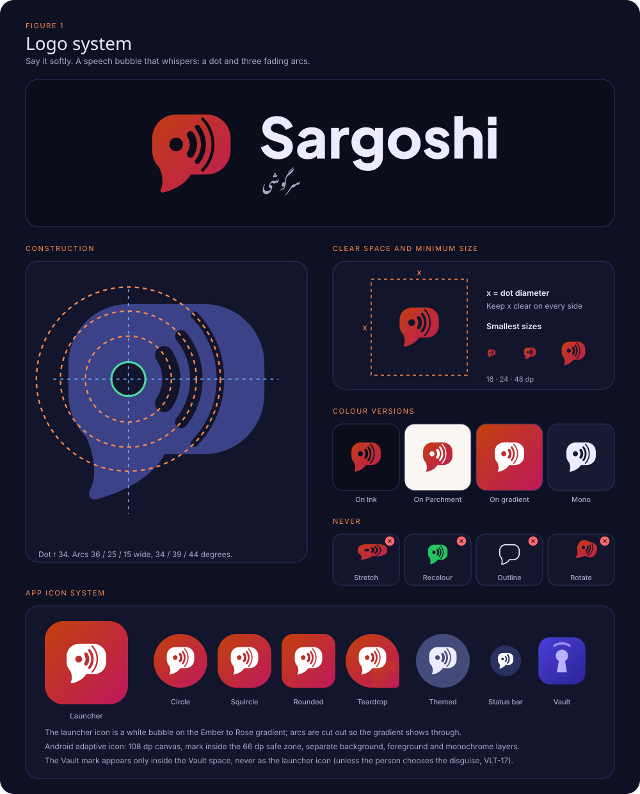

**Concept.** *Sargoshi* (سرگوشی) means speaking softly into someone's ear. The mark is a speech bubble that whispers: a dot (the voice) and three arcs that **fade as they travel** (the whisper). The arcs taper in width and widen in angle, so the mark cannot be mistaken for a Wi-Fi or podcast symbol. The bubble's soft tail curls down and left, like a hand cupped to an ear. One shape, no gradient needed to read it, no letter, no cliché of a lock.

**Why it is future proof.** It works as one flat colour from 16 dp to a billboard. It has no text inside, so it survives translation. It has a cut-out (arcs are holes, not paint), so it adapts to any background and any Android themed-icon colour. The Vault gets its own sub-mark so the product can grow into more spaces without redrawing the main mark.

| Part | Spec |
| --- | --- |
| Grid | 512 unit square. Body is a 392 by 300 squircle (corner radius 120) starting at x 60, y 60 |
| Dot | Radius 34, centre at (180, 210) |
| Arcs | Radii 86, 136, 184. Stroke 36, 25, 15. Half-angles 34, 39, 44 degrees. Round caps. Cut out of the body |
| Tail | Soft curl from the bottom edge, tip near (104, 436) |
| Colour | Ember #C2410C to Rose #BE185D, 45 degrees (top left to bottom right), applied to the body |
| Wordmark | "Sargoshi", Plus Jakarta Sans ExtraBold, converted to outlines. Colour Moon on dark, Ink on light |
| Urdu wordmark | سرگوشی in Noto Nastaliq Urdu Bold, converted to outlines, in Mist (dark) or Light secondary (light), set under or beside the English word |
| Tagline | English: *Say it softly.* Urdu: آہستہ بولیے. Used on the store page and welcome screen only, never inside the lockup |
| Clear space | x on every side, where x is the dot diameter (68 units, about 13% of mark height) |
| Minimum size | Mark 16 dp (flat colour version). Lockup 96 dp wide. Below 24 dp use the single-colour version |

**Versions (all in the logo kit, all vector).**

| File | Use |
| --- | --- |
| `sargoshi-mark-gradient.svg` | Primary mark on dark or light |
| `sargoshi-mark-white.svg`, `sargoshi-mark-ink.svg` | Single colour, print, stamps, embossing |
| `sargoshi-lockup-horizontal-dark.svg`, `-light.svg` | Website header, store feature graphic, documents |
| `sargoshi-lockup-stacked-dark.svg`, `-light.svg` | Splash, posters, square placements |
| `sargoshi-app-icon-1024.svg` | Store icon master (Play requires 512 by 512 PNG, derived from this) |
| `android-adaptive-background.svg`, `-foreground.svg`, `-monochrome.svg` | Android adaptive and themed icons (108 dp canvas) |
| `android-notification-icon-24.svg` | Status-bar icon: white silhouette, two heavier arcs, transparent background |
| `sargoshi-vault-mark.svg` | Vault space only: keyhole inside an Indigo squircle with one arc |
| `sargoshi-splash-1080x1920.svg` | Splash reference |

**App icon system.** The launcher icon is a white bubble on the Ember to Rose gradient with the arcs cut out. For Android adaptive icons the canvas is 108 dp and the mark sits inside the 66 dp safe zone, so any maker mask (circle, squircle, rounded square, teardrop) keeps the mark whole. Themed icons use the monochrome layer so the system can tint it. Alternative icons (SET-06) reuse the same bubble in other palettes. The disguised icons (VLT-17) are chosen by the person and never shipped as the default.

**Splash.** Ink background, the gradient mark centred, a soft rose glow behind it. On Android 12 and newer the splash screen API animates the icon; keep the animation under 1 second and never block startup for it. The in-app startup shows the mark with the three arcs fading in one after another (120 ms apart), then the chat list.

**Brand voice.** Quiet, warm, exact. Say what is true, never shout. Examples: "Nothing leaves your phone." not "100% unhackable". No exclamation marks (Section 6.9).

**Sound logo.** Two soft rising notes over 0.6 seconds (a whisper rising), used on first launch, backup complete and call connect. Original, royalty-free, never louder than the system volume curve.

**Do not.** Stretch or rotate the mark. Recolour it outside the palette. Outline it. Put it on a busy photo without a dark scrim. Add a shadow or glow in product UI. Use the Vault mark as the app icon by default.

**Clearance.** The mark is original artwork drawn for this document. No trademark, design-mark or app-store search was run (R-39). Do that before launch and keep two alternates ready.

### 6.11 Layout system

**Spacing scale (dp).** 4, 8, 12, 16, 20, 24, 32, 40, 48, 64. Anything else needs a reason. Touch targets are at least 48 by 48 dp even when the icon is smaller. Gaps between targets are at least 8 dp.

**Grid by window class.**

| Class | Width | Columns | Margins | Gutter | Max content width |
| --- | --- | --- | --- | --- | --- |
| Compact | under 600 dp | 4 | 16 dp | 8 dp | Full width |
| Medium | 600 to 839 dp | 8 | 24 dp | 16 dp | Full width, list pane 340 dp |
| Expanded | 840 dp and up | 12 | 32 dp | 16 dp | Chat pane readable width: bubbles up to 560 dp, text lines near 66 characters |

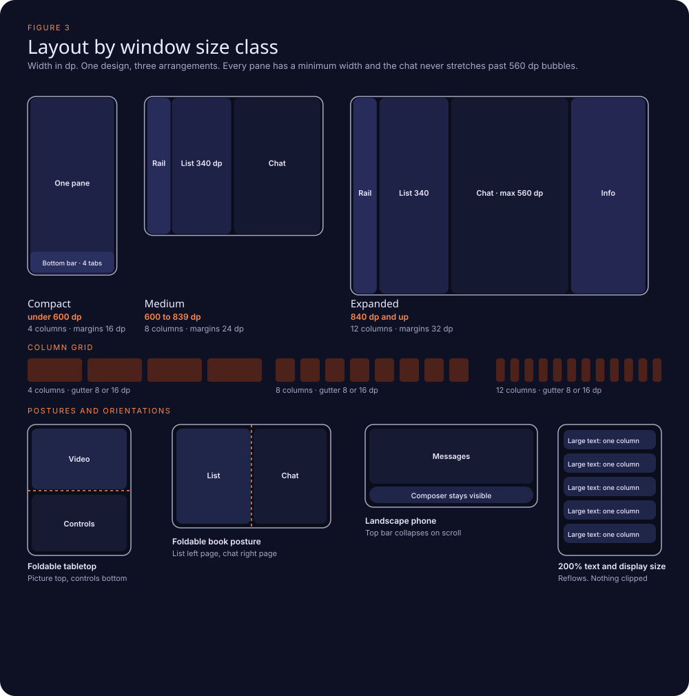

**Scaffold anatomy (compact).**

| Region | Size | Rules |
| --- | --- | --- |
| System status bar | System inset | Content draws behind it (edge to edge) with a scrim only when text would collide |
| Top app bar | 64 dp | Identity and secondary actions only. Collapses on scroll in lists and in landscape |
| Search | 44 dp field | Sits in the lower reach zone when the list is long (pull down reveals it) |
| Content | Fills the rest | Scrolls under both bars. Bottom content padding equals the bar height |
| Bottom navigation | 80 dp including indicator | 4 tabs. Hidden inside a chat and inside the Vault. Active tab uses the Fill icon weight and a Dusk 3 pill |
| Floating action button | 56 dp, radius 18 | 16 dp above the bottom bar, right aligned (left in right-to-left) |
| Composer | 56 dp minimum | Grows to 6 lines. Sits above the keyboard and the gesture inset |
| Bottom sheet | Radius 28, drag handle 5 by 60 dp | Opens to 50% or full height. Dim scrim 55% |
| Gesture inset | System | Never place a target in it |

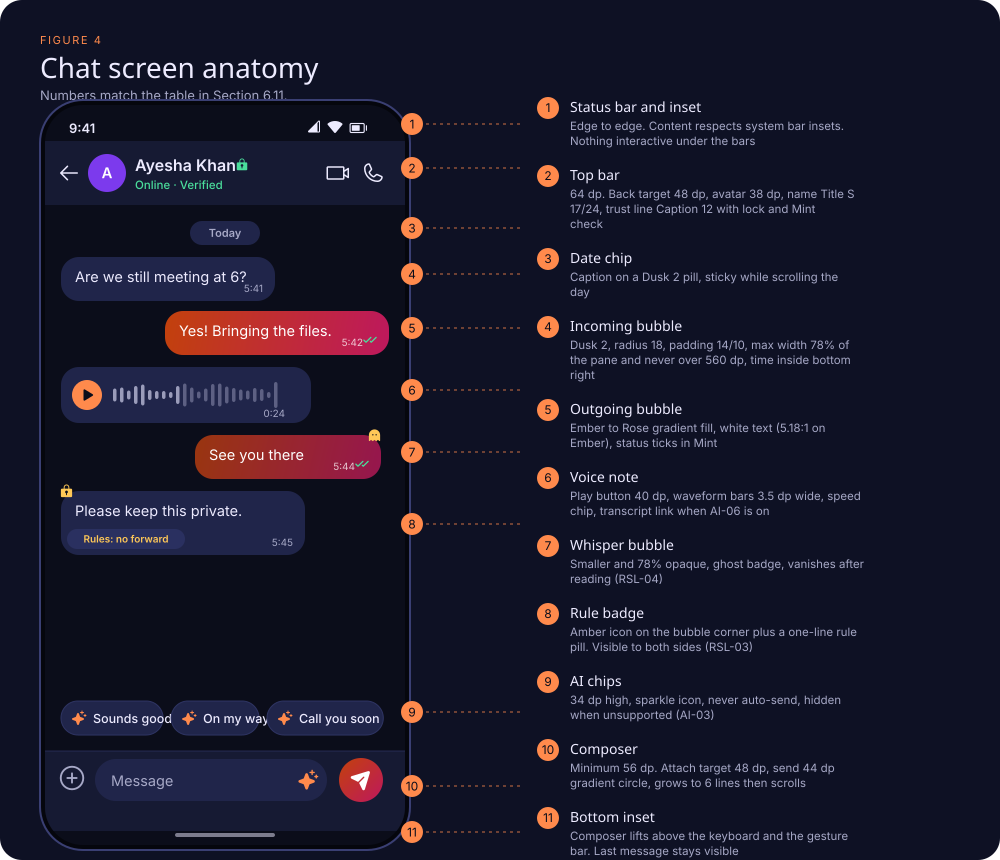

**Chat screen parts (numbers match Figure 4).**

| # | Part | Specification |
| --- | --- | --- |
| 1 | Status bar and inset | Edge to edge. Content respects system bar insets. Nothing interactive under the bars |
| 2 | Top bar | 64 dp. Back target 48 dp, avatar 38 dp, name Title S 17/24, trust line Caption 12 with lock and Mint check |
| 3 | Date chip | Caption on a Dusk 2 pill, sticky while scrolling the day |
| 4 | Incoming bubble | Dusk 2, radius 18, padding 14/10, max width 78% of the pane and never over 560 dp, time inside bottom right |
| 5 | Outgoing bubble | Ember to Rose gradient fill, white text (5.18:1 on Ember), status ticks in Mint |
| 6 | Voice note | Play button 40 dp, waveform bars 3.5 dp wide, speed chip, transcript link when AI-06 is on |
| 7 | Whisper bubble | Smaller and 78% opaque, ghost badge, vanishes after reading (RSL-04) |
| 8 | Rule badge | Amber icon on the bubble corner plus a one-line rule pill. Visible to both sides (RSL-03) |
| 9 | AI chips | 34 dp high, sparkle icon, never auto-send, hidden when unsupported (AI-03) |
| 10 | Composer | Minimum 56 dp. Attach target 48 dp, send 44 dp gradient circle, grows to 6 lines then scrolls |
| 11 | Bottom inset | Composer lifts above the keyboard and the gesture bar. Last message stays visible |

**Screen blueprints.** Each row lists regions from top to bottom with their size, so a developer can build the layout from text alone. Pictures are in Figures 6 to 13.

| Screen | Figure | Blueprint (compact) |
| --- | --- | --- |
| Chat list | 6 | Top bar 64 (mark, title Headline 24, Hush moon, overflow) · Search 44 · Filter chips 32 · Requests row 46 · Chat rows 72 each (avatar 48, name Title S, preview Body, time Caption, unread badge 22) · FAB 56 · Bottom bar 80 |
| Chat | 6 | Top bar 64 (back, avatar 38, name, trust line, video, call) · Messages (date chips, bubbles, voice, media grid) · AI chips 34 (conditional) · Composer 56 |
| Vault lock | 7 | Gradient Indigo to Ink · Vault mark 100 · Title Display 28 · PIN dots 6 · Custom pin pad 4 rows of 52 dp keys · Recovery link · Hint |
| Vault home | 7 | Top bar 64 in Lilac · Storage card 124 (ring 80, counts, checkup pill) · 2 by 4 tiles 82 high · Speed-dial 56 · Lock timer strip |
| Vault gallery | 7 | Top bar · Album chips 32 · 3 column grid, 110 dp cells, 6 dp gaps, blur on · Footer hint strip |
| Present sheet | 8 | Dimmed call behind · Sheet radius 28 · Six source tiles 100 by 84 · Version reason line · Pre-share toggles · Quality segmented control · Start button 44 |
| Call with presenting | 8 | Red sharing bar 28 · Presented content 300 high · Participant tiles 100 high · Status pills · Call controls (5 circles of 54) |
| Backup | 8 | Top bar · Readiness card 150 (ring 92, status, test button) · Destinations 50 each · Versions list · Two buttons 48 |
| Settings home | 9 | Title · Search 44 · Security checkup card 64 · Preset chips 30 · 14 group rows 34 · Bottom bar |
| Alerts | 9 | Title · Severity cards (84 or 118) with 5 dp colour edge and icon · Footnote |
| AI sheet | 9 | Chat dimmed · Sheet · Header with "On this phone" tag · Four action cards 58 · Model manager and Settings buttons |
| Welcome and setup | 10 | Mark 168 on a rose glow · Headline 27 · Three-dot pager · Primary button 52 · Language toggle. Setup: three 100 dp cards with status, Continue 50, Skip link |
| Add a friend | 10 | QR card 220 with centre mark · Username Title · Four action tiles 150 by 50 |
| Lockdown | 12 | Top bar · Amber card with toggle · Six change rows 52 · Review button |
| Focus profiles | 12 | Title · Five profile cards 74 with toggle · Add button · Bottom bar |
| Data usage | 12 | Top bar · Month card 120 with cap bar · By-feature bars · Network note · Cap button |
| Communities | 12 | Gradient banner 150 · Announcements row 64 · Group rows 64 · Invite button |
| Simple mode | 12 | Greeting · 2 by 2 large tiles 152 by 184 with 80 dp icons · Voice tile 84 |
| Tablet and desktop | 11 | Rail 66 · List 250 (340 dp at full scale) · Chat · Info pane |

**Foldables, landscape and large text.** Tabletop posture puts the picture above the fold and the controls below. Book posture shows list and chat as two pages. Landscape phones keep the composer visible and collapse the top bar. At 200% text everything reflows to one column and no name is cut without an ellipsis and a long-press to read it in full.

**Right to left.** The entire layout mirrors (Figure 13): the back arrow, bubble sides, send button, FAB, swipe actions, rail position and progress bars. Do not mirror clocks, media play, checkmarks, the logo, or phone numbers.

**One-handed reach.** Primary actions, search and the composer sit in the lower half. The top bar holds only identity and secondary actions. One-handed mode (SET-12) moves the top bar actions to a bottom strip.

### 6.12 Navigation architecture

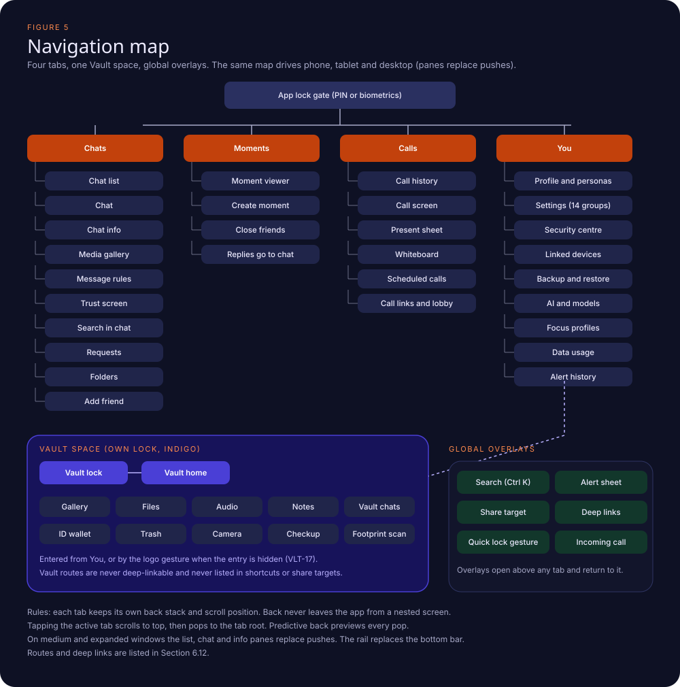

**Rules.**

1. Four tabs on compact: **Chats, Moments, Calls, You**. Rail on medium and expanded. The Vault is a separate space entered from You, or from the logo gesture when the entry is hidden (VLT-17).
2. Every tab keeps its own back stack and scroll position. Switching tabs never resets them.
3. Tapping the active tab scrolls to the top. A second tap pops to the tab root.
4. Back never exits the app from a nested screen. From a tab root, Back goes to the Chats tab, then leaves the app.
5. Predictive back previews every pop. Sheets close before screens pop.
6. On medium and expanded windows, list, chat and info are panes. Opening a chat replaces the chat pane. Opening info opens the third pane. Nothing pushes a full screen except settings sub-pages.
7. The Vault space has its own back stack. Locking the Vault clears it and returns to the previous normal screen. No screen of the Vault is ever kept in the normal back stack.
8. Switching into the Vault changes the surface to Indigo and plays a 200 ms cross-fade. Leaving restores the surface the same way. The colour shift is the signal that you are in a different space.
9. Search is global from the Chats tab and per chat inside a chat. The Vault has its own search (VLT-21) that never reads normal chats.
10. Alerts open as a sheet above the current screen and return to it. Critical alerts that need a choice cannot be swiped away.
11. Every error state offers a way forward: retry, settings, or learn more.

**Routes and deep links.** Deep links use the scheme `sargoshi://` and the HTTPS domain chosen for the product (to be registered). Vault routes are never deep-linkable.

| Screen | Route | Entry points | Notes |
| --- | --- | --- | --- |
| Chat list | `/chats` | Tab, notification, launcher | Start tab by default (SET-08) |
| Chat | `/chats/{chatId}` | List, notification, share target, deep link | `?msg={id}` jumps to a message (MSG-30) |
| Chat info | `/chats/{chatId}/info` | Chat top bar | Third pane on large screens |
| Message rules | `/chats/{chatId}/rules` | Chat info, long-press | |
| Trust screen | `/chats/{chatId}/trust` | Lock icon in the top bar | Safety number, QR |
| Requests | `/requests` | Chat list row | |
| Add friend | `/add` and `/u/{username}` | Invite link, QR, deep link | Shows a preview before adding |
| Moments | `/moments` | Tab | |
| Calls | `/calls` | Tab, missed-call notification | |
| Call | `/calls/{callId}` | Incoming call, call link | Present sheet opens as an overlay |
| Join by link | `/j/{token}` | Call or group link | Lobby when set (CAL-15) |
| Community | `/communities/{id}` | List, invite link | |
| You | `/you` | Tab | |
| Settings | `/settings` and `/settings/{group}/{id}` | You, search, widget | Deep link to any setting (SET-01) |
| Security centre | `/security` | Settings, alert | |
| Backup | `/backup` | Settings, alert, progress notification | |
| Focus profiles | `/focus` | Quick Settings tile, widget | |
| Data usage | `/data` | Settings, cap alert | |
| AI and models | `/ai` | Settings, AI sheet | |
| Vault | not linkable | You, logo gesture | Always passes through the Vault lock |
| Share target | `/share` | Android share sheet | Vault chats never listed |

**Launcher shortcuts (SET-21)** offer New chat, Scan QR and Record voice note. No shortcut ever names a Vault chat.

### 6.13 Component library

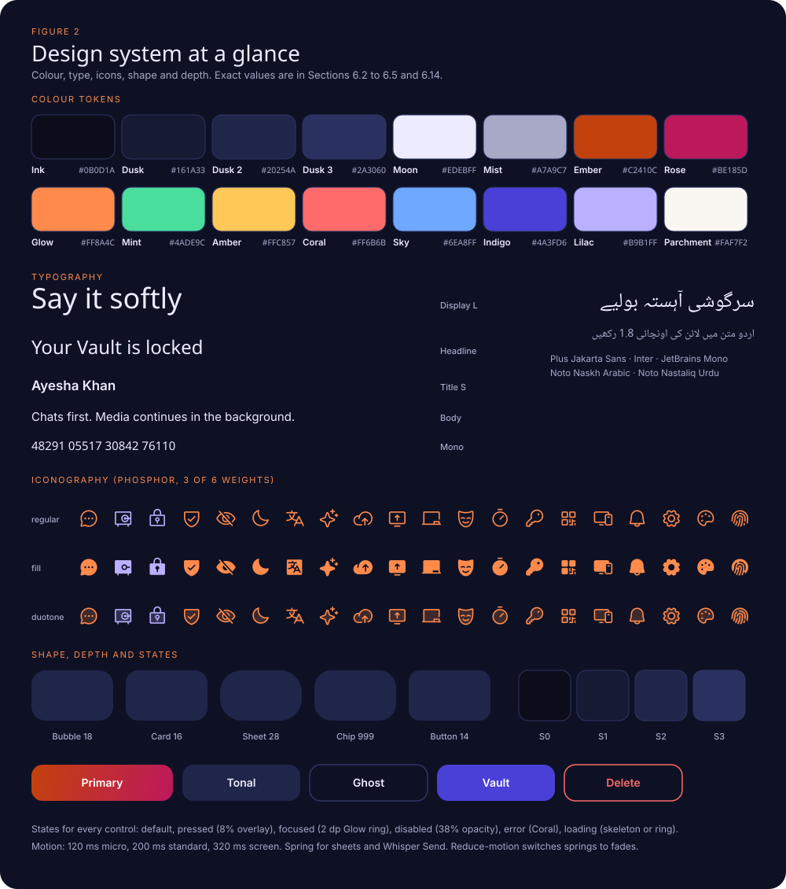

Every component has states: default, pressed (8% overlay), focused (2 dp Glow ring), disabled (38% opacity), error (Coral), loading (skeleton or ring). Targets are at least 48 dp. All components exist in LTR and RTL and at 200% text.

| Component | Variants | Size and shape | Notes |
| --- | --- | --- | --- |
| Primary button | Gradient (Ember to Rose), Vault (Indigo) | Height 48, radius 14, label Label 13 to 15 | One per screen section. Verb first |
| Tonal button | Default, Danger outline | Height 48, Dusk 2 fill | Secondary actions |
| Ghost button | Default | 1.5 dp Line border | Cancel, Learn more |
| Icon button | Plain, Filled, Toggle | 48 target, 24 icon | Fill weight when on |
| FAB | Default, Vault, Extended | 56 by 56, radius 18, one soft shadow | Compose, Add to Vault |
| Chip | Filter, Assist, Input, Suggestion | Height 32, radius 999 | Filter chips use Ember (Indigo in the Vault) |
| Segmented control | 2 to 4 options | Height 36, radius 18 | Quality mode, theme |
| Text field | Filled, Search, PIN, Passphrase | Height 56 (search 44), radius 14 | Helper text 12, error line in Coral with icon |
| Toggle | Default, Vault | 46 by 26, thumb 20 | Always paired with a one-line explanation |
| Slider | Continuous, Stepped | Track 4, thumb 20 | Value shown |
| Checkbox and radio | Standard | 24 | Large target |
| Avatar | Circle, Rounded square | 24, 32, 38, 48, 64, 96 | Initials fallback on a stable colour |
| Badge | Count, Dot | 22 high | Counts chats, not messages (NTF-13) |
| List tile | One, two, three line | 56, 72, 88 | Leading icon or avatar, trailing action |
| Card | Surface, Outlined, Alert | Radius 16 | S1 fill, 5 dp severity edge for alerts |
| Chat bubble | Incoming, Outgoing, Whisper, System | Radius 18, padding 14 by 10 | Time inside bottom right |
| Rule badge | Per rule icon | 15 dp icon plus pill | Amber, visible to both sides |
| Reaction bar | Quick, Full picker | Height 44 | Double-tap uses the chosen emoji |
| Composer | Text, Voice, Edit, Reply | Min 56 | Quick-action bar is reorderable (SET-07) |
| Top app bar | Standard, Large, Vault, Search | 64, Large 112 | Collapses on scroll |
| Bottom navigation | 4 destinations | 80 | Labels always shown |
| Navigation rail | 4 to 6 destinations | 72 wide | Labels shown when expanded |
| Bottom sheet | Modal, Standard | Radius 28 | Lifts above keyboard |
| Dialog | Confirm destructive only | Radius 28, max width 360 | Everything else uses sheets |
| Snackbar | With Undo | 5 seconds | Undo over confirm (Section 6.7) |
| Banner | Info, Warning | Full width | Persistent until acted on |
| Alert card | Info, Notice, Warning, Critical | 84 or 118 high | Section 11.7 |
| PIN pad | 3 by 4, scrambled option | Keys 52, gap 12 | Custom in-app widget, no sounds that leak digits |
| Stat ring | Storage, Readiness | 80 to 92, stroke 9 to 10 | Colour plus number plus word |
| Progress | Linear, Ring, Segmented | 4 to 10 | Known durations only |
| Skeleton | List row, Grid cell, Card | Matches final | Never a blocking spinner under 400 ms |
| Empty state | Chat, Vault, Backup | Icon 64 to 96 duotone, one line, one action | Teaches, never blames |

### 6.14 Design tokens

Tokens are the contract between design and code. Names are stable. The Flutter `SargoshiColors`, `SargoshiType`, `SargoshiSpace`, `SargoshiShape` and `SargoshiMotion` classes are generated from this file (Prompt A addendum).

```json
{
  "color": {
    "ink": "#0B0D1A", "dusk": "#161A33", "dusk2": "#20254A", "dusk3": "#2A3060", "line": "#2E3463",
    "moon": "#EDEBFF", "mist": "#A7A9C7", "ember": "#C2410C", "rose": "#BE185D", "glow": "#FF8A4C",
    "mint": "#4ADE9C", "amber": "#FFC857", "coral": "#FF6B6B", "sky": "#6EA8FF",
    "vaultIndigo": "#4A3FD6", "vaultLilac": "#B9B1FF", "amoled": "#000000",
    "parchment": "#FAF7F2", "paper": "#FFFFFF", "lightSecondary": "#5B5F7E", "lightAccentText": "#9A3412"
  },
  "gradient": { "brand": ["#C2410C", "#BE185D"], "vault": ["#4A3FD6", "#2B2397"] },
  "space": [4, 8, 12, 16, 20, 24, 32, 40, 48, 64],
  "radius": { "button": 14, "card": 16, "bubble": 18, "sheet": 28, "chip": 999, "fab": 18 },
  "elevation": { "s0": "ink", "s1": "dusk", "s2": "dusk2", "s3": "dusk3" },
  "motion": { "micro": 120, "standard": 200, "screen": 320, "springSheet": "stiffness 400, damping 0.8" },
  "type": {
    "displayL": ["PlusJakartaSans", 800, 36, 44], "display": ["PlusJakartaSans", 700, 30, 38],
    "headline": ["PlusJakartaSans", 700, 24, 32], "title": ["PlusJakartaSans", 600, 20, 28],
    "titleS": ["Inter", 600, 17, 24], "bodyL": ["Inter", 400, 16, 24], "message": ["Inter", 400, 16, 22],
    "body": ["Inter", 400, 15, 22], "label": ["Inter", 600, 13, 18], "caption": ["Inter", 400, 12, 16],
    "mono": ["JetBrainsMono", 600, 15, 22], "urduBody": ["NotoNaskhArabic", 400, 17, 30]
  },
  "breakpoints": { "compact": 0, "medium": 600, "expanded": 840 },
  "target": { "min": 48 }
}
```

### 6.15 Urdu and bidirectional typography

| Topic | Rule |
| --- | --- |
| Body font | Noto Naskh Arabic for Urdu runs in chat, settings and lists, 16 to 17 sp, line height 1.7 to 1.8 |
| Display font | Noto Nastaliq Urdu (optional download) only for large text of 20 sp and up. Nastaliq needs line height near 2.0 and extra top padding because glyphs stack diagonally. Never use it for message text under 18 sp |
| Mixed text | Each run uses its own font: Inter for Latin, Naskh for Arabic script. Isolate numbers, usernames and links with bidirectional isolates so punctuation does not jump |
| Direction | Direction follows the first strong character of each message. The bubble side follows the author, not the language |
| Numerals | Western digits by default. Eastern Arabic digits optional (SET-09). Safety numbers, codes and recovery words always use JetBrains Mono and Western digits |
| Truncation | Ellipsis at the end of the reading direction. Long names use a long-press to read in full |
| Roman Urdu | Chip offers conversion (AI-10). The original is kept, the converted text replaces it only on tap |
| Alignment | Text aligns to its own direction in lists. Timestamps sit at the end of the bubble in the reading direction |
| Icons | Mirror directional icons (back, forward, send, undo, redo). Do not mirror clocks, play, checks, the logo |
| Search | Normalise Urdu letter variants (for example Arabic and Urdu forms of ye and kaf) so search finds both |
| Testing | Pseudo-locale with long strings, a right-to-left golden at five widths for every main screen, and a native Urdu reviewer for all copy |

### 6.16 Illustration, motion, sound and haptics

| Topic | Rule |
| --- | --- |
| Illustration | Duotone Phosphor icons at 64 to 96 dp in Glow on Dusk. No people illustrations, no mascots. Empty states are calm and short |
| Imagery | Real photos only when they are the person's own. Store graphics use the mark on Ink with a rose glow |
| Motion catalogue | Send: bubble rises 8 dp and fades in over 200 ms. Whisper Send: spring scale 0.96 to 1 with a soft fade. Sheet: spring from the bottom, 320 ms. Vault enter: 200 ms cross-fade to Indigo. Check-in tick: 120 ms. Reduce motion replaces every spring with a 120 ms fade |
| Sound | Send, receive, call, alert, Hush on and off, Vault lock. Short, soft, original. Different pitch family for the Vault so it is recognisable without looking |
| Haptics | Tick on send, medium pulse on long-press, double tick on Whisper arm, buzz on wrong PIN. Per-contact patterns for the hearing suite (LOC-07) |
| Dark patterns | Banned: fake urgency, hidden decline buttons, confirm-shaming, pre-ticked sharing. Every consent has equal-weight Accept and Decline |

### 6.17 Screen gallery

Every screen below is drawn from the components in Section 6.13 and the tokens in Section 6.14. The blueprint table in Section 6.11 gives the same layout as text.

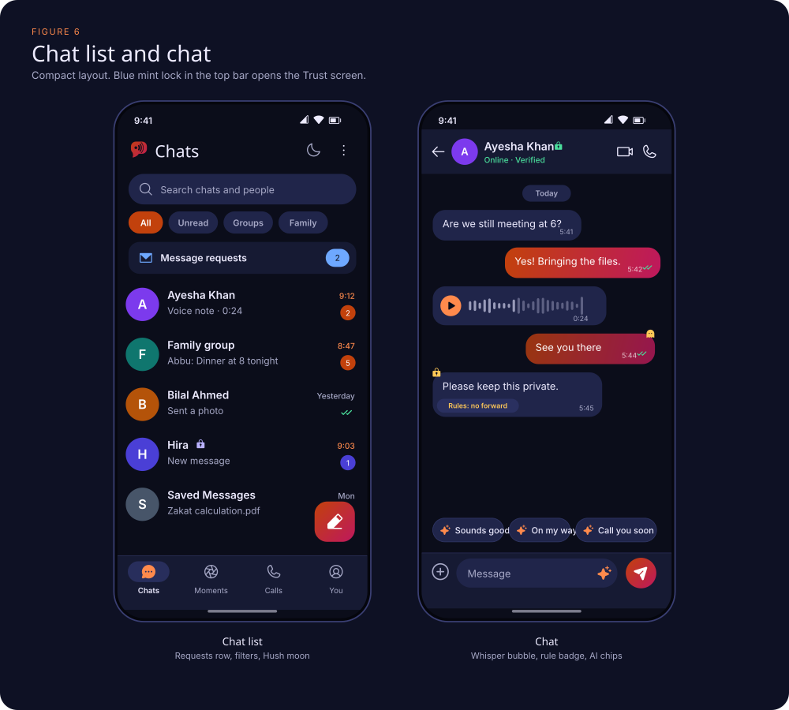

**Chat list and chat.** The chat list keeps identity and the Hush moon in the top bar, a search field, filter chips, a Requests row and 72 dp chat rows. The chat shows the lock and Verified line that opens the Trust screen, whisper and rule badges on bubbles, AI chips above the composer, and a gradient send button.

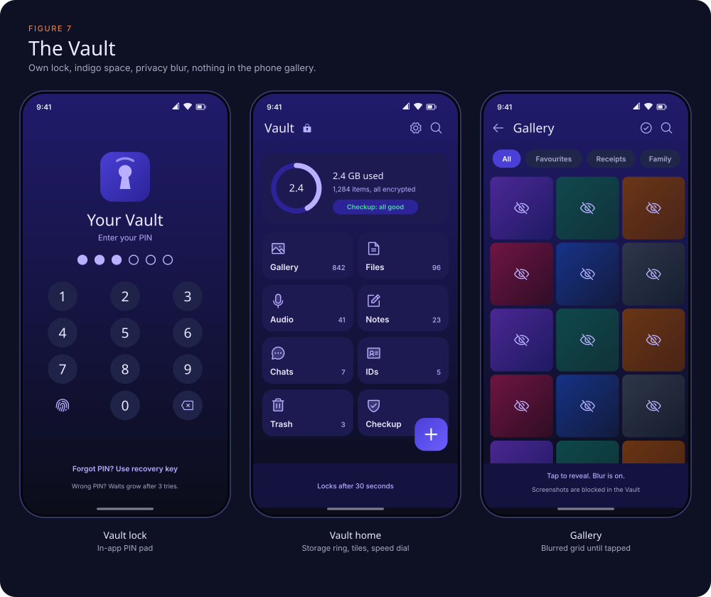

**The Vault.** The Vault has its own lock screen with an in-app PIN pad, an Indigo surface, a storage ring with the checkup state, tiles for each content type, and a gallery that stays blurred until a tap. The bottom bar is hidden and the screen is secure.

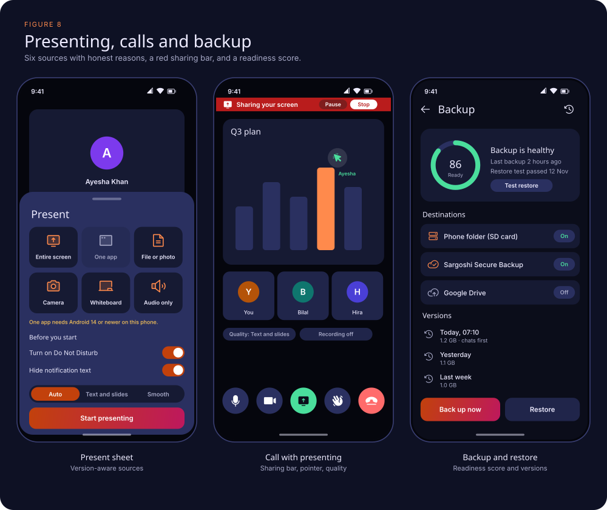

**Presenting, calls and backup.** The present sheet shows six sources and says why one is unavailable. During a share a red bar stays on top with Pause and Stop. The backup screen leads with a readiness score, then destinations and versions.

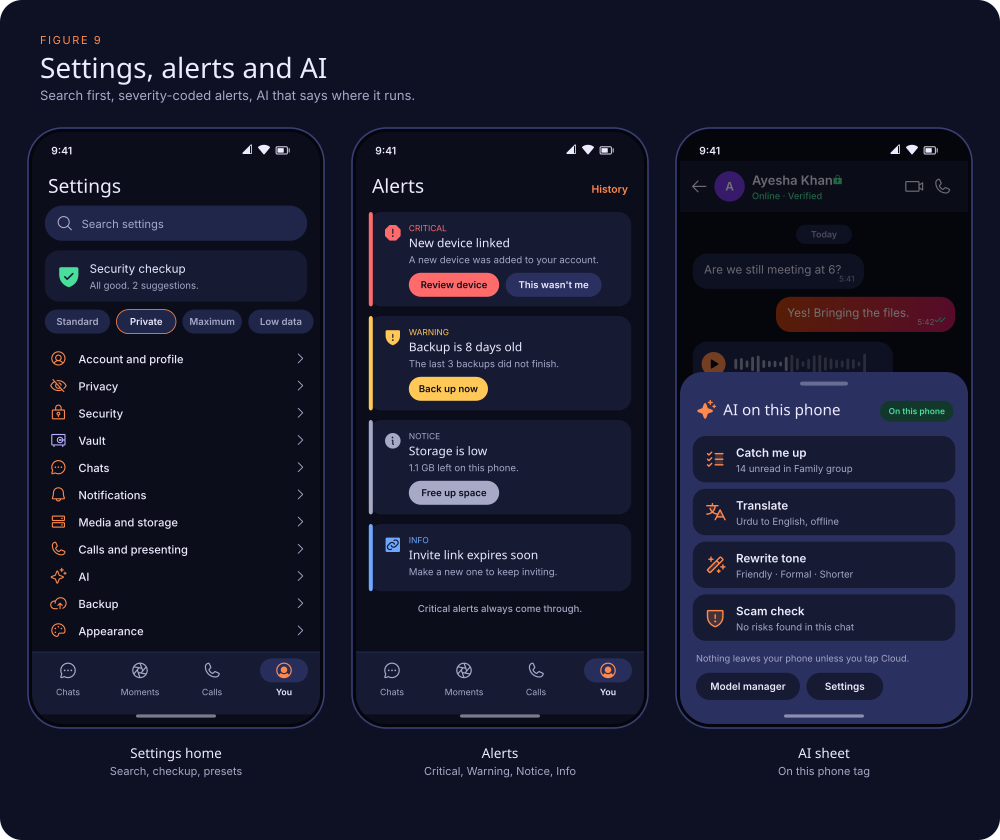

**Settings, alerts and AI.** Settings opens to search, the Security checkup, presets and fourteen groups. Alerts are cards with a coloured edge by severity. The AI sheet shows where each action runs.

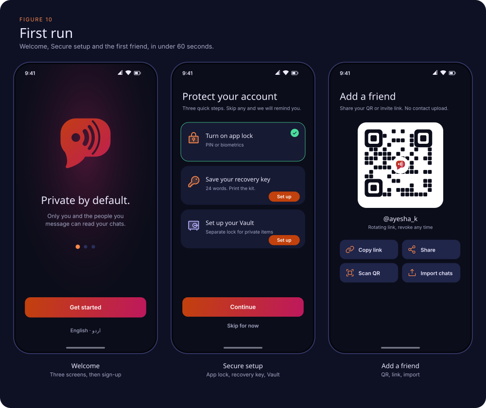

**First run.** Welcome, Secure setup and Add a friend, in under a minute, with no contact upload.

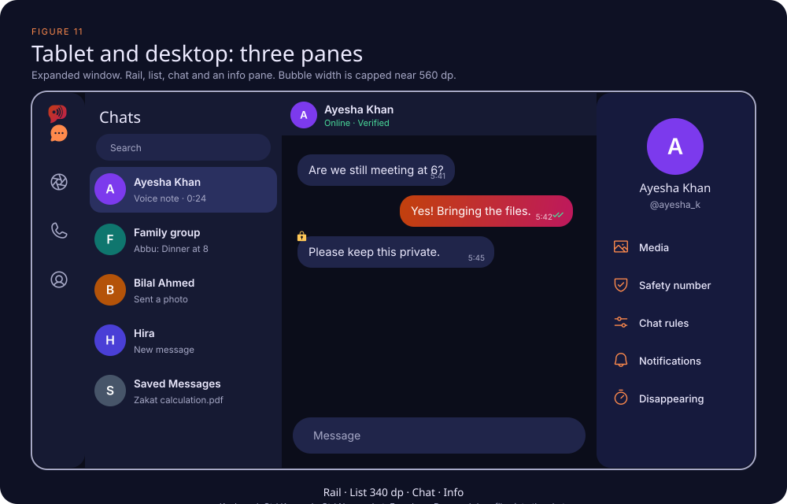

**Tablet and desktop.** Rail, list, chat and info as panes, with keyboard shortcuts and drag and drop.

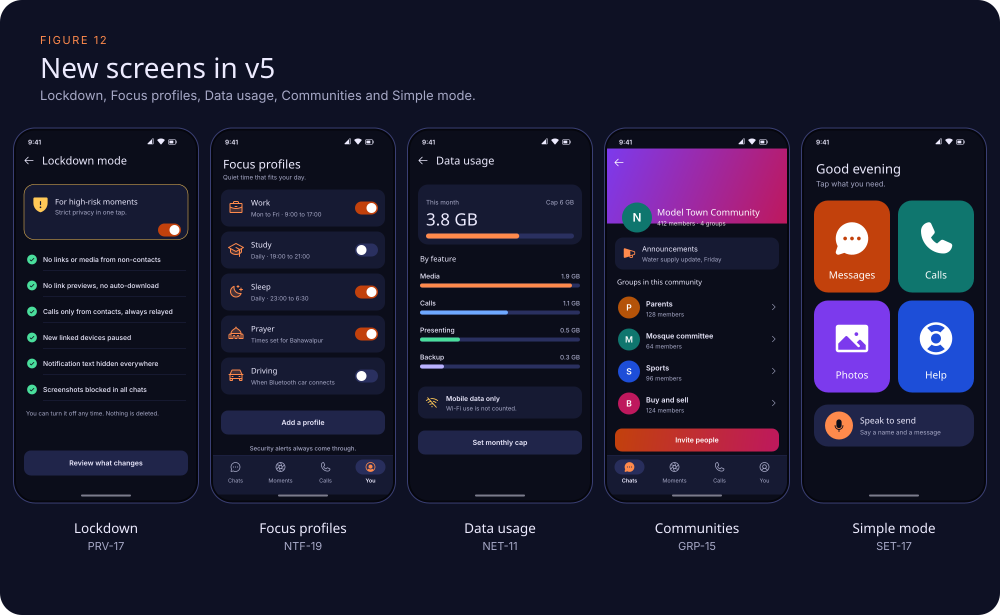

**New screens in v5.** Lockdown mode (PRV-17), Focus profiles (NTF-19), Data usage (NET-11), Communities (GRP-15) and Simple mode (SET-17).

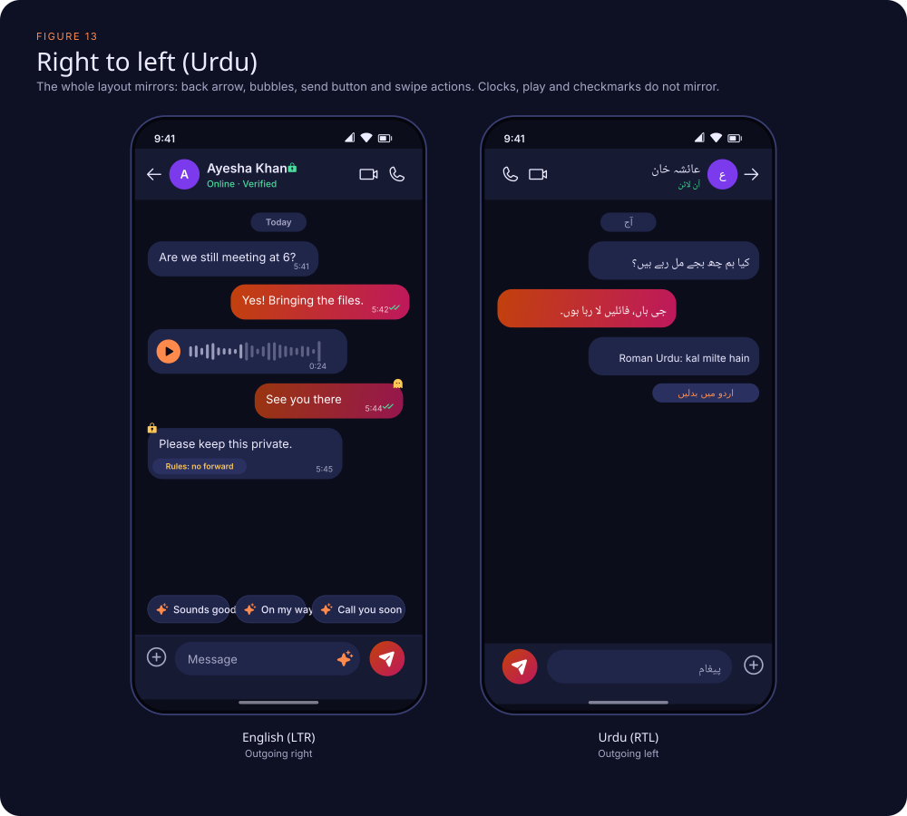

**Right to left.** The full layout mirrors for Urdu. Section 6.15 holds the typography rules.

## 7. Master feature registry

★ marks the true minimum for the closed beta (Beta Core). ✦ marks something new or rewritten in v4. ◆ marks something new in v5. **MVP** is the closed beta, **v1** is public launch and the months after, **v2** needs a team and licences. Phases follow dependency order, not calendar dates. Each feature appears once. Settings that merely expose a feature (for example the Data and storage screen) are listed in Section 13, not here.

### 7.1 Accounts and identity (ACC)

| ID | Feature | Phase |
| --- | --- | --- |
| ACC-01 | ★ Sign up with phone or email and a one-time code, then choose a unique username | MVP |
| ACC-02 | ★ Add contacts by username, QR code or invite link. No mandatory contact upload | MVP |
| ACC-03 | ★ Linked devices (start with 4) and QR sign-in for a new device | MVP |
| ACC-04 | Device management: last active time, rename, remote sign-out | MVP |
| ACC-05 | ★ Delete account inside the app | MVP |
| ACC-06 | Profile: name, photo, short bio, per-field visibility | MVP |
| ACC-07 | Passkey sign-in | v1 |
| ACC-08 | Multi-account switch | v1 |
| ACC-09 | Registration lock PIN, so nobody can re-register your number or email | v1 |
| ACC-10 | Username change with a 30-day cooldown | v1 |
| ACC-11 | Contact nicknames and private notes, stored only on your devices | v1 |
| ACC-12 | ★ ✦ New-device approval: a new device needs approval from an existing device. If none is reachable, a 24-hour wait with alerts on every device | MVP |
| ACC-13 | ✦ Sign in with the recovery key instead of a code | v1 |
| ACC-14 | ✦ Rotating contact link and QR that revoke the old ones | v1 |
| ACC-15 | ✦ Request a copy of the data our servers hold about you, as an encrypted file | v1 |
| ACC-16 | ◆ Remote wipe: signing out a lost device from another device also queues a wipe of Sargoshi chats, keys and Vault keys on it, applied on its next connection. App lock and Vault lock protect it until then | v1 |
| ACC-17 | ◆ Device-link scam signals: an extra warning when a link request arrives during a call, right after a code request, or from an unusual context, with a plain reason | v1 |
| ACC-18 | ◆ Inactive account manager: delete after 6, 12 or 24 months without use, with reminders on every device and by email | v1 |
| ACC-19 | ◆ Legacy contact: a trusted person can ask to close the account or post a memorial notice. Never gives access to chats | v2 |
| ACC-20 | ◆ Several passkeys and hardware security keys (FIDO2) | v1 |
| ACC-21 | ◆ Age assurance: date-of-birth gate with no ID upload, age-appropriate defaults, and a parent-managed route for pre-teens (SAF-12) | MVP |

### 7.2 Personas (PER)

| ID | Feature | Phase |
| --- | --- | --- |
| PER-01 | ✦ Personas: a different name, photo and bio per chat or group | v1 |
| PER-02 | ✦ Burner usernames: temporary usernames with an end date, revocable any time | v1 |
| PER-03 | ✦ Join public channels as a persona | v1 |

### 7.3 Messaging core (MSG)

| ID | Feature | Phase |
| --- | --- | --- |
| MSG-01 | ★ 1-on-1 and group chat | MVP |
| MSG-02 | ★ Replies, reactions, mentions | MVP |
| MSG-03 | ★ Edit and delete for everyone | MVP |
| MSG-04 | ✦ Forward messages (limits are set by Message Rules, RSL-01 and RSL-02) | MVP |
| MSG-05 | Drafts saved per chat | MVP |
| MSG-06 | Delivered and read states, each optional | MVP |
| MSG-07 | Typing indicator, optional | MVP |
| MSG-08 | Link previews generated on the sender's phone | MVP |
| MSG-09 | ★ Offline queue with automatic retry | MVP |
| MSG-10 | Full-text search on the phone | MVP |
| MSG-11 | ✦ Scheduled send and time capsules (deliver now, opens on the date you choose) | v1 |
| MSG-12 | Remind me about this message | v1 |
| MSG-13 | Message info: who got and read it (groups up to 50) | v1 |
| MSG-14 | Quote part of a message | v1 |
| MSG-15 | Chat wallpapers and per-chat accent colour | v1 |
| MSG-16 | Polls, with optional anonymous voting | v1 |
| MSG-17 | **Whisper Send** (signature): hold send and slide up. Applies the Whisper rule set (RSL-04) with a small, faded bubble that vanishes after reading. Works for text, voice and photos | v1 |
| MSG-18 | ✦ Undo send within 5 seconds | MVP |
| MSG-19 | ✦ Share a contact card | v1 |
| MSG-20 | ✦ Rich text: bold, italic, monospace, strikethrough, quote and spoiler | v1 |
| MSG-21 | ✦ Silent send (no notification for the receiver) | v1 |
| MSG-22 | ◆ Advanced search: filters for person, chat, date range, type, has link and has file; jump to a date; saved searches | v1 |
| MSG-23 | ◆ Keep this message: in a disappearing chat, ask to keep a message and the sender approves. The kept copy is marked | v1 |
| MSG-24 | ◆ Edit history: optional per chat, shows earlier versions of an edited message to everyone in the chat | v1 |
| MSG-25 | ◆ Threads: reply in a side thread in any chat or group without flooding the timeline | v1 |
| MSG-26 | ◆ Saved collections: put starred messages and saved items into named collections | v1 |
| MSG-27 | ◆ Repeating scheduled messages: daily, weekly or monthly, with an end date | v1 |
| MSG-28 | ◆ Text stickers: turn a short phrase into a styled sticker | v1 |
| MSG-29 | ◆ Custom reactions: any emoji or sticker as a reaction, with favourites | v1 |
| MSG-30 | ◆ Link to message: a private link that opens that message for members of the chat only | v1 |
| MSG-31 | ◆ Bulk actions: select many messages to forward, star, delete, export or move to the Vault | v1 |

### 7.4 Message Rules (RSL)

| ID | Feature | Phase |
| --- | --- | --- |
| RSL-01 | ✦ Message rules per message: allow forward, allow copy, hide from search and AI, expire after (30 seconds to 4 weeks), delete after read, require unlock to open | v1 |
| RSL-02 | ✦ Chat rules for everything in a chat: block export, block auto-download, block AI processing, block forwarding. Default rules for new chats | v1 |
| RSL-03 | ✦ Rule badges visible to both sides, and a "What this does and does not stop" sheet that is honest about screenshots and cameras | v1 |
| RSL-04 | ✦ Rule templates: Whisper, Confidential, Ephemeral, Custom (view-once media is MED-04) | v1 |

### 7.5 Media and files (MED)

| ID | Feature | Phase |
| --- | --- | --- |
| MED-01 | ★ Photos and video | MVP |
| MED-02 | ★ Documents up to 2 GB, resumable | MVP |
| MED-03 | ★ Voice notes with waveform and speed control | MVP |
| MED-04 | ✦ View-once photos, videos and voice notes | MVP |
| MED-05 | Auto-download rules per network type | MVP |
| MED-06 | Chat media gallery with filters: photos, videos, files, links, voice | MVP |
| MED-07 | "Send in original quality" toggle | MVP |
| MED-08 | Strip location and camera data (EXIF) from every sent photo, on by default | MVP |
| MED-09 | GIFs through a privacy-preserving proxy | v1 |
| MED-10 | Stickers | v1 |
| MED-11 | Location sharing, then live location | v1 |
| MED-12 | Photo editor: crop, draw, text, blur faces by hand (automatic blur is MED-23) | v1 |
| MED-13 | On-device sticker maker | v1 |
| MED-14 | Nearby share with no internet, over local Wi-Fi | v2 |
| MED-15 | ✦ Document scanner with edge detection and multi-page PDF, with "Scan to Vault" | v1 |
| MED-16 | ✦ Trim and compress video before sending | v1 |
| MED-17 | ✦ Shared albums inside a chat | v1 |
| MED-18 | ◆ Video notes: round videos up to 60 seconds | v1 |
| MED-19 | ◆ Voice-note upgrades: lock recording, pause and resume, trim, play consecutive notes as a queue, keep playing in the background | v1 |
| MED-20 | ◆ Smart formats: AVIF or WebP images and HEVC or AV1 video where the phone supports them, with fallback, to cut data | v1 |
| MED-21 | ◆ Content credentials: show provenance (C2PA) on photos that carry it. Never claims to detect fakes | v2 |
| MED-22 | ◆ Arrival share: share live location with an ETA that ends by itself on arrival | v1 |
| MED-23 | ◆ Automatic face blur: a per-chat option that blurs every detected face before a photo or video is sent | v1 |
| MED-24 | ◆ Document preview in chat for PDF, Word, Excel and PowerPoint, rendered on the phone | v2 |

### 7.6 Chat organisation (ORG)

| ID | Feature | Phase |
| --- | --- | --- |
| ORG-01 | ★ Pin, mute, archive | MVP |
| ORG-02 | ★ Chat folders | MVP |
| ORG-03 | Starred messages | MVP |
| ORG-04 | ★ Saved Messages (note to self) | MVP |
| ORG-05 | Unread filter and swipe actions | MVP |
| ORG-06 | Several pinned messages per chat | MVP |
| ORG-07 | Mark chat as unread | MVP |
| ORG-08 | Colour labels for chats | v1 |
| ORG-09 | ◆ Chat lock (light): hide a chat behind app unlock and biometrics without moving it into the Vault. The Vault stays the strong option | v1 |
| ORG-10 | ◆ Smart folders that fill by rules: unread, mentions, groups, people, labels | v1 |
| ORG-11 | ◆ Mentions and replies filter in the chat list | MVP |
| ORG-12 | ◆ Needs-reply and follow-up markers with reminders | v1 |

### 7.7 Groups and communities (GRP)

| ID | Feature | Phase |
| --- | --- | --- |
| GRP-01 | ★ Groups up to 100 with owner, admin and member roles | MVP |
| GRP-02 | Groups up to 1,000 | v1 |
| GRP-03 | Topics (threads) inside large groups | v1 |
| GRP-04 | Join links with approval and a member limit | v1 |
| GRP-05 | Broadcast channels | v1 |
| GRP-06 | Slow mode | v1 |
| GRP-07 | Announcement-only mode | v1 |
| GRP-08 | Join questions that admins review | v1 |
| GRP-09 | Admin log: who changed what | v1 |
| GRP-10 | Events with RSVP (yes, maybe, no), plus one, end time, pinning and reminders ◆ | v1 |
| GRP-11 | Shared checklists | v2 |
| GRP-12 | ✦ Group history for new members: admins choose 0, 25 or 100 recent messages, sent encrypted | v1 |
| GRP-13 | ✦ Mention everyone, with an admin switch | v1 |
| GRP-14 | ◆ Member labels: self-chosen or admin-set tags shown next to names (separate from the admin role) | v1 |
| GRP-15 | ◆ Communities: an umbrella with an announcement channel, linked groups, shared rules and one invite link | v1 |
| GRP-16 | ◆ Join captcha and a welcome message for new members | v1 |
| GRP-17 | ◆ Auto-moderation rules (keywords, links from new members, rate limits) that run on online admin devices, with honest labels about that limit | v1 |
| GRP-18 | ◆ Ownership succession: if the owner leaves or is inactive, ownership moves to an admin after 7 days | v1 |
| GRP-19 | ◆ Ban list and timed mute for members, with an expiry | v1 |
| GRP-20 | ◆ Group notes: one pinned, editable note | v2 |
| GRP-21 | ◆ Group templates: Class, Family, Team and Neighbourhood, each a preset of roles, rules and notification defaults | v1 |

### 7.8 Privacy controls (PRV)

| ID | Feature | Phase |
| --- | --- | --- |
| PRV-01 | ★ Disappearing timers per chat, plus a default timer for new chats (a single message can override it with RSL-01) | MVP |
| PRV-02 | ★ Hide last seen and online status | MVP |
| PRV-03 | ★ Control who can add you and who can call you | MVP |
| PRV-04 | **Sealed sender**: the server cannot see who sent a message. Envelope designed in MVP, shipped in v1 | v1 |
| PRV-05 | ★ Android: block screenshots. iOS: alert on screenshot or screen recording (iOS cannot block them) | MVP |
| PRV-06 | Strip tracking parameters from links | MVP |
| PRV-07 | ★ Hide app preview in the app switcher | MVP |
| PRV-08 | Incognito keyboard flag in text fields | MVP |
| PRV-09 | Hide profile photo from people who are not contacts | MVP |
| PRV-10 | Privacy checkup: a 5-step review of your settings | v1 |
| PRV-11 | Per-chat overrides for read receipts and typing indicator | v1 |
| PRV-12 | "Always relay calls": all call traffic goes through our relay, so the other person never sees your IP address | v1 |
| PRV-13 | ✦ "What Sargoshi knows about you": a screen listing exactly what our servers store | v1 |
| PRV-14 | ★ ✦ App lock for the whole app with PIN or biometrics, separate from the Vault | MVP |
| PRV-15 | ✦ Clipboard guard: sensitive copy flag, auto-clear after 30 seconds, no copying from the Vault or Whisper messages | MVP |
| PRV-16 | ✦ Privacy blur in the chat list: hide previews and photos until tapped | MVP |
| PRV-17 | ◆ Lockdown mode: one tap applies strict settings (no links or media from non-contacts, no previews, calls only from contacts and relayed, new linked devices paused). Shows the exact list first and can be undone | v1 |
| PRV-18 | ◆ Quick lock gesture: shake, double power press or a tile locks the app and the Vault and clears the recents entry | v1 |
| PRV-19 | ◆ Private link viewer: opens links in an isolated in-app tab with no stored cookies or history and trackers removed | v2 |
| PRV-20 | ◆ Capture notice: where Android reports a screenshot or recording, show a notice in chats with Whisper or Confidential rules. Does not prevent capture | v1 |

### 7.9 Private Vault (VLT)

| ID | Feature | Phase |
| --- | --- | --- |
| VLT-01 | ★ ✦ Vault space with its own lock: PIN (6 or more digits) or passphrase (8 or more characters), optional biometrics | MVP |
| VLT-02 | ★ ✦ Vault Gallery: photos, videos and GIFs with albums, favourites, slideshow and encrypted thumbnails | MVP |
| VLT-03 | ★ ✦ Vault Files: documents, PDFs, archives and any file type, with an in-app viewer | MVP |
| VLT-04 | ★ ✦ Vault Audio: audio files and voice notes with player, speed control and local transcript | MVP |
| VLT-05 | ✦ Vault Notes: rich text, checklists and attachments | v1 |
| VLT-06 | ★ ✦ Vault Chats: move any chat in, including history and media. Messages that arrive while locked wait sealed | MVP |
| VLT-07 | ✦ Vault Contacts: private contact cards that never enter the phone Contacts | v1 |
| VLT-08 | ✦ ID wallet: scans of CNIC, passport, licence and cards, with expiry reminders | v1 |
| VLT-09 | ★ ✦ Vault camera and recorder: photos, video and voice go straight into the Vault and are never written to the gallery | MVP |
| VLT-10 | ★ ✦ Import from gallery or files with "Remove original" (system consent) and a leftover-trace report | MVP |
| VLT-11 | ✦ Export with unlock and a warning, to a place you choose, with location and camera data removed | MVP |
| VLT-12 | ★ ✦ Viewers that decrypt on the fly: no temporary plaintext file, no local web server. Screenshots, recording and casting blocked. Hidden from recent apps | MVP |
| VLT-13 | ★ ✦ Zero system footprint: nothing in MediaStore, shared storage, system thumbnails, search, widgets, shortcuts, notifications, autofill, clipboard, Android backup or the global AI index | MVP |
| VLT-14 | ★ ✦ Lock model: auto-lock choices, lock on screen off, lock on app switch, biometric re-authentication on each open, escalating lockout | MVP |
| VLT-15 | ✦ Decoy vault: a second PIN opens a believable vault with content you choose | v1 |
| VLT-16 | ✦ Duress PIN: opens the decoy, hides the real Vault entry, can quietly alert a trusted contact | v1 |
| VLT-17 | ✦ Disguised app icon and name (Calculator, Notes, Clock) chosen by you, with the Vault entry hidden behind a gesture | v1 |
| VLT-18 | ✦ Intruder log: time and count of wrong attempts, with an optional front-camera photo kept inside the Vault (off by default) | v1 |
| VLT-19 | ✦ Vault trash with 30-day auto-purge, inside the Vault | MVP |
| VLT-20 | ✦ Secure delete: destroy the item key, plus best-effort overwrite (honest note for flash storage) | MVP |
| VLT-21 | ✦ Vault search across names, notes and text found in images, indexed only inside the Vault | v1 |
| VLT-22 | ✦ Vault AI on the phone: text-in-image search, auto-albums (documents, receipts, screenshots), duplicate finder | v1 |
| VLT-23 | ✦ Privacy blur grid: Vault thumbnails stay blurred until tapped | MVP |
| VLT-24 | ✦ Send from the Vault straight into a chat with no cache or gallery copy. The attachment follows Message Rules | v1 |
| VLT-25 | ✦ Vault storage manager: size per album, compress photos, recompress video | v1 |
| VLT-26 | ✦ Vault checkup: verifies every item decrypts, finds stray temporary files, warns about risky settings (accessibility services, overlay permission, screen recorders, USB debugging, root) | v1 |
| VLT-27 | ✦ Footprint scan: finds leftover copies of Vault items in the gallery, Downloads and chat media folders using on-device image hashes, and offers to remove them (needs media access, with a Photo Picker fallback) | v1 |
| VLT-28 | ✦ Optional encrypted Vault sync to a linked device | v2 |
| VLT-29 | ◆ Smart ID capture: detect the document type and expiry date with on-device text recognition (Latin digits first) and set the reminder | v1 |
| VLT-30 | ◆ Vault secrets: logins, recovery codes, Wi-Fi keys and card notes with no autofill and no clipboard by default | v2 |
| VLT-31 | ◆ Secure one-time share link: a view-only copy for one recipient that expires. Leaves the Vault by design and says so | v2 |

### 7.10 Safety and moderation (SAF)

| ID | Feature | Phase |
| --- | --- | --- |
| SAF-01 | ★ Report and block, from chats, groups, channels and profiles | MVP |
| SAF-02 | A report sends the selected messages from the reporter's phone, nothing else | MVP |
| SAF-03 | ★ Requests inbox: messages from unknown senders wait for approval, with no media or links until you accept | MVP |
| SAF-04 | Spam filter: on-device rules plus server rate limits | MVP |
| SAF-05 | ★ Child-safety reporting, public CSAE standards page, named safety contact | MVP |
| SAF-06 | ★ Appeals reviewed by a human, with a clear reason for every ban | MVP |
| SAF-07 | Added to a group by a non-contact: show a preview and "Leave and report" in one tap | MVP |
| SAF-08 | Link safety warnings | v1 |
| SAF-09 | Look-alike warning when a new contact's username is close to one you already have; Mint verified badge after you compare safety numbers | v1 |
| SAF-10 | ✦ Message franking so moderators can verify that a reported message was really sent | v1 |
| SAF-11 | ✦ Safety check-in timer: if you do not confirm, trusted contacts get your last shared location and a message | v1 |
| SAF-12 | ◆ Family accounts: parent-managed accounts for pre-teens. Visible to the child, no message reading, no hidden mode. The parent controls who can contact the child and which groups they join | v2 |
| SAF-13 | ◆ Pakistan scam library: signed, versioned rule packs for wallet-agent fraud, prize and aid scams, fake officers, job offers and OTP requests | v1 |
| SAF-14 | ◆ SOS: hold a button to send an alert, the last location and an optional 10-second audio clip to trusted contacts. Different from the check-in timer | v1 |
| SAF-15 | ◆ Local help directory: offline list of reporting and helpline contacts for cybercrime, harassment and child safety. Numbers verified before each release | v1 |
| SAF-16 | ◆ Restrict: a person’s messages go quietly to Requests and they are not told. Plus keyword filters | v1 |
| SAF-17 | ◆ QR scanner with a safety check before a link or payment code opens | v1 |

### 7.11 Calls (CAL)

| ID | Feature | Phase |
| --- | --- | --- |
| CAL-01 | ★ 1-on-1 voice call, end-to-end encrypted | MVP |
| CAL-02 | ★ 1-on-1 video call | MVP |
| CAL-03 | Native call screen (Telecom on Android, CallKit on iOS) | MVP |
| CAL-04 | Call history | MVP |
| CAL-05 | Low-data call mode | MVP |
| CAL-06 | Missed-call quick actions: Message, Call back, Remind me | MVP |
| CAL-07 | Group calls up to 8 people | v1 |
| CAL-08 | ◆ Call waiting and hold | v1 |
| CAL-09 | Call links | v1 |
| CAL-10 | Noise suppression and adaptive bitrate | v1 |
| CAL-11 | Raise hand and call reactions | v1 |
| CAL-12 | In-call chat | v1 |
| CAL-13 | Picture-in-picture during video calls | v1 |
| CAL-14 | ✦ Call verification with a 4-emoji code | v1 |
| CAL-15 | ✦ Lobby for call links: the host admits people | v1 |
| CAL-16 | ✦ Network handover without dropping the call (Wi-Fi to mobile data) | v1 |
| CAL-17 | ◆ Missed-call message: when a call is not answered, the caller can leave a voice or video message | v1 |
| CAL-18 | ◆ Scheduled calls with a calendar entry, reminder and join link | v1 |
| CAL-19 | ◆ Huddles: a drop-in audio room inside a group | v2 |
| CAL-20 | ◆ Video effects: background blur and replacement, low-light boost, framing (T2 and above) | v1 |
| CAL-21 | ◆ Call handoff between linked devices | v2 |
| CAL-22 | ◆ Classroom and webinar mode: up to 100 viewers, speakers on stage, raise-hand queue, view-only audience. The SFU sees participants, not content | v2 |
| CAL-23 | ◆ Call quality report: after a poor call, one tap sends network statistics only | v1 |
| CAL-24 | ◆ Caller screening: calls from unknown people ring silently with a prompt and appear in Requests | v1 |
| CAL-25 | ◆ Audio routing: earpiece, speaker, Bluetooth and hearing-aid choices with a remembered preference and proximity sensor | v1 |

### 7.12 Presenting and screen sharing (SHR)

| ID | Feature | Phase |
| --- | --- | --- |
| SHR-01 | ✦ Share the entire screen | v1 |
| SHR-02 | ✦ Share one app through the system picker (Android 14 and up where the phone offers it) | v1 |
| SHR-03 | ✦ Present from inside Sargoshi: photo, video, PDF, slides, document or note. Works on every supported Android version | v1 |
| SHR-04 | ✦ Share the camera as a source, with flip, torch and zoom | v1 |
| SHR-05 | ✦ Share device audio alone or with the screen | v1 |
| SHR-06 | ✦ Shared whiteboard: pen, shapes, text, laser pointer, per-person cursors, export to the Vault | v1 |
| SHR-07 | ✦ Presenter privacy shield: hides Sargoshi notification text, prompts for Do Not Disturb, shows black for secure windows | v1 |
| SHR-08 | ✦ Pause, resume and stop from a floating control (optional permission) or the status chip | v1 |
| SHR-09 | ✦ Quality modes: Text and slides, Smooth motion, Auto, with frame rate and resolution caps | v1 |
| SHR-10 | ✦ Switch source in the middle of a call (asks the system for new consent) | v1 |
| SHR-11 | ✦ Audience controls: who can view, who can present, viewer zoom and pan, follow presenter | v1 |
| SHR-12 | ✦ Record the session with a recording indicator for everyone, saved into the Vault | v1 |
| SHR-13 | ✦ Viewer pointer: viewers draw a temporary laser pointer on the presented screen. No remote control, by design | v1 |
| SHR-14 | ✦ Two presenters at the same time | v2 |
| SHR-15 | ◆ Presenter notes and a private timer for slides and files | v1 |
| SHR-16 | ◆ Freeze frame: pause a video or screen and annotate the still | v1 |
| SHR-17 | ◆ Scenes: save and switch layouts such as slides with camera | v2 |

### 7.13 Moments (MOM)

| ID | Feature | Phase |
| --- | --- | --- |
| MOM-01 | 24-hour moments with audience control, encrypted | v1 |
| MOM-02 | Replies go to the chat | v1 |
| MOM-03 | Optional view list | v1 |
| MOM-04 | Close friends list | v1 |
| MOM-05 | Mute someone's moments | v1 |
| MOM-06 | ◆ Question and poll stickers in moments | v1 |
| MOM-07 | ◆ Highlights: keep chosen moments on the profile with audience control | v1 |

### 7.14 Backup, restore and export (BKP)

| ID | Feature | Phase |
| --- | --- | --- |
| BKP-01 | ★ ✦ Local encrypted backup to a folder you choose, including SD card or USB-OTG storage | MVP |
| BKP-02 | ✦ Sargoshi Secure Backup in the cloud, zero-knowledge | v1 |
| BKP-03 | ✦ Your own cloud: Google Drive app data, S3-compatible storage or WebDAV | v1 |
| BKP-04 | ★ ✦ 24-word recovery key with optional passphrase, and a printable Recovery Kit with QR | MVP |
| BKP-05 | ✦ Incremental, deduplicated backups with versions (7 daily, 4 weekly, 6 monthly) | v1 |
| BKP-06 | ✦ Schedules and conditions: daily, weekly or manual; Wi-Fi only; charging only; battery above 30% | MVP |
| BKP-07 | ✦ Scope control: chats, media types, size caps, last N days of media, text only | v1 |
| BKP-08 | ✦ Vault backup with its own key, off by default | v1 |
| BKP-09 | ✦ Verification: integrity checks and monthly restore drills on a random sample | v1 |
| BKP-10 | ★ ✦ Restore wizard: new phone, same phone, one chat or a chosen version. Chats first, media in the background, resumes after interruption | MVP |
| BKP-11 | ✦ Phone-to-phone transfer over local Wi-Fi, encrypted, no internet | v1 |
| BKP-12 | ✦ Cross-platform restore (Android, iOS, desktop) | v2 |
| BKP-13 | ✦ Export a chat or all chats as HTML, PDF, JSON or text with media, optionally encrypted | v1 |
| BKP-14 | ✦ Backup health dashboard: last success, size, next run, restore-readiness score | MVP |
| BKP-15 | ✦ Smart storage: offload old media to your backup and keep thumbnails, restore on tap | v1 |
| BKP-16 | ✦ Change or revoke the recovery key, delete cloud backups | v1 |
| BKP-17 | ✦ Encrypted history sync to a newly linked device | v1 |
| BKP-18 | ◆ Recovery key quiz with reminders at 7, 30 and 90 days, feeding the readiness score | MVP |
| BKP-19 | ◆ Storage forecast: how big the backup will be in 3 and 12 months at the current rate, and what each destination will cost to hold | v1 |

### 7.15 Notifications and alerts (NTF)

| ID | Feature | Phase |
| --- | --- | --- |
| NTF-01 | ★ Content-free push payloads | MVP |
| NTF-02 | ★ Notification channels by category | MVP |
| NTF-03 | ★ Per-chat sound, vibration and mute | MVP |
| NTF-04 | ★ Hush mode: scheduled quiet hours with exceptions | MVP |
| NTF-05 | ★ Notification privacy levels | MVP |
| NTF-06 | ★ Alert system with four severity levels (ALR-01 to ALR-23) | MVP |
| NTF-07 | ★ Notification health check in Settings: shows whether battery rules are blocking pushes | MVP |
| NTF-08 | In-app notification centre with alert history | MVP |
| NTF-09 | ✦ Reply, Mark as read and Mute for 1 hour from the notification | MVP |
| NTF-10 | Smart grouping and rate limits | MVP |
| NTF-11 | Priority contacts that can break through Hush mode | MVP |
| NTF-12 | Repeat-caller breakthrough: a second call within 3 minutes rings through | MVP |
| NTF-13 | Badge count rules (count chats, not messages; muted chats excluded) | MVP |
| NTF-14 | ◆ Prayer-time engine: times calculated on the phone from a city and method you choose. No location permission needed | v1 |
| NTF-15 | ◆ Push fallback for phones without Google services: UnifiedPush or a battery-guarded persistent connection | v2 |
| NTF-16 | ◆ Live progress notifications: Android 16 progress style for backup, restore, large uploads, presenting and check-in timers. Older Android uses a standard ongoing notification | v1 |
| NTF-17 | ◆ Driving mode: starts on a car Bluetooth connection or by hand. Reads messages aloud, takes voice replies, rings only priority contacts | v1 |
| NTF-18 | ◆ Highlights mode per group: notify only for mentions, replies and saved contacts | MVP |
| NTF-19 | ◆ Focus profiles: Work, Study, Sleep, Prayer, Driving and custom. Each bundles a Hush schedule, allowed contacts and which chats show | v1 |

### 7.16 Settings and customisation (SET)

| ID | Feature | Phase |
| --- | --- | --- |
| SET-01 | ★ ✦ Settings search with deep links and recent settings | MVP |
| SET-02 | ✦ Presets: Standard, Private, Maximum privacy, Low data, Battery saver. Each shows exactly what changes before you apply it | v1 |
| SET-03 | ✦ Per-chat and per-contact overrides, with one overview of everything you overrode | v1 |
| SET-04 | ✦ Settings file: export, import, and automatic inclusion in every backup | v1 |
| SET-05 | ✦ Appearance studio: theme, accent colour (12 plus custom), text size, font choice, bubble style, corner radius, density, avatar shape | MVP |
| SET-06 | ✦ Alternative branded app icons | v1 |
| SET-07 | ✦ Gestures and quick actions: remap swipes, double-tap, long-press menu order and the composer quick-action bar | v1 |
| SET-08 | ✦ Navigation: reorder or hide tabs, choose the start tab, rail or bar on large screens | v1 |
| SET-09 | ✦ Language and region: UI language, per-chat translation language, number style (Western or Eastern Arabic), Gregorian calendar with optional Hijri dates | MVP |
| SET-10 | ✦ Sounds and haptics: per-event sounds, ringtone, haptic strength | MVP |
| SET-11 | ✦ Performance profile: automatic device tier with manual override | MVP |
| SET-12 | ✦ Accessibility suite: high-contrast theme, dyslexia-friendly font, colour-blind-safe palette, one-handed mode, screen-reader verbosity | v1 |
| SET-13 | ✦ Quick Settings tiles and privacy-safe widgets (Hush, Lock Vault, Present screen). Widgets show counts, never message text | v1 |
| SET-14 | ✦ Security centre: devices, sessions, recovery key status, alert log, vault checkup and security checkup in one place | MVP |
| SET-15 | ✦ About and transparency: versions, protocol version, audit report, licences, SBOM, transparency report, build hash | MVP |
| SET-16 | ✦ Experiments: opt-in early features behind flags | v1 |
| SET-17 | ◆ Simple mode: larger text, four big tiles, voice prompts and fewer features for first-time and older users, set up by a family member | v1 |
| SET-18 | ◆ Digital wellbeing: local usage insights, daily limit nudges, bedtime. Nothing leaves the phone | v1 |
| SET-19 | ◆ Guided tour and demo mode with sample content, so the Vault and rules can be tried before real data goes in | v1 |
| SET-20 | ◆ Theme packs: export and import a theme file | v1 |
| SET-21 | ◆ Launcher shortcuts: New chat, Scan QR and Record voice note. Never a Vault chat | v1 |

### 7.17 Localisation and accessibility (LOC)

| ID | Feature | Phase |
| --- | --- | --- |
| LOC-01 | ★ English and Urdu with full right-to-left mirroring | MVP |
| LOC-02 | ★ Text scales to 200%; TalkBack and VoiceOver labels; WCAG AA contrast; no meaning by colour alone | MVP |
| LOC-03 | ✦ Reduce-motion setting | MVP |
| LOC-04 | Read messages aloud with the system voice | v1 |
| LOC-05 | Interface in Punjabi, Pashto and Sindhi | v2 |
| LOC-06 | ◆ Urdu typing aids: phonetic Urdu layout in the composer, Roman Urdu conversion and word suggestions from an on-device lexicon | v1 |
| LOC-07 | ◆ Hearing and vision suite: flash and vibration call alerts, per-contact haptic patterns, TalkBack custom actions on messages, switch access support, large-print reading mode | v1 |
| LOC-08 | ◆ Interface in Saraiki and Balochi, with community translation review | v2 |

### 7.18 Low-end and weak-network mode (NET)

| ID | Feature | Phase |
| --- | --- | --- |
| NET-01 | ★ Lite UI profile | MVP |
| NET-02 | ★ Data saver and image quality caps | MVP |
| NET-03 | ★ Resumable uploads and sync that survives dropped connections | MVP |
| NET-04 | Network diagnostics in Settings > Advanced, real measurements only | v1 |
| NET-05 | Storage manager: clear media by chat | MVP |
| NET-06 | Waiting-to-send queue view ("3 messages waiting") | MVP |
| NET-07 | Connect through your own proxy | v1 |
| NET-08 | ◆ Nearby messaging: short text and voice notes over Bluetooth and Wi-Fi Direct when the network is down, relayed through nearby Sargoshi phones, end to end encrypted. No media relaying | v2 |
| NET-09 | ◆ Connection resilience: transport fallbacks (WebSocket over 443, QUIC, long polling), signed shareable proxy links and bridge-list updates. No domain fronting | v1 |
| NET-10 | ◆ Outage mode: when the network is down, show the likely cause class, the retry plan and the options (proxy link, Nearby) | v1 |
| NET-11 | ◆ Data usage monitor: per feature (messages, media, calls, presenting, backup) and per network, with a monthly cap alert | MVP |
| NET-12 | ◆ Preview size before send: shows the size before and after compression and lets you choose | v1 |
| NET-13 | ◆ Background data and battery guard: a budget for background sync with adaptive behaviour | v1 |

### 7.19 Operations (ADM)

| ID | Feature | Phase |
| --- | --- | --- |
| ADM-01 | ★ Abuse dashboard | MVP |
| ADM-02 | Feature flags | MVP |
| ADM-03 | Content-free analytics, opt-in | MVP |
| ADM-04 | Support tooling | MVP |
| ADM-05 | Transparency report generator | MVP |
| ADM-06 | Help and safety centre inside the app | MVP |
| ADM-07 | Service status banner | v1 |
| ADM-08 | ◆ Verified update channel for direct APK downloads: signed update manifest, in-app update check, signature fingerprint shown | v1 |
| ADM-09 | ◆ Reproducible builds and a public guide to verify a build | v2 |
| ADM-10 | ◆ In-app feedback with a redacted diagnostics bundle the person reviews before sending | MVP |
| ADM-11 | ◆ What’s new cards with a switch to turn them off | v1 |

### 7.20 Growth and migration (GRW)

| ID | Feature | Phase |
| --- | --- | --- |
| GRW-01 | ✦ Import WhatsApp chat exports (text with media) on the phone | v1 |
| GRW-02 | ✦ Import Telegram exports (JSON) | v1 |
| GRW-03 | ★ ✦ Invite cards, links and QR with deep links that open the right chat after install | MVP |
| GRW-04 | ✦ Switch kit: checklist to move your circle, and a group-move announcement template | v1 |
| GRW-05 | ✦ Share to Sargoshi from any app and Direct Share targets (Vault chats excluded) | MVP |
| GRW-06 | ✦ Find friends privately: contact matching that never uploads your address book | v2 |
| GRW-07 | ◆ Public username page: a web landing page with a safe install fallback and no tracking | v1 |
| GRW-08 | ◆ Group move tracker: bulk-invite a group to a new Sargoshi group and see who has joined | v1 |

### 7.21 Desktop, web and large screens (DSK)

| ID | Feature | Phase |
| --- | --- | --- |
| DSK-01 | ✦ Windows desktop app as a linked device | v2 |
| DSK-02 | ✦ Web app as a linked device | v2 |
| DSK-03 | ✦ Tablet and foldable layouts | v1 |
| DSK-04 | ✦ Present a desktop window or monitor from the desktop app | v2 |
| DSK-05 | ◆ Wear OS companion: notification actions, quick replies and the Hush toggle. No Vault | v2 |
| DSK-06 | ◆ Android Auto: read aloud and voice reply, tied to Driving mode. No Vault | v2 |
| DSK-07 | ◆ Keyboard, mouse and Chromebook support: hover, right-click menus, shortcuts | v1 |

### 7.22 Version 2: bots and mini-apps (BOT)

| ID | Feature | Phase |
| --- | --- | --- |
| BOT-01 | Bot API and webhooks | v2 |
| BOT-02 | Mini-app container for polls, tools and services | v2 |
| BOT-03 | ◆ Bot permission labels: every bot declares which messages it can read | v2 |
| BOT-04 | ◆ Rules on my phone: if-then automation (auto-reply, auto-archive, remind) that runs locally and gives no bot access to messages | v1 |

### 7.23 Version 2: payments (PAY)

| ID | Feature | Phase |
| --- | --- | --- |
| PAY-01 | Wallet and transfers through licensed local partners. Needs regulatory approval first | v2 |
| PAY-02 | ◆ Payment request cards with deep links to local payment apps. Sargoshi holds no money and takes no custody. Needs a legal and technical review | v2 |

### 7.24 Version 2: business (BIZ)

| ID | Feature | Phase |
| --- | --- | --- |
| BIZ-01 | Verified business profile and catalogue | v2 |
| BIZ-02 | Quick replies | v2 |
| BIZ-03 | Business hours and away message | v2 |
| BIZ-04 | API for shops and schools | v2 |
| BIZ-05 | ◆ Verified official accounts through domain proof | v2 |

## 8. The Private Vault

### 8.1 What the Vault is

The Vault is a separate, locked space inside Sargoshi for everything private: chats, photos, videos, audio, voice notes, files, notes, contacts and ID scans. It has its own lock, its own keys and its own storage. **Items in the Vault never appear in the phone gallery, Google Photos, file managers, system search, recent apps, notifications, widgets, shortcuts, clipboard history, Android backups, or the app's own global search.** That promise is the product, so Section 8.6 turns it into a leak matrix and Section 8.10 turns it into automated tests that must pass on every build.

**Relationship to other protections.** App lock (PRV-14) locks the whole app. The Vault has a stronger and separate lock inside it. Android's own Private Space (introduced in Android 15, as far as I know) is an alternative at the system level; Sargoshi works inside it, but apps in a locked Private Space are stopped, so notifications will not arrive until it is unlocked (unverified, test before advising users).

### 8.2 What lives in the Vault

| Area | Registry | What it holds | Viewer | Notes |
| --- | --- | --- | --- | --- |
| Gallery | VLT-02 | Photos, videos, GIFs | In-app viewer, pinch zoom, swipe, slideshow. Video through a decrypting player | Albums, favourites, privacy blur grid (VLT-23), encrypted thumbnails |
| Files | VLT-03 | Documents, PDFs, archives, any type | PDF and images in-app. Other types export only | No "Open with" for other apps |
| Audio | VLT-04 | Music, recordings, voice notes | In-app player with speed control | Local transcript if AI is on |
| Notes | VLT-05 | Rich text, checklists, attachments | In-app editor | Notes never sync to the cloud unless BKP-08 is on |
| Chats | VLT-06 | Whole chats with history and media | The normal chat screen, in vault colours | Media from these chats lands in the Vault only |
| Contacts | VLT-07 | Private contact cards | In-app | Never written to the phone's Contacts |
| ID wallet | VLT-08 | CNIC, passport, licence, card scans | In-app with expiry reminders | Reminder text is generic |
| Camera and recorder | VLT-09 | New photos, video, voice | In-app camera | Never touches the gallery |
| Trash | VLT-19 | Deleted items for 30 days | In-app | Auto-purge, then key destroyed |

### 8.3 Keys, lock model and unlocking

| Key | What it is | Where it lives |
| --- | --- | --- |
| Vault Master Key (VMK) | 32 random bytes, generated on the phone | Only ever stored wrapped (encrypted) |
| PIN or passphrase key | Argon2id of the PIN or passphrase with a random 16-byte salt. Parameters benchmarked on a mid-range phone (target 250 to 500 ms) and never below current OWASP minimums | Derived at unlock, never stored |
| Hardware entanglement key | A non-exportable HMAC key inside the Android Keystore (StrongBox where present) | Hardware-backed Keystore |
| Unlock key | HKDF-SHA-256 over the PIN key and an HMAC from the entanglement key | Derived at unlock |
| Wrapped VMK (PIN copy) | VMK encrypted under the unlock key | File `vault_key.bin` |
| Biometric key | A Keystore AES-GCM key that needs strong biometric authentication for every use and is invalidated when the enrolled biometrics change | Hardware-backed Keystore |
| Wrapped VMK (biometric copy) | VMK encrypted under the biometric key | File `vault_bio.bin` |
| Recovery wrap | VMK encrypted under a key from the Vault recovery key (24 words shown once at setup) | File `vault_rec.bin` |
| Derived keys | From the VMK by HKDF: database key, file-key wrapping key, search-index key | Memory only while unlocked |
| File keys | A fresh random key per object, wrapped under the file-key wrapping key | Inside each object header |

**Why entangle the PIN with hardware.** Without it, someone who copies the app's files could try a million 6-digit PINs on a fast computer. With it, every guess needs the phone's Keystore, so guessing is limited to the phone itself. Be honest about what is left: on a rooted or otherwise compromised phone an attacker can still call the Keystore from the app's own process. At about 300 ms per guess, a 6-digit PIN falls in roughly 3.5 days of nonstop guessing (1,000,000 guesses at 0.3 seconds each). A passphrase of 8 or more characters is far stronger, so the setup screen recommends one for high-risk users and shows a strength meter. PINs shorter than 6 digits are not allowed.

**Lock rules (VLT-14).** The Vault locks immediately, after 30 seconds, 1 minute or 5 minutes (default: 30 seconds), on screen off, and when the app goes to the background if that option is on. Biometrics re-authenticate on each open if enabled. Wrong PINs trigger delays of 30 s, 1 min, 5 min, 15 min, then 1 hour for every further failure, with an alert (ALR-04). The failure counter lives in a no-backup file signed with the Keystore HMAC key so tampering is detectable. "Wipe the Vault after N wrong attempts" exists but is **off by default**, because a child or a thief could trigger it on purpose.

**PIN entry.** A custom in-app PIN pad (not the system keyboard) with no key-press sounds or animations that leak digits, and an option to scramble digit positions.

### 8.4 Storage format and layout

| Item | Spec |
| --- | --- |
| Location | The app's private internal storage, `filesDir/vault/<vault id>/`. Never external storage, never shared storage, never a content provider |
| File names | Random identifiers. Real names, dates, albums and types live only in the encrypted vault database |
| Object format | Header (magic `SGO1`, version, cipher id, chunk size, 16-byte file id, nonce prefix, wrapped file key) then chunks. Each chunk is up to 64 KiB of plaintext plus a 16-byte authentication tag |
| Cipher | ChaCha20-Poly1305 in a STREAM construction (a counter per chunk and a last-chunk flag), from a maintained crate. The old Jetpack Security `EncryptedFile` is **not** used because Google deprecated it in June 2024 |
| Random access | Chunk i sits at a known offset, so video and audio can seek by decrypting only the chunks they need |
| Tamper and truncation | Reordered, swapped, edited or truncated chunks fail authentication and are reported by the Vault checkup |
| Database | SQLCipher, key derived from the VMK. Holds item names, albums, tags, notes, search index and AI tags |
| Thumbnails | Separate encrypted objects (160, 256 or 384 px by device tier). Never in the system thumbnail cache |
| Size leakage | Sizes round up to chunk boundaries. The database stores true sizes |
| Delete | Destroy the item's wrapped key (cryptographic erase), then overwrite and delete the file as a best effort. Flash storage cannot guarantee overwrites, which is why the key destruction is the real mechanism |

### 8.5 Core flows

| Flow | How it works |
| --- | --- |
| Import (VLT-10) | The person picks items with the system Photo Picker or document picker (no storage permission needed). Each stream is encrypted straight into the Vault. Then "Remove original" asks the system to delete the source: Android 11 and above show a system consent dialog (`MediaStore.createDeleteRequest`, which skips the trash), Android 10 handles a recoverable-security prompt, Android 9 and below need the legacy storage permission. If the picker URI cannot be deleted by the app, show "Delete originals in your gallery" with a one-tap shortcut and a checklist (Verify on device) |
| Leftover report | After import: "Original removed. Check these places too: Google Photos and its Trash, chat apps' media folders, Downloads, cloud drives." Footprint scan (VLT-27) can find some of them on the phone |
| Camera and recorder (VLT-09) | Photos: the camera hands JPEG bytes to memory and then to the encryptor, no file. Voice: audio frames are encoded and encrypted as they arrive. Video: record through a muxer that writes to a stream where possible. If a platform muxer needs a seekable file, write to a no-backup scratch file, encrypt, then destroy it at once, and show that behaviour in the Vault checkup (verify the muxer behaviour per Android version) |
| Receive while locked (VLT-06) | Messages for Vault chats are decrypted by the chat session, then sealed (public-key encryption) to a Vault inbox key and stored. Attachments stay as encrypted blobs. On unlock they are opened, re-encrypted under the VMK, and the inbox entries are removed. The chat session state itself lives in the normal app database because the app must keep receiving while locked. It contains no message text |
| Move a chat in | History is copied into the Vault database, removed from the normal database with `secure_delete` on and a vacuum, and the full-text index entries are deleted |
| Send from Vault (VLT-24) | The attachment is encrypted for the recipient straight from the Vault with no cache copy and follows the chat's Message Rules |
| Export (VLT-11) | Unlock, warning, choose a destination through the system file picker, strip location and camera data, then write. The exported copy is outside the Vault by definition |
| Trash (VLT-19) | Deleted items move to the Vault trash for 30 days, then the keys are destroyed |

### 8.6 Leak matrix: every way private content could escape

| # | Leak vector | Control | Proven by |
| --- | --- | --- | --- |
| 1 | Phone gallery and MediaStore | Never write to shared storage or MediaStore | MediaStore row count before and after every operation |
| 2 | System thumbnail caches | Nothing in shared storage, so the system never sees a file to thumbnail | Thumbnail directory scan |
| 3 | Google Photos and other cloud backup of originals | Vault storage is app-private. Leftover report and footprint scan for originals | Manual checklist in the beta |
| 4 | Android Auto Backup and device-to-device transfer (both on by default) | `allowBackup="false"` and data-extraction rules that exclude everything for cloud backup and device transfer. Sargoshi uses its own encrypted backup (Section 12) | `bmgr` backup test restores nothing |
| 5 | File managers and other apps | Internal storage only. No file provider exposure except a short-lived, single-item export | Provider and permission audit |
| 6 | Temporary plaintext files and caches | No plaintext temp files. Image, video and network caches are disabled for Vault views. Cache, code-cache and no-backup folders are scanned | Plaintext scanner (file magic bytes and test strings) after every flow |
| 7 | Local web server for video | None. Media3 uses a custom data source that decrypts chunks on demand. No listening sockets | Socket listing during playback |
| 8 | Share sheet and "Open with" | Disabled for Vault items. Only the export flow exists | UI and intent audit |
| 9 | Screenshots, screen recording, casting, recent apps | Secure window flag on every Vault screen, recents screenshot disabled, Vault activities excluded from recents, Vault never appears in a screen share | Automated screenshot test returns black |
| 10 | Notifications | Vault chats show "New message" or nothing. ID reminders say "Document reminder" | Notification text test |
| 11 | Widgets, shortcuts, Direct Share, assistants | No shortcuts or share targets are published for Vault chats | Shortcut manager dump |
| 12 | System and app search | Vault content is excluded from global search and from the global AI index. The Vault has its own encrypted index | Index inspection |
| 13 | Clipboard | Copy disabled in Vault viewers. Sensitive-content flag and auto-clear for anything copied from notes | Clipboard test |
| 14 | Keyboard learning and suggestions | Personalised learning disabled for Vault text fields. PIN uses an in-app pad. Third-party keyboards are warned about | Field flag audit |
| 15 | Autofill | Vault fields are excluded from autofill | View flag audit |
| 16 | Accessibility services reading the screen | A secure window does not stop accessibility services. Vault checkup lists non-system services and warns. Optional "lock while one is active" | Checkup test |
| 17 | Overlays and tapjacking | Hide overlay windows and filter obscured touches on Vault screens | Overlay test app |
| 18 | Logs and crash reports | Redaction layer. No names or paths in logs | Log scanner |
| 19 | Sargoshi's own backups | Vault excluded unless BKP-08 is on, then encrypted under its own key | Backup content test |
| 20 | Memory | Decrypted data lives in memory only while viewed, cleared on lock | Lock test |
| 21 | Before first unlock after reboot | Vault storage uses credential-encrypted storage | Boot test |
| 22 | ADB backup and debugging | Release builds not debuggable, backup off | Build check |
| 23 | Deleted originals on flash storage | Honest note. Android's file-based encryption protects data at rest on modern phones | Copy review |
| 24 | Photos of the screen by a camera | Cannot be stopped. Honest label | Copy review |
| 25 | Contacts and calendar providers | Vault contacts and reminders stay inside Sargoshi | Provider test |
| 26 | Links opened from notes | A warning explains that the browser keeps history | Copy review |
| 27 | Launcher shortcuts and widgets (SET-13, SET-21) | Only New chat, Scan QR and Record voice note are published. No Vault names. Widgets show counts, never text | Shortcut manager dump |
| 28 | Live progress and ongoing notifications (NTF-16) | Text is generic ("Backup in progress"). Vault backup shows no item names or counts | Notification text test |
| 29 | Wear OS and Android Auto surfaces (DSK-05, DSK-06) | Vault chats are never bridged. Notification text follows NTF-05 and never names a Vault chat | Companion app test |

### 8.7 Decoy and duress modes

- **Decoy vault (VLT-15).** The person sets a second PIN. It opens a believable vault with content they choose (the setup offers a neutral starter set). Both wrapped keys always exist in the same size, and a disabled decoy is filled with random bytes, so an observer cannot tell whether a decoy is set up. Unlock tries both and takes the same time.
- **Duress PIN (VLT-16).** A third PIN opens the decoy, hides the real Vault entry and the Vault tab until the real PIN is entered twice, and can quietly send a prewritten alert to one trusted contact. It never wipes anything by default.
- **Disguise (VLT-17).** The person can switch the app icon and name to Calculator, Notes or Clock (alternative launcher entries), and hide the Vault tab so it opens only by a long-press on the logo plus the PIN. Disguised icons can conflict with store policy, so only person-chosen alternatives are offered and Play policy must be checked before launch.
- **Intruder log (VLT-18).** Records time and count of failed attempts. An optional front-camera photo stays inside the Vault, is off by default, and has a consent screen. Check local law before enabling by default anywhere.

### 8.8 Vault screens (see Figure 7)

| Screen | Layout |
| --- | --- |
| Vault lock | Dark indigo gradient, the vault keyhole glyph, in-app PIN pad, biometric button, "Forgot PIN?" leads to recovery key |
| Vault home | Storage ring, tiles for Gallery, Files, Audio, Notes, Chats, IDs, Trash. A speed-dial button with Camera, Voice, Scan, Note and Import |
| Gallery | Album chips, grid with optional blur, multi-select, favourites, top bar with Search and Select |
| Viewer | Full screen, swipe between items, pinch zoom, info sheet, send and export in a bottom bar |
| Vault chats | The normal chat list in Indigo with a lock badge on each chat |
| ID wallet | Cards with expiry chips (green, amber, red) |
| Vault checkup | Score, list of findings with one-tap fixes, last scan time |

### 8.9 What the Vault cannot do

It cannot protect against a phone that is already compromised at the system level, a person with your unlocked phone and your Vault PIN, a camera pointed at your screen, copies of the original photos that already exist in other apps or the cloud, or forensic recovery of originals you deleted before importing. The footprint scan and leftover report reduce the last two. The Vault screen says this in plain words once, at setup.

### 8.10 Leak test harness (required on every build)

1. **Plaintext scanner.** After every Vault flow, scan the app's files, cache, code-cache and no-backup directories, and the shared MediaStore, for known test files (JPEG, MP4, PDF, M4A signatures and a known test string). Zero hits allowed.
2. **Socket check.** No listening sockets during playback.
3. **Backup check.** Run an Auto Backup and a device-transfer simulation. Zero Vault files restored.
4. **Screen check.** Automated screenshot of each Vault screen returns black.
5. **Notification and shortcut check.** Dump notifications and shortcuts after receiving a Vault-chat message. No text, no names.
6. **Log check.** Scan logs for names, paths and message text.
7. **Lock check.** After lock, memory-held thumbnails are released and image caches are empty.
8. **Fuzz and tamper check.** Flip bytes in objects. Authentication must fail and the checkup must report it.
9. **Companion check.** With a paired watch and car emulator, receive a Vault-chat message and a Vault backup progress update. No text, names or counts reach either surface.

### 8.11 Vault additions in v5

| Feature | Design | Honest limit |
| --- | --- | --- |
| Smart ID capture (VLT-29) | The Vault camera detects a document and reads its type and expiry date with on-device text recognition. The reminder text stays generic ("Document reminder"). Latin digits first. Urdu text on a CNIC is read only if the chosen engine passes the quality gate (Section 10.4, AI-14) | Wrong reads are possible. The person confirms the date before the reminder is saved |
| Vault secrets (VLT-30, v2) | Logins, recovery codes, Wi-Fi keys and card notes are stored as encrypted records in the Vault database. No autofill, no clipboard by default, "reveal for 10 seconds" with biometric check | Not a full password manager. Do not market it as one |
| Secure one-time share link (VLT-31, v2) | A view-only copy is re-encrypted for one recipient under a one-time key, uploaded as an expiring blob, and opened in a secure viewer. The link carries no key in the URL fragment sent to servers | The recipient can photograph the screen. A copy leaves the Vault by design, and the sheet says so before sending |
| Companion surfaces | No bridge to Wear OS or Android Auto for the Vault | None |

## 9. Presenting, screen sharing and calls

### 9.1 Call design

| Part | Design |
| --- | --- |
| Signalling | Sent inside the encrypted chat session. The server learns that a call happened and when |
| 1-on-1 media | WebRTC peer to peer with relay fallback. With PRV-12 (always relay) the other person never sees your IP address |
| Group media | WebRTC through an open-source SFU such as LiveKit, with frame-level end-to-end encryption. Confirm E2EE support for Flutter before committing (unverified) |
| Media keys | Derived from the chat session, rotated when anyone joins or leaves. A 4-emoji code (CAL-14) lets both sides verify the call |
| Native integration | Android: self-managed Telecom connection and a high-priority incoming-call notification. iOS: PushKit and CallKit |
| Network changes | Wi-Fi to mobile data handover without dropping the call (CAL-16) |
| Low data | Low-data mode caps video resolution and prefers audio |
| What the server sees | Who is in a call and when. Say so in the privacy policy |

### 9.2 What each Android version allows (verified 20 Nov 2026 from Android developer documentation unless noted)

Roughly 35% of Android phones in Pakistan run Android 14, 15 or 16, and about 45% run Android 11 to 13 (StatCounter, July 2026). That makes in-app presenting essential, because it is the only app-scoped option on older phones.

| Source | Android 8 to 13 | Android 14 | Android 15 and up |
| --- | --- | --- | --- |
| Entire screen (SHR-01) | Yes. The system asks for consent every session | Yes | Yes. A status-bar stop chip shows (from 15 QPR1, secondary source) |
| One app (SHR-02) | **No** | Only on phones that include the single-app picker (it reached Pixel in 14 QPR2) | Yes on all devices. The picker excludes the status bar, navigation bar and notifications from what viewers see |
| Present from inside Sargoshi (SHR-03, SHR-04, SHR-06) | Yes | Yes | Yes |
| Device audio (SHR-05) | Android 10 and up, only from apps that allow capture | Same | Same |
| Switch app mid-share | Not possible | Not possible | A task-switcher feature was seen in development but not confirmed as shipped. Plan on a new consent (SHR-10) |
| Share ends on screen lock | Behaviour varies | Behaviour varies | Ends (15 QPR1 per a secondary source). Show "Sharing stopped" and offer restart |

### 9.3 The source sheet

Tapping **Present** in a call opens one sheet. Unavailable choices are shown with a short reason, never hidden without explanation.

| Choice | What viewers see | Version needs | Notes |
| --- | --- | --- | --- |
| Entire screen | Your whole display | All | Notification text hidden (SHR-07). Do Not Disturb prompt |
| One app | Only that app's window | Android 14 and up where offered | The system picker chooses the app. Sargoshi cannot choose for the user |
| File or photo | The item, page by page, with a laser pointer | All | PDF, image, video, slides, note. Nothing else on the phone is visible |
| Camera | Rear or front camera | All | Flip, torch, zoom. For "show me this" moments |
| Whiteboard | A shared canvas | All | Pen, shapes, text, laser pointer, cursors with names. Export to the Vault |
| Audio only | Sound from your phone | Android 10 and up | Apps that block capture stay silent |

### 9.4 Presenter experience and safety

| Moment | What happens |
| --- | --- |
| Before sharing | A short checklist: Turn on Do Not Disturb, close private apps, hide notification text. One tap applies the first and third |
| Consent | The system consent dialog appears every session. The consent token works once, so the app asks again after a stop |
| While sharing | A persistent red bar "You're sharing your screen" with Pause and Stop (ALR-14). An optional floating control needs the "draw over other apps" permission and is off by default. The status-bar stop chip is the fallback |
| Secure windows | Apps that mark their windows secure appear black to viewers. Sargoshi's own Vault and PIN screens always do |
| Pause | Viewers see "Presenter paused" while the presenter works privately |
| Quality | **Text and slides**: sharp, 5 to 10 frames per second. **Smooth motion**: up to 30. **Auto** adapts. Static screens send few frames, so slides cost little data |
| Switching source | Opens the sheet again. A new system consent may be needed |
| Stopping | Stop, screen lock (on versions that end the share), call end, another projection starting, or the app being killed. Each shows a clear message |
| After | Nothing about the share is stored unless the presenter recorded it |

### 9.5 Audience, collaboration and recording

- **Who can view and present (SHR-11).** The host chooses everyone, selected people, or admins only. Viewers can zoom, pan, pin the presenter, or follow the presenter.
- **Viewer pointer (SHR-13).** A viewer holds to draw a temporary laser pointer on the shared view. There is no remote control, by design: Android does not allow it without an accessibility service, and Sargoshi will not ask for one.
- **Whiteboard (SHR-06).** Up to 8 people draw at once. Each cursor carries a name. Export to the Vault as an image or PDF.
- **Recording (SHR-12).** Only the host can start it. Every participant sees a recording indicator and a one-line notice. The file is saved straight into the Vault, never the gallery.
- **Viewer screenshots.** Cannot be prevented. A one-time hint says so (R-19).
- **Two presenters (SHR-14).** Version 2.

### 9.6 Technical notes for the builders

1. A projection token is single-use on Android 14 and up. Reusing it throws a security exception. Create the virtual display once per token and handle the stop callback.
2. A foreground service of the media-projection type, with its permission, must run during the share on Android 14 and up.
3. Register the projection callbacks (resize, visibility, stop) and update the UI.
4. Android 15 lets other apps detect that they are being captured. Banking apps may blank themselves. Tell the presenter that blank windows are expected.
5. Frame rate and resolution come from the quality mode. Use a WebRTC screen capturer (LiveKit's screen share API) rather than a custom capture loop.
6. On iOS, use a broadcast upload extension started from the system picker. Extensions have strict memory limits (verify), so cap resolution.
7. In desktop (v2), share a window or a monitor through the desktop app (DSK-04).

### 9.7 Presenting additions in v5

- **Presenter notes and timer (SHR-15).** Notes attach to a slide or file page and show only on the presenter's device, with a private timer.
- **Freeze frame (SHR-16).** A button freezes the current frame for viewers so the presenter can annotate it, then releases it.
- **Scenes (SHR-17, v2).** Save layouts such as "slides with small camera" and switch with one tap.
- **Live progress notification (NTF-16).** The ongoing share notification uses the Android 16 progress style where available, with Pause and Stop actions, and a standard ongoing notification on older Android. Text is generic.
- **Quality report (CAL-23).** After a share with dropped frames, one tap sends network statistics only.
- **Classroom mode (CAL-22, v2).** Up to 100 viewers with speakers on stage. Because this needs an SFU and is costly, it ships behind a flag after cost per active user is measured.

## 10. AI system

### 10.1 Principles

1. **On the phone first.** Nothing leaves the phone without a labelled tap (AI-22 is the only exit).
2. **Honest about support.** If a phone or a language is unsupported, the control is hidden and Settings > AI explains why.
3. **Never in the Vault by default.** Vault content is excluded from the global index. Vault AI (VLT-22) runs in the Vault's own encrypted index and can be switched off.
4. **Every feature has a switch**, plus one master switch. Results carry an "On this phone" tag.
5. **Models are visible.** The model manager (AI-24) lists each model with size, licence, language, where it runs, and a Remove button.
6. **Allowed licences only.** Permissive licences (Apache-2.0, MIT, BSD) that allow commercial use. Models under non-commercial licences are not shipped.
7. **Background limits.** The system generative APIs run only while the app is in the foreground and have per-app quotas (verified 20 Nov 2026). Background features, such as AI-19 urgent detection, must use small local classifiers, not the system generative models.

### 10.2 Device tiers and what each can run

| Tier | Phones | Runs |
| --- | --- | --- |
| T1 | Under 3 GB RAM | Rules and tiny classifiers only: Roman Urdu conversion, smart actions, scam rules, translation for languages the user downloads |
| T2 | 4 to 6 GB RAM, most of the target market | T1 plus small bundled models: speech to text, semantic search, sensitive-image blur, short summaries |
| T3 | 8 GB or more, or a phone on Google's supported list for system AI (for example recent Pixel, Galaxy S26 and Xiaomi flagships listed in the ML Kit docs) | T2 plus the system generative features: summarise, proofread, rewrite, image description, prompt |

### 10.3 Language support (verified 20 Nov 2026)

| Language | On-device translation | System generative text (summarise, rewrite, proofread) | Notes |
| --- | --- | --- | --- |
| English | Yes | Yes | |
| Urdu | Yes | Not listed | Use a bundled model for rewrite and summaries later |
| Hindi, Arabic, Persian, Bengali, Gujarati | Yes | Not listed | |
| Punjabi, Pashto, Sindhi | **Not in Google's on-device list** | Not listed | "Later, or cloud on request". Check model licences before bundling any open translation model |
| Roman Urdu | Own converter | n/a | Own small model plus rules |

Non-English pairs translate through English, which lowers quality. Say so in the translation sheet.

### 10.4 Feature catalogue

| ID | Feature | What the person sees | Where it runs |
| --- | --- | --- | --- |
| AI-01 | Translate message | "Translate" on any message, with the original one tap away | On-device translation packs, all tiers |
| AI-02 | ✦ Auto-translate chat | Per-chat switch. Translation under each incoming message | Same |
| AI-03 | Smart replies | Up to 3 chips above the keyboard. Never auto-sends | System model on T3 where supported (English only as far as I know). Bundled small model on T2 later. Hidden if unsupported |
| AI-04 | ✦ Catch me up | Summary of unread group messages with links back to the messages | T2 small model, T3 system model |
| AI-05 | Voice note summary | One line under a long voice note | Needs AI-06 |
| AI-06 | ✦ Voice note transcript | "Transcribe" under a voice note | System speech recognition (basic mode on Android 12 and up) or a bundled small speech model. Check Urdu quality on real phones (unverified) |
| AI-07 | Tone rewrite | Friendly, Formal, Shorter, Clearer in a sheet with Use, Edit, Dismiss | T3 system rewriting. T2 small model later. Urdu later |
| AI-08 | ✦ Fix spelling and grammar | One-tap fix in the composer | T3 system proofreading (English first). Others later |
| AI-09 | Urdu voice typing | Mic in the composer, Urdu or English | System speech recognition |
| AI-10 | Roman Urdu to Urdu script | Type "kya haal hai", tap the chip | Own converter, all tiers |
| AI-11 | Scam and phishing warning | Amber banner with a one-line reason. Never blocks | Rules on all tiers. Small classifier on T2 and T3 |
| AI-12 | ✦ Search by meaning | Find "the plumber's number" without those words | Small embedding model, T2 and T3. One index per space (normal, Vault) |
| AI-13 | ✦ Smart actions | Long-press for Add reminder, Add to calendar, Copy address, Copy number. Understands Urdu digits and words like "kal" and "parson" | Rules, all tiers |
| AI-14 | ✦ Copy text from image | Select text in a photo | Latin text through ML Kit. **ML Kit's text recognition does not cover Arabic script as far as I know**, so Urdu needs another engine such as Tesseract (Apache-2.0). Test quality before promising Urdu OCR (unverified) |
| AI-15 | ✦ Image descriptions | Screen readers get a short description of received images | T3 system image description on listed phones. Hidden elsewhere |
| AI-16 | ✦ Sensitive image blur | Explicit-looking images from unknown senders are blurred with "View anyway". Nothing is reported automatically | Small classifier, T2 and T3 |
| AI-17 | ✦ Live captions in calls | Captions under the speaker. A "Captions on" label shows to everyone | System speech recognition, local only |
| AI-18 | ✦ Call notes | Opt-in per call. Everyone is told. Summary saved to Saved Messages or the Vault | Needs AI-17 |
| AI-19 | ✦ Urgent message detection | Lets urgent messages from priority contacts break through Hush mode | Small local classifier plus keywords. Runs in the background after decryption |
| AI-20 | ✦ Digest of muted chats | One daily or weekly card | Foreground generation when the app opens, or rules on T1 |
| AI-21 | ✦ Announcement helper | Draft or polish a channel announcement | T3 system model, T2 small model |
| AI-22 | Cloud assistant | A sheet shows exactly which text leaves the phone and where it goes, with Send and Cancel. Visible "Cloud" label | Opt-in per use. Never for Vault chats. Nothing stored server-side |
| AI-23 | ✦ Auto-reply when busy | Hush mode can send a short, editable reply | Template plus optional AI draft |
| AI-24 | ✦ Model manager | Installed models, size, licence, language, remove, Wi-Fi only downloads | Local |
| AI-25 | ✦ Ask this chat | A side panel: ask a private question about the current chat | On device where the tier allows, else cloud with consent. Not available when the chat has "block AI" (RSL-02) |
| AI-26 | ✦ Word lookup | Long-press a word for meaning, Urdu and Roman Urdu forms, pronunciation | Offline dictionary packs (check licences) |
| AI-27 | ✦ Document summary | Summary of a PDF or document before opening | T2 small model, T3 system model |
| AI-28 | ✦ Smart privacy suggestions | "This chat looks sensitive. Move it to the Vault?" or "Turn on Confidential rules?" | Local rules and classifier, never logged |
| AI-29 | ✦ Redact assist | Finds CNIC numbers, card numbers and phone numbers in text or images before sending and offers to mask or blur | Rules plus text recognition (Latin digits first) |
| AI-30 | ✦ Live call translation | Spoken translation between two languages in a call | T3 only, version 2 |
| AI-31 | ◆ Pakistan scam packs | Amber warning naming the scam type (fake wallet agent, prize, fake officer, job offer, OTP request) and one line on what to do. Never blocks | Signed rule packs updated through the app, run on the phone, all tiers |
| AI-32 | ◆ Voice commands | "Call Ayesha", "Read my messages", "Reply yes" in Urdu or English | System speech recognition with local intent rules. Version 2 |
| AI-33 | ◆ Add a description | Suggested alt text for images you send. You edit or skip | T3 system image description. Hidden elsewhere |
| AI-34 | ◆ Voice-note translation | Transcript and translation under a voice note | AI-06 plus AI-01, T2 and T3. Test Urdu quality on real phones (unverified) |
| AI-35 | ◆ OTP and secret guard | Before sending text that looks like a one-time code, PIN, password or card number, a sheet asks "Send this?" | Local rules, all tiers |
| AI-36 | ◆ Calm send | Optional pause with "Read again?" before sending sharp words. Off by default | Small local classifier, T2 and T3 |

## 11. Notifications and alerts

### 11.1 Principles

1. The server never knows what a message says. Push messages are wake-ups with no sender, no text, no count.
2. The phone builds the notification after fetching and decrypting, so privacy rules run locally.
3. Alerts are for decisions, notifications are for news.
4. Quiet by default: grouping, rate limits and Hush mode are on from day one.
5. Never silent about security. Critical alerts cannot be muted.

### 11.2 Delivery pipeline

| Step | What happens |
| --- | --- |
| 1 | The server queues the encrypted envelope for the device and sends a wake-up through FCM (Android) or APNs (iOS) with a fixed payload such as `{"v":1,"t":"wake"}` |
| 2 | The app wakes, fetches waiting envelopes, decrypts them. Messages for Vault chats are sealed into the Vault inbox (Section 8.5) |
| 3 | The rules engine (11.3) decides whether to show anything, and how |
| 4 | The app posts a local notification, or a generic "You have new messages" if the fetch fails within about 10 seconds |
| 5 | On iOS the same work runs in a notification service extension with a tight memory limit. Test decryption in it before promising iOS parity |
| 6 | The notification health check (NTF-07) tests the whole path and names the weak step |

### 11.3 Rules engine, in this exact order (fixed from v3)

| Order | Rule | Result |
| --- | --- | --- |
| 1 | Is it a Critical alert? | Always shown. Skips every later rule |
| 2 | Is the chat muted? | Silent. Counts show only in the app |
| 3 | Is Hush mode on? | Hold unless the sender is a priority contact (NTF-11), it is a repeat call (NTF-12), or AI-19 marks it urgent |
| 4 | Is it a Vault chat? | "New message", or nothing if the person chose silent. Never name or text |
| 5 | Privacy level (NTF-05) | Show name and text, or name only, or "New message" |
| 6 | Grouping (NTF-10) | One notification per chat. After 5 messages in 30 seconds, collapse to "5 new messages" |
| 7 | Rate limit | At most one sound per chat per 30 seconds, then vibrate only |
| 8 | Badge (NTF-13) | Number of chats with unread messages. Muted chats excluded unless the person turns that on |

### 11.4 Channels (Android)

| Channel | Importance | Default sound | Contains |
| --- | --- | --- | --- |
| Messages | High | Sargoshi chime | Chat messages |
| Mentions and replies | High | Chime | Mentions, replies, reactions (reactions off by default) |
| Calls | Max (ring) | Ringtone | Incoming and missed calls |
| Moments | Default | None | New moments from close friends |
| Group activity | Low | None | Joins, events, polls |
| Reminders | High | Soft tone | Message reminders, event reminders, ID document reminders |
| Security alerts | High | Alert tone | ALR alerts. Cannot be switched off |
| Safety check-in | High | Alert tone | SAF-11 timers |
| Safety and account | Default | None | Report outcomes, ban notices, appeal updates |
| Backup and restore | Low | None | Backup finished, restore progress |
| System | Low | None | Updates |
| Calls and sharing in progress | Low | None | Ongoing notification the system requires |

### 11.5 Permission and reliability handling

| Case | Handling |
| --- | --- |
| Notification permission denied (Android 13 and up) | The app keeps working. A card in the chat list explains the cost and opens system settings. Asked in context, not at first launch |
| Aggressive battery rules (Xiaomi, Oppo, Vivo, Samsung and others) | Health check detects, shows the exact settings page per brand with a short guide, re-checks after return |
| Phones without Google services | Not supported at launch because FCM is unavailable. State this on the store page. Alternatives (maker push services or a persistent connection) are a later scope decision |
| Push token changes | Re-register on every launch. Server drops stale tokens |
| Flood after a long offline period | One summary notification per chat, not hundreds |

### 11.6 Hush mode

| Setting | Options |
| --- | --- |
| Turn on | Schedule (days and times), or manual: 1 hour, until tomorrow, until I turn it off |
| Allowed through | Priority contacts, repeat callers, urgent messages (AI-19), all security alerts (locked on) |
| While on | A moon icon shows in the chat list header |
| Auto-reply | Optional (AI-23) |

### 11.7 Alert system

| Level | Colour | How it looks | Can Hush mode hold it? |
| --- | --- | --- | --- |
| Info | Sky | Banner for 4 seconds, or an entry in the notification centre | Yes |
| Notice | Mist | Dismissible card in the chat list or Settings | Yes |
| Warning | Amber | Persistent card or banner until the person acts or dismisses. A notification with the default sound | Yes |
| Critical | Coral | Bottom sheet that needs a choice, plus a high-importance notification | **No, never** |

| ID | Trigger | Severity | Where it shows | Actions |
| --- | --- | --- | --- | --- |
| ALR-01 | A new device was linked | Critical | Push on all your devices, sheet, notification centre | Review device, This wasn't me |
| ALR-02 | A contact's safety number changed | Warning | A banner at the top of that chat. It is a chat banner, not a notification, so Hush mode does not affect it. It cannot be dismissed without a choice | Verify, Continue anyway |
| ALR-03 | A sign-in code was requested | Warning | Push to your existing devices | This was me, This wasn't me |
| ALR-04 | Wrong Vault or app PIN 3 times | Critical | Local sheet and a saved log entry | Try later, Reset |
| ALR-05 | No backup, or backup older than 7 days with failures, or older than 30 days | Notice, then Warning | Card in Settings and the chat list | Back up now |
| ALR-06 | Push health check failed | Warning | Card in the chat list | Fix notifications |
| ALR-07 | Registration lock or recovery key changed | Critical | Push on all devices | Review, This wasn't me |
| ALR-08 | Scam or phishing risk (AI-11) | Warning | Banner above the message | Why?, Report, Ignore |
| ALR-09 | Integrity check failed, or rooted or jailbroken | Warning | Card in Settings > Security | Learn more. Never blocks use |
| ALR-10 | Storage low | Notice, then Warning | Card in Settings | Free up space |
| ALR-11 | App too old for the protocol | Critical | Full-screen sheet | Update now |
| ALR-12 | Invite or call link about to expire | Info | Banner | Make a new link |
| ALR-13 | Moderator action on your account | Critical | Push, sheet, notification centre | See the reason, Appeal |
| ALR-14 | Screen share or call in progress | Notice (persistent) | Ongoing notification and in-app bar | Stop sharing, Return to call |
| ALR-15 | ✦ Vault checkup found a risk | Warning | Card in Security centre | Fix now |
| ALR-16 | ✦ Check-in timer about to expire | Warning | Notification with sound. The one Warning that Hush mode never holds, because the person set the timer | I'm safe, Add time |
| ALR-17 | ✦ Restore drill failed | Warning | Card in Backup dashboard | Back up again, Learn more |
| ALR-18 | ◆ Suspicious device-link request (ACC-17) | Critical | Push on all devices and a sheet | Deny, Review |
| ALR-19 | ◆ Lockdown mode is on | Notice (persistent) | Card in the chat list and Security centre | Review, Turn off |
| ALR-20 | ◆ This device was signed out and wiped by you (ACC-16) | Notice | Sheet on the next open | Sign in again, Learn more |
| ALR-21 | ◆ Update available from the verified channel (ADM-08) | Notice, Critical for security fixes | Card, or a full-screen sheet for Critical | Update now, Later |
| ALR-22 | ◆ Network outage detected (NET-10) | Info | Banner in the chat list | See options |
| ALR-23 | ◆ Data cap near (NET-11) | Notice | Card in Settings | See usage, Change cap |

**Optional email alerts.** "Email me about security events" sends only ALR-01, ALR-03, ALR-07 and ALR-18, with no message content. Off until a verified email is added.

## 12. Backup, restore, export and migration

### 12.1 Principles

1. **Chats first.** A restore makes chats usable within minutes. Media follows in the background.
2. **You hold the key.** Our servers and any cloud you choose see only ciphertext.
3. **Proven, not hoped.** A backup you have never restored is a guess, so Sargoshi tests backups with restore drills (BKP-09).
4. **Your choice of place.** Local folder, Sargoshi cloud, your own cloud, or all of them.
5. **Honest about loss.** If the recovery key is gone, the backup is gone. The app says this clearly and often.

### 12.2 What is backed up

| Data | Included | Notes |
| --- | --- | --- |
| Messages, reactions, edits, pins, stars, drafts | Yes | Incremental |
| Media and files | Yes, by your scope (BKP-07) | Deduplicated |
| Contacts, personas, folders, labels | Yes | |
| Settings and customisation | Yes, automatically (SET-04) | |
| Account identity key | Yes, wrapped under the backup key | Keeps safety numbers stable after a restore. A design choice to confirm with the cryptographer |
| Chat session keys (ratchet state) | **No** | Protects forward secrecy. Sessions are re-established after restore |
| Vault | Off by default. If on (BKP-08), a separate backup under the Vault's own key | Needs Vault PIN and Vault recovery key to restore |
| AI models | No | Re-downloaded on demand |

### 12.3 Destinations

| Destination | Who sees what | Notes | Phase |
| --- | --- | --- | --- |
| Local folder (BKP-01) | You only | Any folder you choose, including SD card or USB-OTG. Written through the system file picker | MVP |
| Sargoshi Secure Backup (BKP-02) | We store ciphertext under opaque names | Zero-knowledge. Free tier and paid tier (Section 18.3) | v1 |
| Google Drive app data (BKP-03) | Google stores ciphertext in the app's hidden space | Needs Google sign-in. Uses a narrow app-data scope. Confirm OAuth verification needs before building (unverified) | v1 |
| S3-compatible storage (BKP-03) | Your provider stores ciphertext | You supply endpoint and keys | v1 |
| WebDAV (BKP-03) | Your server stores ciphertext | For self-hosters | v1 |
| Phone to phone (BKP-11) | Direct encrypted link over local Wi-Fi | No internet, no cloud | v1 |

### 12.4 Backup engine design

| Topic | Design |
| --- | --- |
| Recovery key (BKP-04) | 24 words from a standard word list (256 bits). Optional passphrase mixed in through Argon2id, so both are needed. A printable Recovery Kit PDF with the words and a QR |
| Key hierarchy | Recovery key to a backup master key by HKDF. Per-chunk keys derive from it. A separate Vault backup key exists only if BKP-08 is on |
| Snapshots | Each backup is a snapshot: an encrypted manifest listing chunk hashes plus encrypted chunks. Names are opaque |
| Chunking | Message records in batches of 1 to 5 MB. Media in fixed 4 MiB chunks |
| Deduplication | By a keyed hash of each chunk, so a server cannot confirm that it holds a known file |
| Encryption | Authenticated encryption per chunk. Manifest authenticated and carries a monotonic counter |
| Versions (BKP-05) | Keep 7 daily, 4 weekly, 6 monthly snapshots. Removed chunks are garbage-collected by reference counting |
| Rollback | The app remembers the last counter it wrote. A restore shows the snapshot date so the person can spot an old copy |
| Scope (BKP-07) | Choose chats, media types, per-file size cap, last N days of media, or text only. A size estimate is shown before the first run |
| Schedule (BKP-06) | Daily, weekly or manual. Conditions: Wi-Fi only, charging only, battery above 30%. Runs through the system's background work scheduler. Manual backups run as expedited work |
| Resume | Uploads resume at the chunk. Interrupted backups never corrupt the last good snapshot |
| Verification (BKP-09) | After each upload, verify sizes and hashes. Monthly restore drill: download a random sample (at least 20 chunks or 5%), decrypt, compare with the manifest, report pass or fail (ALR-17) |
| Health dashboard (BKP-14) | Last success, size, next run, destinations, restore-readiness score |

**Restore-readiness score** (0 to 100): 40 points for a successful backup in the last 24 hours, 30 for a passed drill in the last 30 days, 20 for a saved Recovery Kit confirmed by a key quiz, 10 for a second destination. Below 60 shows a Warning card.

### 12.5 Restore scenarios

| Scenario | Steps | Notes |
| --- | --- | --- |
| New phone, cloud (BKP-10) | Install, verify account and approve the device (ACC-12), enter recovery key, choose a snapshot, restore | Chats open first. Thumbnails next. Full media in the background |
| New phone, local file | Same, choosing the folder or file | Works with no internet except for account verification |
| New phone, direct transfer (BKP-11) | Scan the QR on the old phone. Transfer over local Wi-Fi | Fastest. Old phone must be working |
| Same phone, reinstall | Same as new phone | |
| One chat only | Pick snapshot, pick chat, merge | Never overwrites newer messages |
| Time travel | Pick any kept version | Restores into a separate view first |
| Interrupted restore | A restore journal resumes at the last chunk | Progress and ETA shown |
| Low storage | Restore chats and thumbnails, leave media as "tap to restore" (BKP-15) | Shows needed space |
| Lost recovery key | Cannot restore. Offer to start fresh | R-06 |
| Vault restore | Needs the Vault PIN or passphrase and the Vault recovery key | Separate screen so the Vault never appears in the normal restore |

### 12.6 Smart storage, export and portability

- **Smart storage (BKP-15).** Offload old media to your backup and keep thumbnails. Tap to restore.
- **Export (BKP-13).** HTML, PDF, JSON or text per chat, or all chats, with media in a zip, optionally encrypted.
- **Data request (ACC-15).** An encrypted file of what the servers hold about you (profile, device list, settings, queue sizes). Message content is not on the servers.

### 12.7 Importing from other apps

| Source | How | Limits |
| --- | --- | --- |
| WhatsApp (GRW-01) | The person uses WhatsApp's own "Export chat" (with media) and shares the file to Sargoshi. The import runs on the phone, parses text and media, handles different date formats by locale, maps senders to imported contacts, and marks messages "Imported" | Only WhatsApp's official export. No reading of its encrypted database. Authorship is as exported, not cryptographically proven |
| Telegram (GRW-02) | The person uses Telegram's export (JSON) | Same limits |
| Contacts | None are uploaded. Invites by link or QR (GRW-03) | Friends find you through the link, not your address book |

### 12.8 Key quiz and storage forecast (v5)

**Recovery key quiz (BKP-18).** After the Recovery Kit is shown, the app asks for three random words from the 24 (positions chosen at random). A pass is stored locally with the date and counts for 20 points of the readiness score. Reminders at 7, 30 and 90 days ask for a fresh quiz. The app never stores the words and never asks for them outside the quiz and the restore screen.

**Storage forecast (BKP-19).** From the growth of the last 90 days the app shows the likely backup size in 3 and 12 months for each destination and warns when a destination's quota will run out. The forecast is local arithmetic only.

## 13. Settings and customisation

### 13.1 Information architecture

Settings opens to a search bar (SET-01), the **Security checkup** card, a **Simple mode** switch (SET-17) and 14 groups in a fixed order: Account and profile, Privacy, Security, Vault, Chats, Notifications, Media and storage, Calls and presenting, AI, Backup, Appearance, Language and region, Accessibility, Advanced and About. Every setting has a one-line explanation. A setting that differs from the default shows a small dot, and "Changed settings" lists them.

### 13.2 Presets (SET-02)

Applying a preset shows the exact list of changes before confirming, and can be undone once.

| Setting | Standard | Private | Maximum privacy | Low data | Battery saver |
| --- | --- | --- | --- | --- | --- |
| Read receipts and typing | On | Off | Off | On | On |
| Last seen and online | Contacts | Nobody | Nobody | Contacts | Contacts |
| Notification content | Name and text | Name only | Hidden | Name and text | Name only |
| Link previews | On | Off | Off | Off | On |
| Auto-download on mobile data | Photos | Off | Off | Off | Photos |
| Disappearing default | Off | 1 week | 1 day | Off | Off |
| Always relay calls (PRV-12) | Off | On | On | Off | Off |
| App lock | Off | On | On | Off | Off |
| Screenshot blocking | Off | Vault only | Everywhere | Off | Off |
| AI on-device features | On | On | On, no cloud | Off | Off |
| Visual effects | Per tier | Per tier | Per tier | Reduced | Minimal |
| Backup | Daily, Wi-Fi | Daily, Wi-Fi | Local only | Weekly, Wi-Fi | Weekly, charging |

### 13.3 Settings catalogue

Scope: G global, C per chat, P per contact, D per device. The last column points to the feature the setting controls.

**A. Account and profile**

| Setting | Options | Default | Scope | Feature |
| --- | --- | --- | --- | --- |
| Name, photo, bio | Text and image | Name set at sign-up | G | ACC-06 |
| Who sees each profile field | Everyone, Contacts, Nobody | Contacts | G | ACC-06 |
| Username | Change (30-day cooldown) | As chosen | G | ACC-10 |
| Contact link and QR | Reset (revokes old) | Active | G | ACC-14 |
| Burner usernames | Create, set end date, revoke | None | G | PER-02 |
| Personas | Create, assign to a chat or group | None | C | PER-01 |
| Contact nickname and private note | Text | Empty | P | ACC-11 |
| Request my data | Request | n/a | G | ACC-15 |
| Delete account | Delete | n/a | G | ACC-05 |

**B. Privacy**

| Setting | Options | Default | Scope | Feature |
| --- | --- | --- | --- | --- |
| Last seen and online | Everyone, Contacts, Nobody | Contacts | G, P | PRV-02 |
| Profile photo visibility | Everyone, Contacts, Nobody | Contacts | G | PRV-09 |
| Who can add me to groups | Everyone, Contacts, Nobody | Contacts | G | PRV-03 |
| Who can call me | Everyone, Contacts, Nobody | Contacts | G | PRV-03 |
| Who can message me first | Everyone (goes to Requests), Contacts | Everyone to Requests | G | SAF-03 |
| Read receipts | On, Off | On | G, C | MSG-06, PRV-11 |
| Typing indicator | On, Off | On | G, C | MSG-07, PRV-11 |
| Link previews | On, Off | On | G | MSG-08 |
| Strip tracking from links | On, Off | On | G | PRV-06 |
| Strip photo location and camera data | On, Off | On | G | MED-08 |
| Always relay calls | On, Off | Off | G | PRV-12 |
| Clipboard guard | On, Off | On | G | PRV-15 |
| Hide previews in chat list | Off, Hide text, Hide text and photos | Off | G | PRV-16 |
| Hide app preview in recents | On, Off | On | G, D | PRV-07 |
| Block screenshots | Off, Vault only, Chosen chats, Everywhere | Vault only | G, C | PRV-05 |
| Incognito keyboard | On, Off | On | G | PRV-08 |
| What Sargoshi knows about me | View | n/a | G | PRV-13 |
| Privacy checkup | Start | n/a | G | PRV-10 |
| Lockdown mode ◆ | Off, On | Off | G | PRV-17 |
| Quick lock gesture ◆ | Off, Shake, Double power press, Tile | Off | D | PRV-18 |
| Capture notice ◆ | On, Off | On | G, C | PRV-20 |

**C. Security**

| Setting | Options | Default | Scope | Feature |
| --- | --- | --- | --- | --- |
| App lock | Off, PIN, Biometrics | Off (suggested at setup) | G, D | PRV-14 |
| Lock after | Immediately, 1 min, 5 min, 30 min | 1 min | D | PRV-14 |
| Registration lock PIN | Set, change, remove | Off (suggested) | G | ACC-09 |
| Passkey | Add, remove | None | G | ACC-07 |
| Sign in with recovery key | Allow, Disallow | Allow | G | ACC-13 |
| New-device approval | On (cannot be turned off) | On | G | ACC-12 |
| Linked devices | List, rename, sign out | n/a | G | ACC-03, ACC-04 |
| Email alerts for security events | Off, On | Off | G | Section 11.7 |
| Safety numbers and key changes | View, verify | n/a | P | SAF-09 |
| Security centre | Open | n/a | G | SET-14 |
| Remote wipe on sign-out ◆ | Ask, Always, Never | Ask | G | ACC-16 |
| Device-link scam warnings ◆ | On (cannot be turned off) | On | G | ACC-17 |
| Inactive account ◆ | Off, 6, 12, 24 months | 12 months | G | ACC-18 |
| Several passkeys and security keys ◆ | Add, remove | None | G | ACC-20 |
| Date of birth and age settings ◆ | View | n/a | G | ACC-21 |

**D. Vault**

| Setting | Options | Default | Scope | Feature |
| --- | --- | --- | --- | --- |
| Vault lock type | PIN (6 or more digits), passphrase (8 or more characters) | Chosen at setup | G | VLT-01 |
| Biometric unlock | Off, On | On if available | G, D | VLT-14 |
| Auto-lock | Immediately, 30 s, 1 min, 5 min | 30 s | G | VLT-14 |
| Lock on screen off | On, Off | On | G | VLT-14 |
| Lock on app switch | On, Off | On | G | VLT-14 |
| Wipe after wrong attempts | Off, 5, 10, 20 | Off | G | VLT-14 |
| Privacy blur grid | On, Off | On | G | VLT-23 |
| Show vault entry | Tab, Hidden behind gesture | Tab | G | VLT-17 |
| Decoy vault and duress PIN | Set up, edit content | Off | G | VLT-15, VLT-16 |
| Disguised icon and name | Default, Calculator, Notes, Clock | Default | G | VLT-17 |
| Intruder log | Off, Log only, Log with photo | Log only | G | VLT-18 |
| Vault chat notifications | New message, Silent | New message | G | Section 11.3 |
| Trash retention | 7, 30 days | 30 days | G | VLT-19 |
| Vault checkup | Run now | n/a | G | VLT-26 |
| Footprint scan | Run now | n/a | G | VLT-27 |
| Vault AI features | Off, On | On | G | VLT-22 |
| Include Vault in backups | Off, On | Off | G | BKP-08 |

**E. Chats**

| Setting | Options | Default | Scope | Feature |
| --- | --- | --- | --- | --- |
| Disappearing messages | Off, 1 hour, 1 day, 1 week, 4 weeks | Off | G default, C | PRV-01 |
| Chat rules | Block export, block auto-download, block AI, block forwarding | Off | C | RSL-02 |
| Default rule template for new chats | None, Whisper, Confidential, Ephemeral | None | G | RSL-04 |
| Undo send | Off, 5 seconds | 5 seconds | G | MSG-18 |
| Enter key | Sends, New line | New line | G | MSG-01 |
| Rich text | On, Off | On | G | MSG-20 |
| Translate language | Per chat language, Auto | Off | C | AI-02 |
| Swipe actions | Reply, Archive, Mute, Pin, Mark unread, Delete | Right Reply, Left Archive | G | SET-07 |
| Double-tap reaction | Any emoji or Off | Heart | G | SET-07 |
| Long-press menu order | Reorder | Default | G | SET-07 |
| Composer quick-action bar | Reorder or hide | Default | G | SET-07 |
| Archived chats | Stay archived, Unarchive on new message | Stay archived | G | ORG-01 |
| Chat folders | Create, order, auto-rules | None | G | ORG-02 |
| Wallpaper and accent | Per chat | Theme default | C | MSG-15 |
| Message info | On, Off | On | G | MSG-13 |
| Edit history ◆ | Off, On | Off | C | MSG-24 |
| Keep this message ◆ | Ask sender, Never | Ask sender | C | MSG-23 |
| Threads ◆ | On, Off | On | G | MSG-25 |
| Repeating scheduled messages ◆ | View, edit | None | C | MSG-27 |
| Saved collections ◆ | Create, edit | None | G | MSG-26 |
| Custom reactions ◆ | Choose favourites | Default set | G | MSG-29 |
| Chat lock (light) ◆ | Off, On per chat | Off | C | ORG-09 |
| Smart folders ◆ | Create, rules | None | G | ORG-10 |
| Mentions and replies filter ◆ | On, Off | On | G | ORG-11 |
| Needs-reply markers ◆ | On, Off | On | G | ORG-12 |
| Automatic face blur ◆ | Off, On | Off | C | MED-23 |
| Member label ◆ | Set, clear | None | C | GRP-14 |
| Join captcha and welcome message ◆ | Admins only | Off | C | GRP-16 |
| Auto-moderation rules ◆ | Admins only | Off | C | GRP-17 |

**F. Notifications**

| Setting | Options | Default | Scope | Feature |
| --- | --- | --- | --- | --- |
| Notification content | Name and text, Name only, Hidden | Name only | G | NTF-05 |
| Per-chat sound and vibration | Choose or Mute | Default | C, P | NTF-03 |
| Mute | 1 hour, 8 hours, 1 week, Always | Off | C | ORG-01 |
| Hush mode schedule | Days and times | Off | G | NTF-04 |
| Priority contacts | Choose | None | P | NTF-11 |
| Allow repeat calls | On, Off | On | G | NTF-12 |
| Urgent detection (AI) | Off, On | Off | G | AI-19 |
| Grouping and rate limits | On, Off | On | G | NTF-10 |
| Badge counts | Chats, Messages, Off | Chats | G | NTF-13 |
| Reactions notify | On, Off | Off | G | Section 11.4 |
| Notification actions | Reply, Mark read, Mute 1 hour | All | G | NTF-09 |
| Notification check | Run | n/a | G, D | NTF-07 |
| Alert history | Open | n/a | G | NTF-08 |
| Group notifications ◆ | All, Highlights, None | All | C | NTF-18 |
| Focus profiles ◆ | Work, Study, Sleep, Prayer, Driving, custom | None | G | NTF-19 |
| Prayer times city and method ◆ | Choose or manual | None | G | NTF-14 |
| Driving mode trigger ◆ | Off, Car Bluetooth, Manual | Off | G, D | NTF-17 |
| Live progress notifications ◆ | On, Off | On | D | NTF-16 |

**G. Media and storage**

| Setting | Options | Default | Scope | Feature |
| --- | --- | --- | --- | --- |
| Auto-download on Wi-Fi | Photos, Audio, Video, Files | Photos, Audio | G | MED-05 |
| Auto-download on mobile data | Photos, Audio, Video, Files | Off | G | MED-05 |
| Auto-download when roaming | Off | Off | G | MED-05 |
| Upload quality | Standard, Original | Standard | G | MED-07 |
| Data saver | Off, Medium, Strict | Off | G | NET-02 |
| Lite UI | Auto, On, Off | Auto | G, D | NET-01 |
| Waiting-to-send queue | View | n/a | G | NET-06 |
| Storage manager | By chat, by type | n/a | G | NET-05 |
| Keep media for | Forever, 1 year, 6 months, 30 days | Forever | G, C | NET-05 |
| Offload old media | Off, On | Off | G | BKP-15 |
| Connect through proxy | None, SOCKS5, HTTP | None | G | NET-07 |
| Data usage monitor ◆ | View | n/a | G | NET-11 |
| Monthly data cap alert ◆ | Off, set a limit | Off | G | NET-11 |
| Smart image and video formats ◆ | Auto, Off | Auto | G | MED-20 |
| Preview size before send ◆ | On, Off | Off | G | NET-12 |
| Background data guard ◆ | Auto, Strict | Auto | G | NET-13 |

**H. Calls and presenting**

| Setting | Options | Default | Scope | Feature |
| --- | --- | --- | --- | --- |
| Low-data calls | Auto, Always | Auto | G | CAL-05 |
| Picture-in-picture | On, Off | On | G | CAL-13 |
| Call verification code | Show, Hide | Show | G | CAL-14 |
| Default presenting quality | Auto, Text and slides, Smooth motion | Auto | G | SHR-09 |
| Hide notification text while presenting | On (cannot be turned off) | On | G | SHR-07 |
| Show Do Not Disturb prompt | On, Off | On | G | SHR-07 |
| Floating presenter control | Off, On (needs permission) | Off | D | SHR-08 |
| Who can present in my calls | Everyone, Selected, Admins | Selected | G | SHR-11 |
| Recording | Host only, Off | Off | G | SHR-12 |
| Captions in calls | Off, On | Off | G | AI-17 |
| Caller screening ◆ | Off, Unknown callers | Unknown callers | G | CAL-24 |
| Missed-call message ◆ | Off, On | On | G | CAL-17 |
| Call waiting ◆ | On, Off | On | G | CAL-08 |
| Video effects ◆ | Off, Blur, Background | Off | G | CAL-20 |
| Audio routing ◆ | Auto, Earpiece, Speaker, Bluetooth | Auto | G | CAL-25 |
| Call quality report ◆ | Ask, Never | Ask | G | CAL-23 |
| Presenter notes ◆ | On, Off | On | G | SHR-15 |

**I. AI**

| Setting | Options | Default | Scope | Feature |
| --- | --- | --- | --- | --- |
| Master switch | On, Off | On | G | Section 10.1 |
| Each feature (AI-01 to AI-36) | On, Off | On except AI-19, AI-20, AI-23, AI-33, AI-34, AI-36 | G | Section 10.4 |
| Cloud assistant | Never, Ask each time | Never | G | AI-22 |
| Model manager | Download, remove, Wi-Fi only | Wi-Fi only | G | AI-24 |
| Allow AI in a chat | On, Off | On | C | RSL-02 |
| Translation packs | Choose languages | English, Urdu | G | AI-01 |
| Pakistan scam packs ◆ | On, Off | On | G | AI-31 |
| OTP and secret guard ◆ | On, Off | On | G | AI-35 |
| Add a description to images ◆ | Off, On | Off | G | AI-33 |
| Voice-note translation ◆ | Off, On | Off | G | AI-34 |
| Calm send ◆ | Off, On | Off | G | AI-36 |

**J. Backup**

| Setting | Options | Default | Scope | Feature |
| --- | --- | --- | --- | --- |
| Destinations | Local, Sargoshi cloud, Drive, S3, WebDAV | Local | G | BKP-01 to BKP-03 |
| Schedule | Off, Daily, Weekly | Daily | G | BKP-06 |
| Only on Wi-Fi, only when charging | On, Off | Wi-Fi on, charging off | G | BKP-06 |
| What to include | Chats, media types, size cap, last N days | Chats and recent media | G | BKP-07 |
| Versions to keep | Preset, Custom | 7 daily, 4 weekly, 6 monthly | G | BKP-05 |
| Recovery key | View, test, change | Set at setup | G | BKP-04, BKP-16 |
| Restore drill | Monthly, Off | Monthly | G | BKP-09 |
| Export chats | Choose | n/a | G | BKP-13 |
| Settings file | Export, import | n/a | G | SET-04 |
| Phone-to-phone transfer | Start | n/a | G | BKP-11 |
| Recovery key quiz reminders ◆ | On, Off | On | G | BKP-18 |
| Storage forecast ◆ | View | n/a | G | BKP-19 |

**K. Appearance**

| Setting | Options | Default | Scope | Feature |
| --- | --- | --- | --- | --- |
| Theme | Dark, Light, AMOLED, Midnight Sky, System, Dynamic colour | Dark | G, D | SET-05 |
| Accent colour | 12 presets or custom | Ember | G | SET-05 |
| Text size | 5 steps and custom | Default | G | SET-05 |
| Font | Inter, Plus Jakarta Sans, System, Dyslexia-friendly | Inter | G | SET-05 |
| Bubble style | Soft, Flat, Compact | Soft | G, C | SET-05 |
| Corner radius | 0 to 24 slider | 18 | G | SET-05 |
| Chat density | Comfortable, Compact | Comfortable | G | SET-05 |
| Avatar shape | Circle, Rounded square | Circle | G | SET-05 |
| App icon | Default or branded set | Default | G | SET-06 |
| Tabs | Reorder, hide, start tab | Chats first | G | SET-08 |
| Navigation on large screens | Rail, Bar | Rail | G, D | SET-08 |
| Performance profile | Auto, Lite, Standard, Full | Auto | D | SET-11 |
| Sounds | Per event | Default | G | SET-10 |
| Haptics | Off, Light, Standard, Strong | Standard | G, D | SET-10 |
| Quick Settings tiles and widgets | Add | None | D | SET-13 |
| Simple mode ◆ | Off, On | Off | G, D | SET-17 |
| Digital wellbeing ◆ | Off, Insights, Insights and limits | Off | G | SET-18 |
| Theme pack ◆ | Import, export | None | G | SET-20 |
| Launcher shortcuts ◆ | On, Off | On | D | SET-21 |
| Guided tour and demo mode ◆ | Start | n/a | G | SET-19 |

**L. Language and region**

| Setting | Options | Default | Scope | Feature |
| --- | --- | --- | --- | --- |
| App language | English, Urdu (more in version 2) | System | G | LOC-01 |
| Numbers | Western, Eastern Arabic | Western | G | SET-09 |
| Calendar | Gregorian, Gregorian with Hijri dates | Gregorian | G | SET-09 |
| Roman Urdu converter | Off, Chip, Auto-suggest | Chip | G | AI-10 |
| Week starts on | Saturday, Sunday, Monday | System | G | SET-09 |
| Urdu typing aids ◆ | Off, Phonetic layout, Phonetic with suggestions | Phonetic layout | G | LOC-06 |

**M. Accessibility**

| Setting | Options | Default | Scope | Feature |
| --- | --- | --- | --- | --- |
| High-contrast theme | Off, On | Off | G | SET-12 |
| Colour-blind-safe palette | Off, On | Off | G | SET-12 |
| Reduce motion | System, On, Off | System | G | LOC-03 |
| One-handed mode | Off, On | Off | G, D | SET-12 |
| Screen-reader detail | Brief, Standard, Verbose | Standard | G | SET-12 |
| Read messages aloud | Off, On | Off | G | LOC-04 |
| Captions | Off, On | Off | G | AI-17 |
| Visual call alerts ◆ | Off, Flash, Flash and vibrate | Off | D | LOC-07 |
| Per-contact haptic pattern ◆ | Choose | Default | P | LOC-07 |
| Switch access and TalkBack actions ◆ | On | On | G | LOC-07 |
| Large-print reading mode ◆ | Off, On | Off | G | LOC-07 |

**N. Advanced and About**

| Setting | Options | Default | Scope | Feature |
| --- | --- | --- | --- | --- |
| Network diagnostics | Run | n/a | G | NET-04 |
| Experiments | Off, On per feature | Off | G | SET-16 |
| Export redacted logs | Export | n/a | G | Section 14.6 |
| Reset settings | Reset all or by group | n/a | G | SET-04 |
| About and transparency | Versions, audit, licences, SBOM, transparency report, build hash | n/a | G | SET-15 |
| Help and safety centre | Open | n/a | G | ADM-06 |
| Connection fallbacks ◆ | Auto, Off | Auto | G | NET-09 |
| Outage mode ◆ | Auto, Off | Auto | G | NET-10 |
| Proxy link ◆ | Open or share a signed link | None | G | NET-07, NET-09 |
| Update channel ◆ | Store, Verified direct download | Store | D | ADM-08 |
| Send feedback ◆ | Open | n/a | G | ADM-10 |
| What’s new cards ◆ | On, Off | On | G | ADM-11 |

## 14. Security and cryptography

### 14.1 Target and wording

**Target.** Hybrid post-quantum protection in the first key agreement and in ongoing rekeying, claimed only after an independent audit. Until then the app says **"Post-quantum protected (beta)"**. Never write "unhackable" or "military-grade". After the audit, say "Hybrid post-quantum end-to-end encryption" and link the report.

### 14.2 Layers

| Layer | Design | Note |
| --- | --- | --- |
| Account identity key | One long-term identity key per account, created on the first device and moved to linked devices through the encrypted linking protocol, so safety numbers stay stable across devices | Cryptographer to confirm. Included in backups wrapped under the backup key (Section 12.2) |
| Initial key agreement (1-on-1) | X25519 Diffie-Hellman combined with an ML-KEM-768 encapsulation, mixed through HKDF-SHA-256. Follow Signal's published PQXDH specification as the reference and record every deviation | A composition of vetted primitives, not a new primitive. Needs review |
| Message keys (1-on-1) | Double Ratchet with ChaCha20-Poly1305 and HKDF-SHA-256. Skipped-key limit 1,000 | |
| Ongoing post-quantum rekeying | A sparse ML-KEM-768 ratchet (public key 1,184 bytes, ciphertext 1,088 bytes, against 32 bytes for X25519), so budget the bandwidth | Phase 2 of the crypto work. The hook exists from day one |
| Groups | MLS (RFC 9420) on a standard classical suite | Post-quantum MLS suites are experimental. Groups are labelled classical until a standardised, audited suite exists. Upgrade trigger: an audited PQ suite in the chosen library |
| Calls | Media keys derived from the chat session, frame-level E2EE through the SFU | The SFU sees who is in a call and when |
| Sealed sender (PRV-04) | The sender's identity travels inside the encrypted envelope, and delivery uses an access key derived from the recipient's profile key | v1. Until then the server can see which account sent each envelope. Say so |
| Message franking (SAF-10) | The sender includes a commitment and a franking key in the encrypted message. The server adds a signed tag. A reporter reveals the key so moderators can verify the content was really sent | v1. Without it reports are labelled "unverified" |
| Authentication | Ed25519 signatures now. Plan ML-DSA later | Apple's PQ3 also keeps classical authentication |
| Keys on the phone | Wrapped by hardware-backed keys (Android Keystore with StrongBox where present, iOS Keychain and Secure Enclave) | Secure Enclave handles only P-256 keys, so X25519 and ML-KEM keys sit encrypted under an enclave-protected key |
| Local database | SQLCipher. The key never leaves the device | |
| Vault | Per-object keys under a Vault Master Key, hardware-entangled PIN key, streaming AEAD. Full design in Section 8.3 and 8.4 | |
| Backup | Zero-knowledge, recovery key, chunked AEAD. Full design in Section 12.4 | |
| Verification | Safety numbers and QR check now. Key-change warnings cannot be silently dismissed (ALR-02) | Key transparency in version 2 (14.7) |
| App hardening | Pin certificates for your own API. Play Integrity and App Attest as abuse signals only. Pin dependencies, publish an SBOM. Rooted or jailbroken is a warning (ALR-09), never a block | Attestation is not a security boundary |

### 14.3 Library decision (default, recommended)

**Path C: a Rust core built from vetted primitive crates, plus OpenMLS for groups.** Primitives only from maintained crates, for example `x25519-dalek`, `ed25519-dalek`, `chacha20poly1305` (with its `aead` STREAM support for the Vault), `hkdf`, `hmac`, `sha2`, `argon2`, `zeroize`, and an ML-KEM implementation such as `libcrux-ml-kem` or RustCrypto's `ml-kem`. **Check each crate's version, licence and audit status before pinning.** This is a starting list, not a verified bill of materials. libsignal is avoided (AGPL-3.0, unsupported outside Signal's apps, carried). Never write your own cipher, hash or KEM. Required before public launch: a published protocol document, an independent audit, and a bug bounty.

### 14.4 Abuse controls

| Threat | Controls |
| --- | --- |
| Code spam and SMS cost | 5 code requests per hour per identifier, 10 per hour per IP, 5 attempts per code, email option, device attestation as a signal, cost alarms |
| Username enumeration | Exact-match lookups only, 30 per minute per account, no autocomplete across all users, burner usernames (PER-02) and rotating links (ACC-14) |
| Contact spam | Messages from strangers land in Requests (SAF-03). No media or links until accepted. A cap on first messages to non-contacts per day |
| Group spam | Added-by-stranger preview with "Leave and report" (SAF-07), join questions (GRP-08), slow mode (GRP-06) |
| Fake and look-alike accounts | Look-alike warning and verified badge (SAF-09) |
| Scams | On-device warnings (AI-11) and redact assist (AI-29) |
| Illegal content | Franked reports (SAF-10), human review, appeals (SAF-06), CSAE page, hash-based blocking only for content users report (no scanning of private chats), a named safety contact |
| Automated abuse | Token-bucket rate limits by account, device and IP. Strike system. Temporary holds with a clear reason |
| Denial of service | CDN and WAF in front of public endpoints, queue length caps, connection limits |

### 14.5 Account takeover defences

| Attack | Defence |
| --- | --- |
| SIM swap or intercepted code | New-device approval from an existing device (ACC-12). If none is reachable, a 24-hour wait with alerts on all devices and email. Registration lock PIN (ACC-09). Recovery-key sign-in (ACC-13). Passkeys (ACC-07) |
| Stolen unlocked phone | App lock (PRV-14), separate Vault lock, remote sign-out from any device |
| Phishing for the recovery key | The app never asks for it outside the restore screen. Warnings in the Recovery Kit. Support staff never ask |
| Malicious linked device | ALR-01, device list with last active time, one-tap removal |

### 14.6 Incident response and disclosure

Publish a `security.txt` and a vulnerability disclosure policy with a 90-day coordinated window, run a bug bounty from public launch, keep a key-compromise playbook (rotate signing keys, force-update via ALR-11, revoke tokens), keep a kill switch for each risky feature through feature flags, notify affected users and regulators as the law requires and as quickly as possible after confirmation, and publish a transparency report at least twice a year (ADM-05). Redacted log export (Settings > Advanced) never includes message text, names or keys.

### 14.7 Key transparency (version 2 design note)

Signal shipped Automatic Key Verification in August 2026. Sargoshi will start with manual safety numbers and add an append-only, publicly auditable log of username-to-key bindings that clients check for inclusion and consistency, so a server cannot silently swap a key. Scope this with the cryptographer after the audit.

### 14.8 What the servers store

| Data | Kept | For how long |
| --- | --- | --- |
| Account record (username, display name, creation time) | Yes | Until deletion |
| Devices and public key bundles | Yes | Until the device is removed |
| Encrypted message envelopes | Yes, in a queue | Until delivered, at most 30 days |
| Push tokens | Yes | Until replaced or the device is removed |
| Encrypted media blobs | Yes | 30 days after the last reference |
| Backups (Sargoshi cloud) | Ciphertext only | Per the retention you choose |
| IP addresses | Only in rate-limit counters | At most 24 hours |
| Message content, contacts, Vault, settings | Never in plaintext | n/a |

### 14.9 Additional controls in v5

| Control | Design | Honest limit |
| --- | --- | --- |
| Remote wipe (ACC-16) | A signed wipe command is queued for the target device. On its next connection the app destroys the database key, session state, Vault keys and local files, then signs out. Sent only from an already-approved device, after a confirmation, with a 10-minute undo of the sign-out part | A device that never reconnects keeps its data. App lock and Vault lock are the protection until then. Say so in the confirmation |
| Lockdown mode (PRV-17) | Applies a fixed list: no links or media from non-contacts, no link previews, no auto-download, calls only from contacts and always relayed, new linked devices paused, notification text hidden, screenshots blocked in all chats. The list is shown before applying and is undoable. Security alerts stay on | Cannot stop a compromised operating system or a determined adversary with physical access. Do not market it as spyware protection |
| Device-link scam signals (ACC-17) | The server flags link requests that arrive close to a code request or from an unfamiliar context. The existing device shows a stronger warning (ALR-18) with a plain reason. A person is never blocked from approving | Signals are heuristics. False alarms are expected and are acceptable here |
| Signed updates (ADM-08) | The update manifest is signed with an offline Ed25519 key. The app verifies the signature, a monotonic version number and the APK signing certificate fingerprint, which it shows to the person | A person can still install a fake APK by hand. The in-app check only protects updates |
| Auto-moderation in encrypted groups (GRP-17) | Rules run on the devices of online admins, which see the messages anyway. Actions are delete, mute and flag. The server never reads content | If no admin is online nothing is enforced. The settings screen says so |
| Family accounts (SAF-12) | Pre-teen only. The child sees that the account is parent-managed. Parents control who can contact the child and which groups they can join. Parents cannot read messages. No hidden mode. Review with a child-safety adviser | A parent who also has the child's phone can see what any adult sees. Do not market it as a spy tool |
| Capture notice (PRV-20) | Uses the Android capture-detection signal where the system offers it | Cannot prevent capture and cannot detect a camera pointed at the screen |
| Nearby messaging (NET-08) | Uses existing sessions. Relays carry sealed envelopes with a hop limit of 5 and a 24-hour lifetime. Text and short voice notes only. Rate limits and opt-in | Relays learn that an envelope passed and its size class. Range, battery and background rules limit it. Treat as best effort |
| Content credentials (MED-21) | Reads the C2PA manifest if present and shows the source | Missing credentials do not mean a fake. Never label media "AI-generated" without a credential |
| Legacy contact (ACC-19) | Allows account closure or a memorial notice only | Does not and cannot unlock chats or backups |

## 15. Architecture and data flow

```
Phone (Flutter UI, Kotlin native modules)
  ├─ Rust crypto core (FFI): identity, sessions, MLS, backup and vault crypto
  ├─ SQLCipher databases: chats (app) and vault (separate key)
  ├─ Vault engine (native): streaming encrypt and decrypt, viewers, camera, import
  ├─ Backup engine: chunking, manifests, destinations, restore journal
  ├─ On-device AI layer: system model → bundled model → hidden
  └─ WebSocket + HTTPS ──► Gateway (Rust)
                              ├─ PostgreSQL: accounts, usernames, devices, key bundles
                              ├─ Redis Streams: per-device encrypted envelope queues
                              ├─ S3-compatible store: encrypted media and backups
                              ├─ FCM / APNs: content-free wake-ups
                              └─ LiveKit SFU + TURN: calls, presenting
```

### 15.1 Stack

| Layer | Choice | Why |
| --- | --- | --- |
| Mobile client | Flutter and Dart, with Kotlin modules for the vault engine, camera, secure windows, Telecom and screen capture | One codebase, native where the platform demands it |
| State and navigation | Riverpod and go_router, adaptive layouts by window size class | Testable, responsive |
| Local data | Drift over SQLCipher | Offline-first history and search |
| Crypto core | Rust through FFI (flutter_rust_bridge or a plain C ABI) | One implementation for both platforms |
| Gateway | Rust: tokio, axum, WebSocket | One language with the core |
| Server data | PostgreSQL, Redis Streams, S3-compatible storage | Short-lived queues, no readable content |
| Calls | WebRTC, LiveKit SFU, TURN relays | Group calls and presenting |
| Push | FCM high priority on Android, APNs with mutable-content on iOS, PushKit for calls. Payloads carry no text | Confirm on Xiaomi, Oppo, Vivo, Samsung and Pixel in beta |
| Media playback | Media3 with a custom decrypting data source for the Vault | No temp files, no local server |
| Delivery | GitHub Actions, Fastlane, staged rollouts, feature flags | Safe releases |
| Observability | Self-hosted crash and performance tooling. No message content in logs | Keeps the privacy promise |
| Regions | Users and encrypted blobs can be pinned to a region | Pakistan's 2024 PTA draft proposes local data storage |

### 15.2 Multi-device and sync

One account, up to 4 linked devices (ACC-03). Each device has its own sessions with each contact. A sender encrypts once per recipient device (small groups) or once per group (MLS). New devices get recent history through an encrypted sync from the primary (BKP-17). The Vault stays on the device by default. Optional Vault sync is version 2 (VLT-28).

### 15.3 Performance budgets by tier (targets to measure, not results)

| Budget | T1 | T2 | T3 |
| --- | --- | --- | --- |
| Cold start | under 3 s | under 2 s | under 1.5 s |
| Scrolling a 10,000-message chat | 45 fps or better | 60 fps | 60 to 120 fps |
| Install size | under 45 MB | under 45 MB | under 45 MB |
| Memory in chat (resident) | under 220 MB | under 300 MB | under 450 MB |
| Send to delivered, good network | under 1.5 s | under 1 s | under 1 s |
| Vault gallery first screen | under 1.2 s | under 0.8 s | under 0.6 s |
| Restore: chats usable | under 5 min for a 1 GB text history | same | same |

Measure on real devices in the lab (Section 20.1). Set the final numbers from the first beta data.

**Battery and energy budgets (targets to measure, not results).**

| Situation | Target on T2 |
| --- | --- |
| Idle with push | Under 0.5% per hour |
| Active chat | Under 4% per hour |
| Voice call | Under 8% per hour |
| Video call | Under 18% per hour |
| Presenting | Under 20% per hour |
| Backup of 1 GB over Wi-Fi | Under 3% |
| Call cold start to ringing screen | Under 1.2 s |

### 15.4 Scale and cost notes

- Small groups use per-device envelopes. Large groups use MLS so commit size grows slowly with member count. Test 1,000-member groups before promising them.
- Broadcast channels start at up to 1,000 members encrypted. Larger public channels need a separate design (sender keys or an unencrypted public mode) and are out of scope until version 2.
- Cost drivers: TURN and SFU bandwidth, media storage, backup storage, push, audit, store fees. Measure cost per active user in the beta (Section 18.4).

### 15.5 Ordering and idempotency rules

1. Every message has a client-generated idempotency key. The server drops duplicates.
2. Each chat has a sequence number per sender. The receiver sorts by (server time, sender sequence) and never trusts the sender's clock.
3. Edits and deletes are messages that reference the original ID and are applied when they arrive, including after the original.
4. Retries use exponential backoff with jitter. A queue entry never expires silently: after 30 days the sender sees "Not delivered".
5. Receipts are best effort and can arrive before the message. The UI tolerates both.

### 15.6 Outage, censorship and offline resilience

Pakistan has seen platform blocks, VPN rules and cable faults, and a PTA-confirmed cable fault was reported on 18 Nov 2026 (Section 5). A messenger that fails silently loses trust fast, so connection behaviour is a feature.

| Step | Transport | Used when | Notes |
| --- | --- | --- | --- |
| 1 | WebSocket over TLS on port 443 to the gateway | Normal | Default |
| 2 | HTTPS long polling | WebSocket fails or is reset | Slower but widely allowed |
| 3 | QUIC (HTTP/3) | Optional, where UDP works | Falls back quickly |
| 4 | Signed proxy link (SOCKS5 or HTTP) | The person opens a link from someone they trust | Shows a fingerprint and asks before use (NET-07, NET-09) |
| 5 | Nearby messaging over Bluetooth and Wi-Fi Direct | No internet at all (v2) | Text and short voice notes only (NET-08) |

**Rules.** Fall back automatically within a few seconds and return to step 1 when it recovers. Calls fall back to TURN over TCP on 443. **Outage mode (NET-10)** classifies the problem into a cause class (no network, captive portal, DNS failure, connection reset, gateway unreachable) using probes to several endpoints. It says "likely", never claims that something is blocked, and lists the options. No domain fronting is used (R-33). Counsel reviews before NET-09 ships in Pakistan.

### 15.7 Push fallback and distribution outside Google Play

- **Phones without Google services (NTF-15, v2).** UnifiedPush where a distributor is installed, otherwise a persistent connection in a foreground service with a battery guard and a visible notification. Both carry only wake-ups.
- **Direct APK downloads (ADM-08).** Publish a signed update manifest at a fixed address. The app checks the manifest signature, a monotonic version and the APK signing fingerprint, and shows the fingerprint. The download page shows the same fingerprint and a verification guide.
- **Other stores.** Samsung Galaxy Store, Huawei AppGallery and Xiaomi GetApps have their own rules, which were not checked (unverified).
- **Reproducible builds (ADM-09, v2).** Publish build inputs and a script so anyone can compare a build hash with the published one (SET-15).

### 15.8 Companion surfaces

Wear OS and Android Auto (DSK-05, DSK-06) show only what notification privacy level NTF-05 allows, never name a Vault chat, and never bridge the Vault. Driving mode (NTF-17) uses text-to-speech and voice replies and rings only priority contacts.

## 16. Screens and copy

### 16.1 Navigation

Compact: bottom bar with **Chats, Moments, Calls, You**, and the Vault reachable from You (or from the logo gesture if hidden). Medium and expanded: a navigation rail with the same items. The AI assistant is not a tab: it lives in the composer, the long-press menu and Settings > AI. The full map, rules, route table and deep links are in Section 6.12.

### 16.2 Screen inventory

Figures are separate SVG files (embedded in the PDF, linked here). Every screen is also specified as text in Section 6.11 and in the tables below.

| Screen | Figure | Key elements |
| --- | --- | --- |
| Chat list | 1 | Search, filter chips (All, Unread, folders, Groups), rows with avatar, name, last line, time, unread badge, Hush moon, Requests row |
| Chat | 2 | Top bar with name and lock (opens Trust screen), bubbles, Whisper Send, AI chips, rule badges, composer |
| Vault home | 3 | Storage ring, tiles (Gallery, Files, Audio, Notes, Chats, IDs, Trash), speed-dial add button |
| Vault gallery | 4 | Album chips, blurred grid, multi-select, viewer |
| Present sheet | 5 | Six sources, checklist, quality mode |
| Call with presenting | 6 | Presenter tile, controls, red sharing bar, viewer pointer |
| Backup and restore | 7 | Readiness score, destinations, versions, restore button, drill result |
| Settings home | 8 | Search, Security checkup, presets, 14 groups |
| Alerts and notices | 9 | Severity cards, notification centre |
| AI sheet | 10 | Catch me up, translate, rewrite, model tag |
| Tablet layout | 11 | Rail, list, chat, info pane |
| Design system | 12 | Colour, type, icons |
| Welcome and Secure setup | n/a | Three screens, then app lock, recovery key, optional Vault |
| Trust screen | n/a | Safety number, QR, key history, audit link |
| Lockdown | 12 | Amber card with toggle, six change rows, Review button, undo |
| Focus profiles | 12 | Five profile cards with toggles, Add profile, Hush link |
| Data usage | 12 | Month card with cap bar, by-feature bars, network note, cap button |
| Communities | 12 | Banner, announcements row, linked groups, Invite |
| Simple mode | 12 | Four large tiles, voice tile, family-set-up banner |
| Right-to-left chat | 13 | Mirrored chat with Urdu text, Roman Urdu conversion chip |
| Navigation map | 5 | Whole app map (Section 6.12) |
| Layout classes and chat anatomy | 3, 4 | Section 6.11 |

### 16.3 Core copy table (English source text)

| Where | Text |
| --- | --- |
| Welcome 1 | **Private by default.** Only you and the people you message can read your chats. |
| Welcome 2 | **Your language, your way.** Use English or Urdu. Type in Roman Urdu and convert it any time. |
| Welcome 3 | **No contact upload.** Find people by username or QR code. Your contacts stay on your phone. |
| Secure setup | "Protect your account" · **Turn on app lock** · **Save your recovery key** · **Set up your Vault** · "Skip for now" · "We'll remind you in 3 days." |
| Primary buttons | Continue · Get started · Verify code · Create username |
| Sign-up | "Enter your phone number or email" · "We sent a 6-digit code to {contact}" · "Choose a username" · "That username is taken. Try another." |
| Chat list empty | "No chats yet" / "Add a friend by username or scan their QR code." / **Add a friend** |
| Message states | Sending · Sent · Delivered · Read · "Not sent. Tap to try again." |
| Undo | "Message sent" · **Undo** (5 seconds) |
| Message menu | Reply · React · Copy · Forward · Edit · Star · Pin · Remind me · Translate · Rules · Delete |
| Rules sheet | "Message rules" · Allow forwarding · Allow copying · Hide from search and AI · Expire after · "Rules are respected by Sargoshi. They can't stop screenshots or a camera pointed at a screen." |
| Delete dialog | "Delete this message?" · **Delete for everyone** · **Delete for me** · Cancel |
| Requests | "Message requests" · "{name} wants to message you." · Accept · Delete · Block · Report |
| Safety number | "Safety number" · "Compare these numbers or scan the code to confirm your chat is private." · **Mark as verified** |
| Key change (ALR-02) | "Safety number changed" / "{name}'s safety number changed. This can happen when they get a new phone. Verify it before sharing anything sensitive." / **Verify** · **Continue anyway** |
| Vault lock | "Your Vault" · "Enter your PIN" · "Wrong PIN. Try again in {time}." · **Use biometrics** · "Forgot PIN? Use recovery key" |
| Vault setup | "Create your Vault" · "Your Vault has its own lock. Items inside never appear in your gallery, in search, or in backups unless you choose." · **Choose PIN** · **Use a passphrase** · "A passphrase is stronger. We recommend one if your phone could be borrowed or searched." |
| Vault empty | "Nothing here yet" / "Add photos, files and notes. They stay private." / **Add to Vault** |
| Vault import | "Move to Vault" · "Remove originals from your gallery?" · **Remove originals** · **Keep originals** · "Moved {n} items. Check Google Photos and chat apps for other copies." |
| Vault export | "Export from Vault?" · "The exported file will no longer be protected by your Vault." · **Export** · Cancel |
| Vault limits | "The Vault protects what is inside Sargoshi. It can't stop a camera pointed at your screen or copies you saved elsewhere." |
| Footprint scan | "Find leftover copies" · "We'll compare your Vault with photos on this phone. Nothing leaves your phone." · **Scan** · "Found {n} copies. Remove them?" |
| Decoy | "Decoy Vault" · "A second PIN opens a Vault with content you choose." |
| Present sheet | "Present" · Entire screen · One app · File or photo · Camera · Whiteboard · Audio only · "Your phone will ask for permission each time." |
| Sharing bar | "You're sharing your screen" · **Pause** · **Stop** · "Presenter paused" · "Sharing stopped. Start again?" |
| Recording | "Recording started. Everyone in this call can see this." |
| Hush mode | "Hush mode" · "Mute everything except what matters." · Schedule · Priority contacts · "Security alerts always come through." |
| Notification health | "Notification check" · "Notifications are working." / "Notifications may be delayed on this phone." · **Fix now** |
| New device (ALR-01) | "New device linked" / "A new device was added to your account. If this wasn't you, remove it now." / **Review device** · **This wasn't me** |
| New-device approval | "Approve new device?" · "Someone is signing in as you on {device}." · **Approve** · **Don't approve** |
| Backup | "Back up your chats" · "Your recovery key unlocks your backup. We can't restore it without the key." · **Show recovery key** |
| Backup health | "Backup is healthy" · "Last backup {time}. Last restore test passed on {date}." · **Back up now** · **Test restore** |
| Restore | "Restore your chats" · "Chats first. Photos and videos continue in the background." · **Restore** |
| Drill failed | "Restore test failed" / "We couldn't read part of your backup. Back up again to fix it." / **Back up again** |
| AI settings | "AI features" · "Everything runs on this phone unless you choose Cloud." |
| AI unsupported | "Not available on this phone" · "This feature needs a newer device or a downloaded language pack." · **Learn more** |
| Cloud sheet | "Send to cloud assistant?" / "This text will leave your phone: {preview}" / **Send** · **Cancel** |
| Check-in | "Safety check-in" · "Tell me when I'm home safe in {time}" · **I'm safe** · **Add time** · "If you don't confirm, {name} gets your last shared location." |
| Errors | "No connection. Messages will send when you're back online." · "Something went wrong. Try again." · "This link has expired." · "Update Sargoshi to keep chatting." |
| Report | "Report" · "Choose what to include" · "We only receive the messages you select." |
| Account | "Delete your account?" / "Your chats and backups are removed from our servers. Copies on your own devices and in backups you control stay until you delete them." / **Delete account** · Cancel |
| Lockdown mode | "Lockdown mode" · "Strict privacy in one tap. For high-risk moments." · **Review what changes** · **Turn on** · "Nothing is deleted. You can turn it off any time." · "Lockdown reduces risk. It can’t protect a phone that is already compromised." |
| Remote wipe | "Sign out and wipe this device?" / "Chats and keys on {device} will be removed the next time it connects. Until then your app lock protects it." / **Sign out and wipe** · Cancel |
| Device-link scam | "Someone is asking to link a device" / "This request came right after a code request. If you didn’t start it, deny it." / **Deny** · **Review** |
| Focus profiles | "Focus profiles" · "Quiet time that fits your day." · "Security alerts always come through." |
| Data usage | "Data usage" · "{n} GB this month" · "Wi-Fi use is not counted." · **Set monthly cap** |
| Outage | "Can’t reach Sargoshi" / "This looks like {cause}. Messages will send when you’re back online." / **See options** |
| OTP guard | "Send this?" / "This looks like a code or password. Never share codes with anyone who asks." / **Send anyway** · **Cancel** |
| Scam pack | "This looks like a {scam type}" / "Real {organisation} will never ask for your code or PIN in a chat." / **Why?** · **Report** · **Ignore** |
| Simple mode | "Good evening" · "Tap what you need." · **Messages** · **Calls** · **Photos** · **Help** · "Speak to send" |
| SOS | "Hold to send SOS" / "{name} will get your location and a short audio clip." / "This depends on your signal and battery." |
| Restrict | "Restrict {name}?" / "Their messages go to Requests. They won’t be told." / **Restrict** · Cancel |

### 16.4 Every state is designed

Empty chat list, no network, sending, failed with retry, blocked, low storage, expired link, key changed, update required, Hush mode on, AI model missing, AI unsupported, share active, share stopped, Vault locked, Vault empty, Vault importing, Vault checkup warning, backup running, backup failed, backup healthy, restore in progress, restore interrupted, first run with one suggested action.

Added in v5: Lockdown on, remote wipe pending, outage detected, proxy link opened, data cap near, update available (store and verified), Simple mode on, focus profile active, family-managed account, community join pending, nearby relay active.

### 16.5 First-run flow

Welcome (3 screens) → sign-up and username → **Secure setup** (app lock, recovery key, optional Vault, each skippable and re-offered at 3 days, 7 days and 30 days) → add your first friend (invite card, QR, link, WhatsApp import) → Chats. Target: first chat within 60 seconds and no required permission before it is useful.

## 17. Store, legal and Pakistan compliance

This is a research checklist, not legal advice. Confirm each item on the store's current page and with a Pakistani technology lawyer before launch.

| Area | Requirement | Status |
| --- | --- | --- |
| Google Play: target level | Target Android 16 (API 36) for new apps and updates from 31 Aug 2026. Expect the next level (37) to be required about a year later, following the usual pattern | Carried. The 2027 step is a pattern, unverified |
| Google Play: child safety | Self-certify: public CSAE standards page, in-app report and block, CSAM reporting process, named contact | Carried |
| Google Play: broad media permission | Play restricts broad photo and video access permissions to apps whose core function needs them. Use the system Photo Picker first. The footprint scan (VLT-27) must fall back to Photo Picker or a user-chosen folder if Play refuses broad access | New, unverified. Check the current policy |
| Google Play: foreground services | Screen share needs a foreground service of the media-projection type and its permission, declared in the Play Console | Verified 20 Nov 2026 from Android docs. Declaration form is a Play step |
| Google Play: disguised icons | Offer only person-chosen alternative icons and names, never deceptive defaults | Unverified. Check policy before VLT-17 |
| Google Play: accessibility API | Sargoshi does not use the accessibility service API | Design rule |
| Google Play: listing | Data Safety form, content rating, privacy policy, $25 once. New personal accounts need a 14-day closed test with 12 testers | Carried |
| Android backup | `allowBackup="false"` with data-extraction rules for cloud backup and device transfer | Verified 20 Nov 2026 |
| Apple: export | Set `ITSAppUsesNonExemptEncryption`. Answer the questionnaire | Carried. Ask an adviser |
| Apple: listing | Privacy labels, privacy manifest, user-generated-content controls, in-app account deletion, $99 per year | Carried |
| US launch | State app-store age-verification laws can reach messaging apps | Carried, one secondary source |
| Pakistan: OTT licensing | July 2024 PTA draft: 15-year licence, local registration, data stored in Pakistan, 12 months to comply | Carried. Proposed, not law |
| Pakistan: data law | No comprehensive personal-data law enacted as of reviews dated May to Sept 2026. Data offences run through PECA | Carried |
| Recording and intruder photos | Local consent rules vary. Show consent text. Off by default. Check with counsel | New, unverified |
| Chat import | The person imports their own export. Do not read other apps' protected data | Design rule |
| Your paperwork | Privacy policy, terms, copyright takedown, minimum age, CSAE page, transparency policy, trademark search and filing, disclosure policy | Your task |
| Android 16 progress notifications | `Notification.ProgressStyle` is a platform API with promoted-visibility rules. Use the standard ongoing notification on older Android | Verified 22 Nov 2026 from Android docs |
| Distribution outside Play | Direct APK downloads need signed manifests and clear fingerprints. Other stores have their own rules | Unverified. Check each store |
| Minors and age | Pakistani courts were reported to be examining social media and minors, and a PTA and Meta online-safety letter of intent was reported. Build the age gate (ACC-21) and family accounts (SAF-12) and ask counsel what age and parental rules apply | Unverified detail. Ask counsel |
| Connection resilience in Pakistan | NET-08, NET-09 and proxy links may attract regulatory attention. Get a legal opinion before shipping them | Your task, R-33 |
| Logo and name | Run a trademark and design-mark search for the name and the mark before launch (R-39) | Your task |
| Payment links | PAY-02 deep links to local payment apps need a legal and technical review. Sargoshi never holds money | Unverified |
| Help directory | SAF-15 numbers and links must be verified before each release | Design rule |
| Prayer times | Calculated on the phone from a chosen city and method. No data collected | Design rule |

**Practical approach.** Build to GDPR-level privacy now, keep region-pinned storage possible, and ask counsel early what lawful-access or registration duties would apply to an encrypted messenger.

## 18. Roadmap, business and growth

### 18.1 Counts

The registry holds 350 entries (252 carried from v4 and 98 new in v5). 56 are marked ★ (Beta Core), the same as v4. 119 are in the MVP phase, 193 in v1, 38 in v2. There are also 36 AI features (Section 10), 23 alerts (Section 11), 213 settings (Section 13), 13 figures, 42 risks (Section 4), and 93 audited gaps (45 in v4, 48 in v3).

### 18.2 Scope tiers (the answer to "too much for one developer")

| Tier | What it is | Content | Who builds it |
| --- | --- | --- | --- |
| **Beta Core** | The smallest thing that proves the idea | The 56 ★ rows: sign-up, 1-on-1 and small group chat, offline queue, push, app lock, Vault (gallery, files, audio, camera, import, zero footprint, lock model), local backup and restore, recovery key, new-device approval, invites | You plus a part-time cryptographer and a backend engineer |
| **MVP (closed beta)** | Beta Core plus all MVP rows | Hush mode, alerts, groups to 100, calls 1-on-1, settings search, appearance studio | Small team |
| **Launch (v1)** | Public release after the audit | Everything marked v1: presenting, AI catalogue, Message Rules, Personas, cloud backup, desktop-ready protocol | Team |
| **Full (v2)** | Needs licences and a team | Bots, payments, business, desktop and web, key transparency, cross-platform restore | Team and partners |

### 18.3 Milestones

| Phase | Goal | Gate to leave |
| --- | --- | --- |
| M0 Validate | Clickable prototype of the Section 16 screens. Ten target-user interviews on the vault, rules and backup | At least 7 of 10 pick Sargoshi for one real use |
| M1 Core | Crypto core, gateway, 1-on-1 text, push (Prompts B and C steps 1 to 4) | Two phones exchange encrypted messages with offline queueing. Test vectors pass |
| M2 Beta Core | All ★ rows. Vault leak harness green. Backup and restore drill green | 12 testers for 14 days. Push health measured on five brands. Zero leak-test failures |
| M3 Audit | Independent audit of the crypto core, vault format and backup format. Bug bounty. Publish protocol | Audit report public. Cannot be skipped or compressed |
| M4 Launch | v1 rows | Store reviews pass. Cost per active user known |
| M5 Version 2 | Desktop and web, bots, payments, business, key transparency | Team and licences in place |

### 18.4 Revenue and cost

**Revenue that keeps the privacy promise.** Free core with no ads in chats. Premium plan: larger files, more linked devices, more Secure Backup storage, themes, extra cloud-AI use. A proposed free backup tier mirrors what Signal does (all text plus recent media free, paid plan for more); the exact limits are a business decision to make after measuring storage cost. Business accounts and an API. Creator channels. Fees on mini-apps and payments once version 2 exists. On Google Play, subscriptions through Play billing carry a 15% fee from day one (secondary 2026 guides; confirm on Google's fee page).

**Cost model (measure, do not guess).** Monthly cost per active user = push + relay and SFU bandwidth + media storage + backup storage + support + amortised audit and bounty. Instrument each term in the beta, then set free-tier limits so that the free tier costs less than the expected conversion revenue.

### 18.5 Growth: how Sargoshi earns the switch

| Lever | Feature | Why it works |
| --- | --- | --- |
| Zero-friction move | WhatsApp and Telegram import (GRW-01, GRW-02), invite cards and deep links (GRW-03), switch kit (GRW-04) | People keep their history and bring their circle |
| A reason to open it daily | Vault, Message Rules, Urdu-first AI | Daily value beyond messaging |
| Works on any phone | Tiers, lite mode, 4 GB design target | Reaches the real market |
| Trust you can show | Audit, leak tests, restore drills, transparency report | Proof beats slogans |
| Beyond the phone | Tablet now, desktop and web next (DSK module) | Work and study use |
| Word of mouth | Share to Sargoshi from any app (GRW-05), invite links | Each user brings others |
| Parents and elders | Simple mode (SET-17) set up by a family member | Brings the people the family app hurts most |
| Scam shield | Pakistan scam packs (SAF-13), OTP guard (AI-35) | A concrete reason to install that rivals do not target |
| Outage story | Connection resilience (NET-09), Outage mode (NET-10), Nearby (NET-08) | Trust earned when other apps stall |
| Public pages | Username page (GRW-07), group move tracker (GRW-08) | Easy sharing without a contact upload |

**Leading indicators to track** (set targets after the beta): share of new users who import a chat, share who set up the Vault, share who complete a restore drill, 7-day and 28-day retention, invites sent per user, crash-free sessions, push delivery success per phone brand.

### 18.6 Design gates

Design is part of the milestone gates, not a final polish step.

| Gate | Check | Pass rule |
| --- | --- | --- |
| G1 (M0) | Clickable prototype of Figures 6 to 13 in English and Urdu | 7 of 10 target users complete the first-chat task unaided |
| G2 (M2) | Golden tests at 360, 412, 600, 840 and 1280 dp in LTR and RTL | Zero unexplained diffs |
| G3 (M2) | Contrast, target size and 200% text audit | All AA checks pass, zero targets under 48 dp |
| G4 (M2) | TalkBack walkthrough of sign-up, first chat, Vault | Task completable by a screen-reader user |
| G5 (M3) | Brand check: logo clearance search, icon in Play listing and launcher, themed icon | Search clear, icon legible at 48 px |
| G6 (M4) | Usability round on T1 and T2 phones | SUS score at or above 80 as a target, set final value after the first round |

### 18.7 Premium and pricing guardrails

Free is the full privacy and safety feature set, including the Vault and local backup. Premium is for things that cost real money to serve or are conveniences: more linked devices, more Secure Backup storage, larger files, classroom mode (CAL-22), theme packs, extra cloud-AI use. Safety features are never paywalled. Card use is low in the target market, so test local payment options (carrier billing, wallets, vouchers) and show prices in rupees; availability on Google Play in Pakistan was not checked (unverified). Set limits after measuring cost per active user (Section 18.4).

## 19. Build prompts

Paste each prompt into a fresh chat. Each works through numbered milestones: say "next" only after you have run the acceptance checks for the current one. **Do not skip the checks.** Neither model can verify store policies, crate audit status or live APIs for you, so every prompt forces the model to mark what it could not verify.

| Prompt | Builds | Give it to | Attach these sections |
| --- | --- | --- | --- |
| **A** | Android client: design system, adaptive layouts, all screens, settings engine, notifications, presenting UI, Vault UI, backup UI, AI layer, against fake engines | Gemini | 6 (including 6.10 to 6.16 and Figures 1 to 13), 7 (Beta Core and MVP rows), 8 (8.2, 8.3, 8.5, 8.6, 8.8), 9, 10, 11, 12, 13, 16 |
| **B** | Rust crypto core and gateway: identity, handshake, ratchet, linking and approval, MLS, accounts, queues, push, media, backup storage, abuse controls | Claude | 14, 15, 11.2, 7 (Beta Core and MVP rows) |
| **C** | Vault engine and backup engine: Rust crates, Kotlin module, leak harness | Claude | 8, 12, 14.2, 6.6, 15.3, 7 (VLT and BKP rows) |
| **D** ◆ | Calls and presenting engine: call state machine, media, end-to-end frames, sources, whiteboard, recording, quality | Claude | 7.11, 7.12, 9, 14.2, 15.3, 11.7 |
| **E** ◆ | On-device AI layer: capability tiers, model manager, scam packs, Roman Urdu, search index, evaluation harness | Claude | 10, 7 (AI rows), 13, 16, 17 |

**Order of work:** A1 to A3 and B1 to B6 can run in parallel. C1 to C7 can start once B2 is done. A6 and A8 use fakes until C11 wires the real engines. D1 to D4 can start once B2 and B4 are done. E1 to E4 can start any time because they use no network.

### 19.1 Prompt A: Android client (for Gemini)

````text
ROLE
You are a senior Flutter engineer building the Android client of "Sargoshi", a private messenger with a Private Vault, presenting tools, advanced backup and elite settings. iOS and desktop come later, so keep platform code behind interfaces. You write production-quality, tested code. No placeholder code and no "TODO: implement" bodies, except where this prompt says to use a fake.

ATTACHED SPEC (authoritative, do not contradict): Section 6 (design language, tokens, fonts, icons, responsive layouts, device tiers), Section 7 (feature registry, Beta Core and MVP rows first), Section 8 (Vault: 8.2, 8.3, 8.5, 8.6, 8.8), Section 9 (presenting: 9.2 to 9.5), Section 10 (AI), Section 11 (notifications and alerts), Section 12 (backup and restore: 12.4 and 12.5), Section 13 (settings), Section 16 (screens and copy).

HARD RULES
1. All user-facing text lives in ARB files (lib/l10n/app_en.arb is the source, app_ur.arb the translation). No string literals in widgets. Follow the label rules in Section 6.9.
2. Fonts: Plus Jakarta Sans (display and headings), Inter (UI and body), JetBrains Mono (codes, safety numbers, recovery keys), Noto Naskh Arabic (Urdu body). Noto Nastaliq Urdu is an optional download. Bundle files under assets/fonts, declare them in pubspec.yaml. Never use runtime font downloading. Confirm each font file's licence and record it in LICENSES.md.
3. Icons: Phosphor Icons through the phosphor_flutter package (check the current version and that every icon name in Section 6.4 exists), wrapped in one SgIcon widget that enforces the weight rules: regular by default, fill when selected, duotone in empty states, bold under 18 dp. Mirror directional icons in right-to-left. Brand glyphs (mark, Whisper Send, Vault keyhole-arc) are SVG assets.
4. Colours only from SargoshiColors, a ThemeExtension built from the Section 6.2 token table. No hex literals outside lib/core/theme/. The Vault uses Vault Indigo and Vault Lilac. Never put white text on #7C6CFF.
5. Layout is adaptive. A WindowSizeClass (compact under 600 dp, medium 600 to 839, expanded 840 and up) drives navigation (bottom bar, rail) and chat layout (one pane, two panes, three panes). Support foldable postures through MediaQuery display features. Bubble width caps near 560 dp on large screens.
6. A PerformanceProfile (T1, T2, T3 from Section 6.6) is detected through a platform channel (low-RAM flag, memory class, total memory, system AI availability) and can be overridden in Settings. Blur and glass are T3 only. T1 uses the Lite UI.
7. You do NOT implement cryptography, the Vault engine, the backup engine or the presenting engine. Use the abstract interfaces below. Provide Fake implementations for UI development. Every Fake throws in release mode and shows a red "FAKE ENGINE" banner in debug builds. The real implementations come from other prompts.
8. No analytics, ads or trackers. No network calls except the Sargoshi gateway and the call-server URL the gateway returns.
9. Never log message text, usernames, file names, keys or tokens. Use a logger that redacts by default.
10. Do not invent package APIs. Pin exact versions after checking them. If unsure of an API, write a thin adapter and mark the line // VERIFY. List every // VERIFY at the end of each milestone.
11. minSdk 26, compileSdk and targetSdk 36. Kotlin for native code. Draw edge to edge and support predictive back.
12. Vault screens must use: a secure-window channel (FLAG_SECURE), recents-screenshot disabled, exclude-from-recents for Vault activities, hide-overlay-windows and filter-obscured-touches on PIN and viewer screens, no autofill, no suggestions, copy disabled in viewers, and no image disk caches (size 0 ImageCache for Vault images). The PIN pad is a custom in-app widget, not the system keyboard.
13. Accessibility from the start: semantic labels, 200% text, 48 dp targets, focus order, reduce motion, high-contrast theme.
14. Every widget with logic gets a widget test. Every service gets a unit test. Golden tests at widths 360, 412, 600, 840 and 1280 dp, in LTR and RTL, for the main screens. `flutter analyze` reports zero issues and `flutter test` passes before you declare a milestone done.

STACK
Flutter stable, Dart 3, flutter_riverpod, go_router, drift with SQLCipher, flutter_secure_storage, firebase_messaging, flutter_local_notifications, livekit_client, flutter_rust_bridge, local_auth, record and just_audio, image_picker and file_picker, mobile_scanner and qr_flutter, phosphor_flutter, intl (ICU plurals), flutter_svg. Add others only with a one-line reason.

PROJECT LAYOUT
lib/
  main.dart, app.dart
  core/{theme (SargoshiColors, typography, shapes, motion), icons, l10n, adaptive (WindowSizeClass, AdaptiveScaffold, panes), performance (PerformanceProfile), logging, result.dart, platform_channels}
  data/{db, transport, crypto, vault, backup, presenting, ai, push, settings}
  domain/{models, services (OutboxService, MessageService, ChatService, AlertService, NotificationRulesEngine, HushMode, RulesService, SettingsResolver)}
  features/{onboarding, auth, chats, chat, composer, rules, calls, present, moments, vault, backup, settings, ai, notifications, safety, personas}
  widgets/{SgButton, SgChip, SgBottomSheet, SgAlertCard, SgListTile, SgAvatar, SgBubble, SgPinPad, SgStatRing, SgSkeleton, SgEmptyState, SgIcon, SgRuleBadge}
android/app/src/main/kotlin/... (secure window channel, notification channels, Telecom bridge, performance probe)
test/, integration_test/, golden/

INTERFACES (write exactly these, extend only by adding methods)
```dart
abstract class CryptoCore { /* as in Prompt B FFI list: createIdentity, generatePreKeys, startSession, acceptSession, encrypt, decrypt, safetyNumber */ }
abstract class TransportClient {
  Stream<Envelope> get incoming;                      // WebSocket with reconnect and backoff
  Future<SendResult> sendEnvelopes(String username, List<DeviceEnvelope> envs);
  Future<void> ack(String envelopeId);
  Future<List<Envelope>> fetchPending();              // used by the push wake-up path
}
abstract class VaultEngine {                          // implemented by Prompt C
  Future<VaultState> state();                         // none, locked, unlocked
  Future<void> create({required LockSecret secret, bool recommendPassphrase});
  Future<UnlockResult> unlock(LockSecret secret);     // returns real, decoy, or lockedOut(until)
  Future<UnlockResult> unlockWithBiometrics();
  Future<void> lock();
  Stream<List<VaultItem>> watchItems(VaultArea area, {String? albumId});
  Future<ImportReport> importFrom(List<PickedSource> sources, {bool removeOriginals});
  Future<VaultItem> captureToVault(CaptureKind kind);
  Future<Stream<Uint8List>> openStream(String itemId);        // decrypting, chunked
  Future<ThumbnailBytes> thumbnail(String itemId);
  Future<ExportResult> exportItem(String itemId, ExportTarget target);
  Future<void> moveChatIn(String chatId); Future<void> moveChatOut(String chatId);
  Future<CheckupReport> runCheckup(); Future<FootprintReport> runFootprintScan(ScanScope scope);
  Future<void> trash(String itemId); Future<void> purgeTrash();
}
abstract class BackupEngine {                         // implemented by Prompt C
  Stream<BackupStatus> watchStatus();
  Future<RecoveryKit> createRecoveryKey({String? passphrase});
  Future<void> configureDestination(DestinationConfig c);
  Future<void> runBackup({bool manual = true});
  Future<List<Snapshot>> listSnapshots();
  Future<RestorePlan> planRestore(Snapshot s, RestoreScope scope);
  Stream<RestoreProgress> restore(RestorePlan p);      // resumable
  Future<DrillResult> runRestoreDrill();
  Future<ReadinessScore> readiness();
}
abstract class PresentingEngine {
  Future<List<SourceOption>> availableSources();      // each with available, reason if not
  Future<void> start(SourceKind kind, {QualityMode mode});
  Future<void> pause(); Future<void> resume(); Future<void> stop();
  Stream<PresentState> get state;                     // starting, live, paused, stoppedBy(reason)
}
abstract class OnDeviceAi {
  Future<AiCapability> capability(AiFeature f);       // available, needsDownload(bytes), unsupported(reason)
  Future<AiResult<String>> translate(String text, {required String to});
  Future<AiResult<List<String>>> smartReplies(List<ChatTurn> context);
  Future<AiResult<String>> rewrite(String text, RewriteTone tone);
  Future<AiResult<ScamVerdict>> checkScam(String text);
  Future<AiResult<List<Redaction>>> findRedactions(String text);
  // one method per on-device feature in Section 10.4
}
```
Provide FakeVaultEngine, FakeBackupEngine, FakePresentingEngine, FakeOnDeviceAi (deterministic). If an AI capability is unsupported the UI hides the control and Settings > AI explains why.

SETTINGS ENGINE (Section 13)
Create a typed registry: SettingDef(id, group, type, default, scopes {global, device, chat, contact}, titleKey, descKey, featureId, privacyImpact). Resolution order: contact > chat > device > global > default. Provide search over title and description (including Urdu), a "Changed settings" view, an "Overrides" overview (everything overridden per chat or contact), presets with an exact diff screen and one undo, and a settings file export and import (JSON with schema version). Generate every row of Section 13.3 as a SettingDef. Unit-test resolution, presets and import.

NOTIFICATIONS AND ALERTS (Section 11)
- Create the 12 Android channels from 11.4 with the stated importance.
- NotificationRulesEngine is a pure Dart class with the 8 rules in exactly the order of 11.3. One unit test per rule and per interaction (muted chat plus Critical alert shows the alert; Vault chat plus Hush mode holds; and so on).
- FCM background handler: top-level function with @pragma('vm:entry-point'). Initialise only what it needs, fetch pending, decrypt, run the rules engine, post. If anything fails within 10 seconds, post the generic "You have new messages". Vault chat messages go to the Vault inbox through VaultEngine and never produce text.
- Alert components for ALR-01 to ALR-17: SgAlertCard, banner and sheet driven by severity. Critical alerts use a bottom sheet that needs a choice. ALR-02 cannot be dismissed without "Verify" or "Continue anyway".
- Notification health check screen: ignore-battery-optimisation state, permission, channel blocks, plain-English fix and the exact system page (// VERIFY per brand).

PRESENTING UI (Section 9)
Source sheet with the six sources and a version-aware reason for any unavailable one (Section 9.2). Presenter bar (red, Pause, Stop). Pre-share checklist. Whiteboard with pen, shapes, text, laser pointer and named cursors. Viewer pointer. Recording indicator. All against PresentingEngine fakes. Never claim a capability the Android version does not have.

V5 ADDENDUM (these lines supersede earlier lines where they conflict)
1. BRAND. Use the logo kit in assets/brand (SVG, vector). Build SgLogo (mark, horizontal and stacked lockups, light and dark), the Android adaptive launcher icon (background, foreground, monochrome layers, 108 dp canvas, mark inside the 66 dp safe zone), the status-bar notification icon, the Android 12 splash and the in-app startup animation (three arcs fade in 120 ms apart, under 1 second total, never blocking). Never rasterise the wordmark with a font at runtime: use the outlined SVG.
2. TOKENS. Generate SargoshiColors, SargoshiType, SargoshiSpace, SargoshiShape and SargoshiMotion from the JSON in Section 6.14. Do not hard-code a colour, size or duration anywhere else. A lint rule fails the build on hex literals outside the generated file.
3. LAYOUT. Implement Section 6.11: spacing scale 4 to 64, 4, 8 and 12 column grids per window class, the scaffold regions and sizes, the 11-part chat anatomy, and every screen blueprint. Bubbles never exceed 560 dp. Add golden tests at 360, 412, 600, 840 and 1280 dp in LTR and RTL for every main screen.
4. NAVIGATION. Implement Section 6.12 with go_router: a StatefulShellRoute for the four tabs (each keeps its own stack and scroll), a separate Vault shell with its own navigator that is cleared on lock, pane navigation on medium and expanded windows, predictive back, the route table and deep links. Vault routes are never deep-linkable and never reach share targets or shortcuts.
5. COMPONENTS. Build every component in Section 6.13 with all states, in LTR and RTL and at 200% text. Add a debug-only component gallery screen that shows each one so design review and golden tests can use it.
6. URDU TYPOGRAPHY. Implement Section 6.15: Noto Naskh Arabic for Urdu body, Nastaliq only for large text, bidirectional isolates around numbers, usernames and links, direction by first strong character, Eastern Arabic digits option, Urdu letter-variant normalisation in search.
7. NEW ROWS. Registry rows marked with the v5 marker. Build the MVP ones first: ACC-21, ORG-11, NTF-18, NET-11, BKP-18, ADM-10. Everything else is behind a feature flag with its phase from Section 7. Beta Core is unchanged.
8. ANDROID 16. Use Notification.ProgressStyle through a platform channel for NTF-16 with a standard ongoing notification fallback. Notification text stays generic.
9. FIGURES. Figures 1 to 13 are the visual reference. If a figure and a table disagree, the table wins and you flag it.

MILESTONES (deliver ONE per reply, then stop and wait for "next")
A1 Foundation: pubspec, fonts, icons, SargoshiColors, light, dark, AMOLED and high-contrast themes, typography, shapes, motion, WindowSizeClass and AdaptiveScaffold, PerformanceProfile, l10n (en, ur), go_router shell, Drift database with migrations, settings engine core, golden tests.
A2 Welcome, sign-up, username and Secure setup (app lock, recovery key, optional Vault) against a MockTransportClient with realistic delays and errors.
A3 Chat list, chat, composer, message states, reply, reactions, edit, delete, Undo send, OutboxService with retry and the waiting-to-send view, Requests inbox, message rules sheet (RSL-01), rule badges, using FakeCryptoCore.
A4 Notifications and alerts as specified, Hush mode, priority contacts, notification centre, health check.
A5 Media and voice notes: photo, video, documents with resumable upload against the mock, recorder, gallery, view-once, strip photo location data.
A6 Vault UI: lock screen with SgPinPad, setup with passphrase recommendation, home, gallery with privacy blur, viewers, notes, files, audio, chats, ID wallet, import with remove-original flow, checkup, footprint scan, decoy and duress setup screens. Secure-window channel in Kotlin. Against FakeVaultEngine.
A7 Presenting and calls UI as specified.
A8 Backup and restore UI: dashboard with readiness score, destinations, recovery key flow with a key quiz, snapshots, restore wizard with chats-first progress, drill result. Against FakeBackupEngine.
A9 Settings: all 14 groups, presets, overrides overview, settings file, security centre.
A10 AI layer: OnDeviceAi, model manager, AI sheet, and AI-01, AI-03, AI-07, AI-10, AI-11, AI-13, AI-29 first. Others behind capability checks.
A11 Tablet, foldable, RTL and accessibility pass: audit every screen at the five widths in LTR and RTL, 200% text, TalkBack labels, contrast audit. Report as a table.
A12 Polish: motion, haptics, sounds, empty and error states for every state in Section 16.4, golden refresh.
A13 Brand and tokens: logo widgets, adaptive icon resources, splash, tokens file and generator, lint rule, fonts (Plus Jakarta Sans, Inter, JetBrains Mono, Noto Naskh Arabic) with licence notes.
A14 Navigation shell: route table, tab stacks, Vault shell, pane navigation, predictive back, deep links, share target, launcher shortcuts (SET-21).
A15 Component gallery and goldens: every component in Section 6.13, five widths, LTR and RTL, 200% text.
A16 v5 MVP rows: ACC-21, ORG-11, NTF-18, NET-11, BKP-18, ADM-10 and the screens in Figure 12 that belong to them.
A17 v5 v1 rows behind flags in this order: PRV-17, ACC-17, NET-10, NTF-19, SET-17, GRP-14, GRP-16, MSG-22, MED-19, CAL-24, then the rest.

ACCEPTANCE FOR EVERY MILESTONE
1. `flutter analyze` zero issues, `flutter test` passes, with the test count.
2. "How to run and what to tap".
3. Every // VERIFY and every assumption.
4. Registry feature IDs implemented, and any skipped with the reason.

OUTPUT FORMAT
File tree of changes, then each file in full inside its own code block with its path as a heading. No "rest of file unchanged" shortcuts.

Start now with milestone A1.
````

### 19.2 Prompt B: crypto core and backend (for Claude)

````text
ROLE
You are a senior Rust engineer working with a cryptographer-reviewer on the crypto core and backend of "Sargoshi", a private messenger. Correctness and honesty beat speed. You will not invent cryptographic primitives. If a requirement cannot be met safely, say so and stop. The Vault engine and the backup engine are in a separate prompt (Prompt C) and reuse the primitives you build here.

ATTACHED SPEC (authoritative): Section 14 (security), Section 15 (architecture), Section 11.2 (push pipeline), the Beta Core and MVP rows of Section 7.

HARD RULES
1. Primitives come only from maintained crates. Candidates: x25519-dalek, ed25519-dalek, chacha20poly1305, hkdf, hmac, sha2, argon2, zeroize, subtle, rand_core with OsRng, and an ML-KEM-768 (FIPS 203) implementation such as libcrux-ml-kem or RustCrypto ml-kem. Before pinning, state each crate's version, licence and whether it has been independently audited as far as you know. If you do not know, write "unknown". Never claim an audit you cannot confirm.
2. No custom ciphers, hashes, KEMs or constant-time tricks. Use `subtle` for comparisons. Zeroize secret material on drop. No secrets in logs, errors or Debug output (implement Debug manually for secret types).
3. `#![forbid(unsafe_code)]` in every crate except sg-ffi, where unsafe is allowed only at the FFI boundary, each block with a safety comment.
4. Protocol version is 1. Every wire message starts with a version byte. Unknown versions are rejected.
5. The core is functional and stateless: every function takes serialized state in and returns new serialized state out. The app stores the blobs in SQLCipher. The core never touches disk or the network.
6. The servers store ciphertext only. No endpoint accepts or returns message plaintext, except the report endpoint, which receives only what the reporter chose to attach.
7. Only use dependency releases that are at least 14 days old. Pin exact versions.
8. Mark anything you could not verify with `// VERIFY:` and list them at the end of each milestone. Do not guess crate APIs: check the docs for the version you pin.
9. Write docs as you go (docs/PROTOCOL.md, docs/THREAT_MODEL.md). A reviewer must be able to audit the protocol from the docs alone.

WORKSPACE
sargoshi-core/
  Cargo.toml (workspace), rust-toolchain.toml, deny.toml, .github/workflows/ci.yml
  crates/sg-proto (prost types, constants, version handling)
  crates/sg-crypto (keys, handshake, ratchet, safety number, backup and vault key derivation helpers, padding, streaming AEAD wrapper used by Prompt C)
  crates/sg-mls (OpenMLS wrapper, standard classical suite only)
  crates/sg-ffi (C ABI and flutter_rust_bridge facade)
  crates/sg-store (sqlx/PostgreSQL, Redis Streams, S3 client trait with a MinIO implementation)
  crates/sg-gateway (axum REST and WebSocket server)
  crates/sg-testvec (known-answer tests and generators)
  deploy/docker-compose.yml (postgres, redis, minio, livekit for development), deploy/migrations/
  docs/{PROTOCOL.md, THREAT_MODEL.md, PQ-RATCHET.md, AUDIT-PREP.md}

ACCOUNT IDENTITY AND DEVICE LINKING (new in v4)
One long-term account identity key (Ed25519 signing plus X25519 DH, signed) is created on the first device. Linked devices receive it through an encrypted linking channel: the new device shows a QR with an ephemeral X25519 public key and a ticket; the primary device scans it, derives a shared key with HKDF, and sends the identity key and a device certificate encrypted under it. The server never sees the identity key. Each device still has its own prekeys and its own sessions. The safety number uses the account identity key, so it does not change when someone links a new device. Document this and mark it for cryptographer review.
New-device approval (ACC-12): registering a new device on an existing account creates a pending approval. The server notifies all existing devices (content-free push) and the app asks "Approve new device?". Approval is a signed message from an existing device. If no existing device answers within 24 hours, the server completes registration after a second verification and sends alerts. Registration lock (a PIN hashed with Argon2id on the client, verified by the server through a slow, rate-limited check) blocks even that path.
Sealed sender (not in this scope): keep the envelope format extensible and document in PROTOCOL.md what changes when it ships: sender identity moves inside the encrypted payload, and delivery uses an access key derived from the recipient's profile key.
Message franking (not in this scope): reserve a field for a sender commitment and a server tag. Document it.

CRYPTO SPECIFICATION (implement exactly; record every deviation in PROTOCOL.md)
Key types: IdentitySigningKey (Ed25519). IdentityDhKey (X25519), signed by the signing key over "Sargoshi/IK-DH/v1" || public. SignedPreKey (X25519, id, created_at), signed over "Sargoshi/SPK/v1" || public. PqSignedPreKey (ML-KEM-768 encapsulation key), signed over "Sargoshi/PQSPK/v1" || encapsulation_key. OneTimePreKey (X25519), 100 per device, replenished when fewer than 25 remain.
Handshake (reference: Signal's published PQXDH specification; follow its structure and list deviations):
  Responder publishes a bundle: signing identity, DH identity, SPK, PQSPK, optional OPK, all signatures.
  Initiator verifies all signatures, generates ephemeral X25519 key EK, computes
    DH1 = DH(IK_A, SPK_B), DH2 = DH(EK_A, IK_B), DH3 = DH(EK_A, SPK_B), DH4 = DH(EK_A, OPK_B) if an OPK was used,
    (ct, ss) = ML-KEM-768.Encaps(PQSPK_B),
    SK = HKDF-SHA256(salt = 32 zero bytes, ikm = 0xFF*32 || DH1 || DH2 || DH3 || [DH4] || ss, info = "Sargoshi/PQXDH/v1", len = 32).
  Associated data AD = IK_A_dh_pub || IK_B_dh_pub || encoded PQSPK public key.
  Initial message carries: IK_A pubs, EK_A pub, ct, ids of the SPK, PQSPK and OPK used, then the first Double Ratchet message encrypted under AD.
  Responder repeats the computation, uses ML-KEM Decaps, deletes the used OPK, and rejects replays of the same initial message.
Double Ratchet (Signal specification structure):
  KDF_RK = HKDF-SHA256(salt = root_key, ikm = dh_output, info = "Sargoshi/DR/v1/root") expanded to 64 bytes: new root key and chain key.
  KDF_CK = HMAC-SHA256(chain_key, 0x01) gives the message key seed; HMAC-SHA256(chain_key, 0x02) gives the next chain key.
  Message key expansion: HKDF-SHA256(seed, info = "Sargoshi/DR/v1/message") to 44 bytes: 32-byte ChaCha20-Poly1305 key and 12-byte nonce. Every key is used once.
  Header: version, ratchet public key (32), previous chain length (u32), message number (u32). The header is the AEAD associated data together with AD.
  Maximum skipped message keys 1,000 per session and 2,000 cached. Reject anything beyond. Reject duplicates.
  Padding: pad plaintext to the next multiple of 160 bytes with a length suffix before encryption.
Ongoing post-quantum rekeying (sparse ML-KEM ratchet): DO NOT implement. Define a `PqRatchetHook` trait with a no-op default and write docs/PQ-RATCHET.md as a design note for the cryptographer: message flow, sizes (ML-KEM-768 public key 1,184 bytes, ciphertext 1,088 bytes), rekey cadence options, and bandwidth cost. Mark the app label "Post-quantum protected (beta)".
Safety number: 60 digits in 12 groups of 5. Define it in PROTOCOL.md as: SHA-512 iterated 5,200 times over version || identity public key || stable account identifier, take the first 30 bytes, encode as 6 groups of 5 digits from 5-byte big-endian chunks modulo 100,000, for each side, then order the two halves by byte comparison. Exact Signal compatibility is not required.
Backup key: 24-word recovery phrase from the BIP-39 English list (256 bits entropy; use a maintained crate for wordlist encoding only), then HKDF-SHA256 with info "Sargoshi/Backup/v1" to a 32-byte key. Backups use ChaCha20-Poly1305 in 1 MiB chunks with a per-chunk nonce counter and a final-chunk flag in the associated data.
Vault key from PIN: Argon2id with a random 16-byte salt. Benchmark on a mid-range phone and choose parameters for 250 to 500 ms. Never go below the current OWASP minimum for Argon2id (check it; as far as I know m = 19 MiB, t = 2, p = 1). Make the parameters part of the stored blob so they can be raised later.
Groups: sg-mls wraps OpenMLS with a standard classical cipher suite only: create group, add and remove members, process welcome and commit, encrypt and decrypt application messages. Check OpenMLS's licence and say what it is. Post-quantum MLS suites are out of scope.

FFI (sg-ffi) — expose exactly these as plain functions on byte buffers, with typed error codes and no panics across the boundary (catch_unwind):
identity_create() -> (identity_secret_blob, identity_public)
prekeys_generate(identity_secret_blob, spk_id, opk_start_id, opk_count) -> (prekey_secrets_blob, upload_bundle)
session_start(identity_secret_blob, remote_bundle) -> (session_blob, initial_header)
session_accept(identity_secret_blob, prekey_secrets_blob, initial_header) -> (session_blob, consumed_opk_ids)
session_encrypt(session_blob, plaintext) -> (session_blob, envelope)
session_decrypt(session_blob, envelope) -> (session_blob, plaintext)
safety_number(local_ik_pub, remote_ik_pub) -> string
backup_phrase_generate() -> phrase; backup_key_from_phrase(phrase) -> key; backup_encrypt_chunk / backup_decrypt_chunk
vault_key_derive(pin, salt, params) -> key
mls_* wrappers
Provide Dart bindings through flutter_rust_bridge (or a plain C ABI) and a Dart integration test that completes a full handshake and 100 messages in both directions.

BACKEND (sg-gateway)
Auth: one-time codes through an `OtpSender` trait with SMTP and a stub implementation (an SMS aggregator for Pakistan is a later adapter). Codes are 6 digits, expire in 5 minutes, stored as HMAC, 5 attempts maximum, 5 requests per hour per identifier and 10 per hour per IP. Access tokens last 15 minutes and are bound to a device; refresh tokens last 30 days and rotate on use; reuse of a rotated refresh token revokes the device.
Usernames: 3 to 32 characters, lowercase letters, digits and underscore, must start with a letter, case-insensitive unique, with a reserved-word list. Lookups are rate-limited to 30 per minute per account.
Endpoints (JSON over HTTPS unless noted; all under /v1):
  POST /auth/otp {identifier}                          POST /auth/verify {identifier, code, device_name} -> registration_token
  POST /accounts {registration_token, username, display_name, device{keys}} -> tokens, account_id, device_id
  POST /auth/refresh                                   DELETE /accounts (self-delete, removes queues, bundles, media)
  PUT /keys/{device_id} {upload_bundle}                GET /keys/{username} -> one bundle per device, consuming one OPK each (rate-limited)
  GET /keys/count -> remaining one-time prekeys
  POST /messages/{username} {envelopes:[{device_id, bytes, ttl_s, class: message|call}]} -> {accepted, stale_devices, missing_devices}
  GET /ws (WebSocket): server sends {id, device_id, ts, bytes}; client replies {ack: id}
  POST /media {size, ciphertext_sha256} -> {upload_id, chunk_size, urls}; PUT chunks; POST /media/{id}/complete; GET /media/{id} supports Range
  POST /push/token {platform, token}
  POST /devices/link/start; POST /devices/link/confirm; GET /devices; DELETE /devices/{id}
  POST /reports {reported_username, reason, attachments}   POST /appeals {case_id, text}
  GET /health
Queues: one Redis Stream per device, `q:{device_id}`. XADD on send, XDEL on ack, entries expire after 30 days (trim by MINID). On WebSocket connect, replay pending entries in order.
Push: if the device has no live WebSocket, send a wake-up through FCM (HTTP v1) with the fixed payload {"v":1,"t":"wake"} (calls: {"v":1,"t":"call"} with high priority). No sender, no text, no count. Coalesce wake-ups to at most one per device per 2 seconds. Stub APNs behind a trait.
Media: client-side encrypted blobs only, stored in S3-compatible storage under random IDs, with a 2 GB cap and resumable chunked upload. Delete blobs 30 days after the last reference or on account deletion.
Reports: the server stores what the reporter sent and labels it "unverified". Message franking is a later upgrade; say so in THREAT_MODEL.md.

Database (PostgreSQL, sqlx migrations): accounts(id, username unique citext, display_name, created_at, deleted_at), devices(id, account_id, name, created_at, last_seen_at, revoked_at), identity_keys(device_id, signing_pub, dh_pub, dh_sig), signed_prekeys(device_id, id, pub, sig, created_at), pq_prekeys(device_id, id, ek, sig, last_resort bool), one_time_prekeys(device_id, id, pub, consumed_at), otp_challenges(id, identifier_hmac, code_hmac, attempts, expires_at), refresh_tokens(id, device_id, hash, rotated_at, revoked_at), push_tokens(device_id, platform, token), media_blobs(id, owner_account, size, sha256, created_at, last_ref_at), reports(id, reporter, reported, reason, payload, status, created_at), appeals(id, report_id, text, status, decided_by, decided_at). Write the migrations and a migration test.

BACKEND ADDITIONS (v4)
Approvals: POST /devices/pending (new device), GET /devices/pending (existing devices), POST /devices/pending/{id}/approve and /deny (signed), plus the 24-hour fallback job.
Contact links and QR (ACC-14): POST /links (create), DELETE /links/{id} (revoke), GET /links/{token} (resolve, rate-limited). Tokens are random 128-bit values, stored hashed.
Burner usernames (PER-02): POST /usernames/burner {name, expires_at}, DELETE /usernames/burner/{name}. A burner resolves to the same account but can be revoked and expires automatically.
Scheduled and time-capsule envelopes (MSG-11): POST /messages/{username}/scheduled {envelopes, release_at}. The server holds the ciphertext and releases it to the queue at release_at. It learns only the release time.
Check-in timer (SAF-11): POST /checkins {envelopes_for_trusted_contacts, deadline}, POST /checkins/{id}/heartbeat, DELETE /checkins/{id}. If the deadline passes without a heartbeat, the server releases the pre-encrypted envelopes. State the limits (server learns the deadline and the trusted contacts' queue activity) in THREAT_MODEL.md.
Backup storage (BKP-02): PUT /backup/blobs/{opaque_id}, GET, HEAD, DELETE, LIST by prefix, all with account-scoped quotas. Names are opaque random IDs chosen by the client. The server never parses blob content. Free and paid quota are configuration.
Region pinning: each account has a region. Blobs and queues are stored in that region. Configuration, not code branches.
Abuse controls (Section 14.4): token-bucket rate limits by account, device and IP for every route. First-message cap to non-contacts per day. Strike and hold fields on accounts. Report intake with the "unverified" label.
Health and metrics: /health, and metrics without user identifiers.
Migrations: add tables approvals(id, account_id, new_device_id, state, created_at, decided_by, decided_at), links(id, account_id, token_hash, created_at, revoked_at), burner_usernames(name, account_id, expires_at, revoked_at), scheduled_envelopes(id, account_id, release_at, payload_ref), checkins(id, account_id, deadline, heartbeat_at, payload_ref), backup_blobs(id, account_id, size, created_at, last_ref_at), account_flags(account_id, strikes, hold_until, region).

SECURITY CONTROLS
Request size limits per route. Rate limiting with a token bucket keyed by account, device and IP. Structured logging with a redaction layer; a test proves that no secret or plaintext type implements Display or Debug with content. Config only through environment variables. Dockerfile runs as a non-root user with a read-only filesystem. CI runs cargo fmt, clippy with -D warnings, cargo deny, cargo audit and all tests.

TESTS (required)
Known-answer tests: HKDF (RFC 5869), X25519 (RFC 7748), ChaCha20-Poly1305 (RFC 8439), ML-KEM-768 vectors from the crate or NIST. Property tests with proptest: out-of-order delivery, skipped keys up to the limit, replay rejection, state serialisation round-trip, tampered header and tampered ciphertext rejection. Fuzz targets with cargo-fuzz for envelope and bundle parsing. Integration tests with docker-compose: register two accounts, exchange 1,000 messages, kill and restart the gateway mid-conversation, confirm no loss and no duplicates. A load smoke test that reports connections and messages per second on your machine, labelled as a smoke test and not a benchmark.

V5 BACKEND ADDENDUM
1. REMOTE WIPE (ACC-16). POST /devices/{id}/wipe from an approved device after a signed confirmation. The command is stored as a one-time flag, delivered on the target's next connection, and logged without content. The server never sees keys.
2. DEVICE-LINK SIGNALS (ACC-17). On a link request compute signals: time since the last code request, new network, unfamiliar country, many requests. Return them to the approved devices for ALR-18. Never block approval.
3. INACTIVE ACCOUNTS (ACC-18). A scheduled job warns at 30, 7 and 1 days, then deletes the account and its queues. Backup blobs follow the person's retention choice.
4. AGE ASSURANCE (ACC-21). Store only an age band (under 13, 13 to 15, 16 and over) with the date it was set. No date of birth, no ID. Pre-teen accounts require a parent-managed record (SAF-12, v2).
5. COMMUNITIES (GRP-15). A community is a directory object that links groups and an announcement channel. Membership and messages stay in MLS groups. The server stores only the encrypted directory and invite tokens.
6. REPEATING SCHEDULED MESSAGES (MSG-27). Store sealed envelopes with a repeat rule the client re-seals. The server sees only delivery times.
7. UPDATE MANIFEST (ADM-08). Serve a static manifest signed offline with Ed25519: version, APK URL, SHA-256, signing certificate fingerprint, release notes, minimum version. Reject version rollback.
8. PROXY AND BRIDGE LIST (NET-09). Serve a signed list of alternative gateway addresses. Signed proxy links carry a fingerprint.
9. LEGACY CONTACT (ACC-19, v2). Store an encrypted contact record. Closure and memorial requests wait 14 days and notify the account owner on all devices.

MILESTONES (deliver ONE per reply, then stop and wait for "next")
B1 Workspace, CI, sg-proto, constants, error types, docs skeletons.
B2 Primitive wrappers (including the streaming AEAD wrapper that Prompt C uses) and known-answer tests.
B3 Identity, prekeys, handshake, with tests and the PROTOCOL.md section.
B4 Double Ratchet with property tests, serialisation and fuzz targets.
B5 Safety number, padding, backup and vault key-derivation helpers.
B6 FFI facade, Dart bindings, Dart integration test.
B7 Gateway: OTP, accounts, tokens, usernames, key bundles, registration lock.
B8 Gateway: messages, WebSocket, Redis queues, FCM wake-up, restart-safety test.
B9 Gateway: media, device linking and new-device approval, contact links, burner usernames, reports and appeals, account deletion.
B10 Gateway: scheduled envelopes, check-in timers, backup blob storage with quotas, region pinning, abuse controls and rate limits.
B11 sg-mls wrapper and the MLS delivery-service endpoints (key packages, commit and welcome fan-out).
B12 THREAT_MODEL.md, PQ-RATCHET.md, AUDIT-PREP.md: every assumption, deviation and open question for the cryptographer.
B13 v5 account features: remote wipe, device-link signals, inactive-account job, age band, passkey list (several), update manifest endpoint with offline signing script.
B14 Communities directory, repeating scheduled envelopes, bridge list, proxy-link signing. Update THREAT_MODEL.md for each.

ACCEPTANCE FOR EVERY MILESTONE
1. Commands to build and test, and the full test output summary.
2. Crate table: name, pinned version, licence, audit status (or "unknown").
3. Every // VERIFY and every deviation from this prompt.
4. Anything you refused to do and why.

OUTPUT FORMAT
File tree of changes, then every file in full with its path as a heading. No elided sections.

Start now with milestone B1.
````

### 19.3 Prompt C: Vault and backup engine (for Claude)

````text
ROLE
You are a senior Android and Rust engineer building the Vault engine and the backup engine of "Sargoshi", a private messenger. Your job is to make two promises true and testable: (1) nothing placed in the Vault ever leaks to the phone gallery, other apps, the system, or any backup, and (2) a backup can always be restored. You do not invent cryptographic primitives. You mark anything you could not verify with `// VERIFY:`.

ATTACHED SPEC (authoritative): Section 8 (Vault, all of it), Section 12 (backup, restore, export, import), Section 14.2 (crypto layers), Sections 6.6 and 15.3 (device tiers and budgets), the VLT and BKP rows of Section 7.

DELIVERABLES
1. `sg-vault` Rust crate: object format, key hierarchy, streaming AEAD, wrap and unwrap, chunk index, vault database key derivation, secure delete.
2. `sg-backup` Rust crate: chunker, manifest, encryption, deduplication, retention, garbage collection, restore planner, restore journal, drill.
3. `android-engine` Kotlin module: Keystore and BiometricPrompt integration, lock model, secure windows, import and export, camera and recorder capture into the encryptor, Media3 decrypting data source, Vault inbox, footprint scan, checkup, destinations (SAF folder, S3-compatible, WebDAV, Sargoshi cloud client, Drive adapter), WorkManager scheduling.
4. Dart interfaces `VaultEngine` and `BackupEngine` exactly as in Prompt A, plus platform-channel plumbing.
5. The leak test harness (Section 8.10) as instrumented tests that run on every build.

HARD RULES
1. Primitives only from maintained crates: chacha20poly1305 (with the `aead` STREAM construction), hkdf, hmac, sha2, argon2, zeroize, subtle, rand_core with OsRng. Do NOT use the deprecated Jetpack Security crypto library (EncryptedFile, EncryptedSharedPreferences). Android Keystore is used only to wrap and to entangle keys. Before pinning any crate say its version, licence and audit status, or "unknown".
2. `#![forbid(unsafe_code)]` in both crates. Zeroize secrets. No secrets, names, file names or paths in logs or errors.
3. Vault data lives only under the app's private internal storage `filesDir/vault/<vault id>/`. Never external storage, never MediaStore, never a content provider, never the cache directory, never an export-ready temp file.
4. No plaintext temp files and no local web server, ever. Video and audio play through a Media3 custom data source that decrypts chunks on demand. PDFs and images open from memory. For files that cannot be opened in memory, offer export only.
5. Manifest flags: `android:allowBackup="false"`, `android:dataExtractionRules` excluding everything for cloud backup and device transfer, `android:fullBackupContent` for old versions, release builds not debuggable.
6. Every Vault Activity: secure window flag, recents screenshot disabled, excluded from recents, hide overlay windows (verify the permission and API level), filter touches when obscured, autofill off, no suggestions.
7. Only dependency releases at least 14 days old. Pin exact versions.
8. minSdk 26, target 36. Handle every API level difference explicitly (Section 8.5 import and delete rules) and say which you tested.

SPECIFICATION: VAULT FORMAT AND KEYS (implement exactly; record deviations in docs/VAULT-FORMAT.md)
Object: header { magic "SGO1", version u8, cipher id u8 (1 = ChaCha20-Poly1305 STREAM), chunk_size_log2 u8 (16 = 64 KiB), file_id [16], nonce_prefix [7], wrapped_file_key (12-byte nonce, 32-byte ciphertext, 16-byte tag, associated data = file_id) } then chunks of up to 64 KiB plaintext plus a 16-byte tag, using the STREAM construction with a 32-bit chunk counter and a last-chunk flag. Chunk i starts at header_len + i * (65536 + 16). Reordering, truncation and edits must fail authentication.
Keys: VMK = 32 random bytes. K_pin = Argon2id(secret, salt16, params stored in the blob; benchmark on a mid-range phone for 250 to 500 ms; never below the current OWASP minimum, check it). K_hw = HMAC-SHA-256 under a non-exportable Keystore key (StrongBox if present) over a stored random value. K_unlock = HKDF-SHA-256(salt, ikm = K_pin || K_hw, info = "Sargoshi/Vault/unlock/v1"). Files: vault_key.bin (VMK wrapped under K_unlock), vault_bio.bin (VMK wrapped under a Keystore AES-GCM key that needs strong biometric authentication per use and is invalidated on new biometric enrolment), vault_rec.bin (VMK wrapped under a key from a 24-word Vault recovery key). Derived from VMK by HKDF: K_db (vault SQLCipher key, info "Sargoshi/Vault/db/v1"), K_wrap (file key wrapping), K_idx (search index). Per-object file keys are random.
Decoy and duress: a second and third wrapped-VMK pair of the same size. A disabled decoy is filled with random bytes of the same size. Unlock tries all pairs in constant time and takes the same time on every path.
Lockout: counter in a no-backup file signed with a Keystore HMAC key. Delays 30 s, 1 min, 5 min, 15 min, then 1 h for each further failure. Optional wipe after N failures, off by default. PINs under 6 digits and passphrases under 8 characters are rejected.
Secure delete: destroy the wrapped file key first (cryptographic erase), then overwrite and delete the file as a best effort, then remove the database row.

SPECIFICATION: FLOWS (Section 8.5)
Import from Photo Picker and document picker with streaming encryption, never a plaintext copy. Remove original: Android 11 and above through MediaStore.createDeleteRequest (skips trash); Android 10 handle RecoverableSecurityException; Android 9 and below need the legacy permission. If a picker URI is not deletable by the app, return a result that lets the UI show the "Delete originals in your gallery" fallback. // VERIFY on real devices.
Camera: CameraX photo output to memory then the encryptor. Voice: encode and encrypt frames as they arrive. Video: record through a muxer that writes to a stream where possible; if a platform muxer needs a seekable file, use a no-backup scratch file, encrypt, destroy it at once, and report this in the checkup.
Vault inbox: X25519 inbox keypair, public key in the app database, private key wrapped under VMK. Incoming Vault-chat messages are sealed to the public key (X25519, HKDF, ChaCha20-Poly1305) and stored. On unlock they are opened, re-encrypted under VMK and removed.
Footprint scan: perceptual hashes of Vault image thumbnails versus MediaStore images and user-chosen folders (SAF tree). Use broad media access only if granted; otherwise use the Photo Picker or a chosen folder. Deleting copies uses the system delete request. Show results with blurred thumbnails.
Checkup: verify every object authenticates, find stray scratch files and orphan objects, list risky settings (non-system accessibility services, overlay permission, screen recorders, USB debugging, root).

SPECIFICATION: BACKUP ENGINE (Section 12.4)
Recovery key: 24 words (256 bits) from a standard word list (use a maintained crate for list encoding only), optional passphrase through Argon2id, BMK = HKDF-SHA-256 over both with info "Sargoshi/Backup/v1".
Snapshot: encrypted manifest (chunk hashes, sizes, snapshot id, monotonic counter, created_at, schema version) plus encrypted chunks. Message records in batches of 1 to 5 MB. Media in fixed 4 MiB chunks. Chunk id = HMAC-SHA-256(dedup key, plaintext chunk). Each chunk is encrypted with ChaCha20-Poly1305 under a key from HKDF(BMK, chunk id). Destination object names are opaque random IDs.
Retention: keep 7 daily, 4 weekly, 6 monthly snapshots. Garbage collection by reference counting with a mark-and-sweep safety pass that never deletes chunks referenced by any kept manifest.
Included data: Section 12.2 exactly. Session keys are NOT included. The account identity key is included, wrapped under BMK. The Vault is a separate snapshot chain under its own Vault backup key, only if enabled.
Destinations behind one trait (put, get, head, delete, list, resumable put): LocalFolder (SAF tree URI), S3Compatible, WebDav, SargoshiCloud (the gateway's /backup/blobs API), GoogleDriveAppData (REST, narrow app-data scope; check current OAuth verification needs).
Scheduling: WorkManager with constraints from settings (unmetered network, charging, battery not low, storage not low). Manual backup as expedited work. Long restores run as long-running work with a foreground notification. // VERIFY foreground-service type limits per Android version.
Verification: after upload verify size and hash. Restore drill monthly: sample at least 20 chunks or 5%, download, decrypt, compare with the manifest, return pass or fail.
Restore planner: chats first (message records), then thumbnails, then media in the background. Restore journal makes it resumable at the chunk. One-chat restore merges and never overwrites newer messages. Time travel restores into a separate view first. Low-storage mode leaves media as "tap to restore".
Readiness score: 40 points backup in last 24 hours, 30 drill passed in last 30 days, 20 recovery key quiz passed, 10 second destination.

TESTS (required)
Unit: known-answer tests for HKDF (RFC 5869), ChaCha20-Poly1305 (RFC 8439), Argon2id vectors from the crate. Property tests (proptest): any byte flip, truncation or reorder of a Vault object fails; seek and read at random offsets equals sequential read; wrap and unwrap round trips; lockout timing table; manifest round trips; chunk dedupe never merges different content; garbage collection never deletes a referenced chunk.
Instrumented leak harness (Section 8.10), run after every Vault and backup flow: (1) scan filesDir, cacheDir, codeCacheDir, noBackupFilesDir and MediaStore for JPEG, MP4, PDF and M4A signatures and a known test string, zero hits; (2) list listening sockets during playback, none; (3) run Auto Backup and a device-transfer simulation, zero Vault files restored; (4) screenshot every Vault screen, all black; (5) dump notifications and shortcuts after a Vault-chat message, no names or text; (6) scan logs; (7) after lock, thumbnails released and caches empty; (8) flip bytes in objects, authentication fails and the checkup reports it.
Backup tests: backup then restore on a clean emulator image equals the original database and media hashes; interrupt a restore at 50 random points, resume each time; corrupt one chunk, the drill reports failure; roll back to an older manifest, the app warns.
Performance on a 4 GB test phone: gallery first screen, 4K photo import, 1 GB video playback seek, 1 GB text-history restore. Report numbers, do not tune the tests.

V5 VAULT AND BACKUP ADDENDUM
1. LEAK MATRIX. Add vectors 27 (launcher shortcuts and widgets), 28 (live progress notifications) and 29 (watch and car surfaces) to the harness, plus harness step 9, the companion check.
2. BKP-18. Recovery key quiz: ask three random words of the 24, store only the pass date, never the words. Feed the readiness score and the 7, 30 and 90 day reminders.
3. BKP-19. Storage forecast from the last 90 days of growth, local arithmetic only.
4. VLT-29. Smart ID capture: a Vault-camera pipeline that detects a document, reads type and expiry with on-device recognition, asks the person to confirm the date, and sets a generic reminder.
5. VLT-30 and VLT-31 are v2. Write the design notes and interfaces now, do not build them yet.
6. NTF-16. Backup and restore progress goes through a ProgressReporter that emits generic text only, with no item names or counts for the Vault.

MILESTONES (deliver ONE per reply, then stop and wait for "next")
C1 Crate scaffolding, CI, constants, docs/VAULT-FORMAT.md skeleton, known-answer tests.
C2 sg-vault: object writer and reader, seeking, wrap and unwrap, property tests.
C3 Key hierarchy and lock model in Kotlin: Keystore entanglement, biometrics, decoy and duress, lockout, PIN pad contract, tests.
C4 Import and export flows, remove-original across API levels, trash, secure delete, Vault database.
C5 Viewers: Media3 data source, in-memory image and PDF, no cache, secure windows, recents, overlay protections.
C6 Camera, recorder, Vault inbox, move chat in and out, send from Vault.
C7 Checkup and footprint scan, and the complete leak harness green.
C8 sg-backup: recovery key, chunker, manifest, encryption, dedupe, retention, GC, tests.
C9 Destinations (SAF folder, S3, WebDAV, Sargoshi cloud, Drive), scheduling, verification, restore drill.
C10 Restore planner and journal, chats-first restore, one-chat restore, time travel, interruption tests.
C11 Dart interfaces and platform channels wired to Prompt A's UI. End-to-end run on a 4 GB device with the harness and a restore drill.
C12 Documentation for the auditor: VAULT-FORMAT.md, BACKUP-FORMAT.md, THREAT-MODEL-VAULT.md, every deviation and open question.
C13 v5 additions: leak vectors 27 to 29 and step 9, quiz and forecast engine, smart ID capture pipeline, progress reporter, updated format documents.

ACCEPTANCE FOR EVERY MILESTONE
1. Build and test commands, and the test summary.
2. Crate and library table: name, pinned version, licence, audit status or "unknown".
3. Every // VERIFY and every deviation.
4. Leak-harness result for every flow touched.
5. Anything you refused to do and why.

OUTPUT FORMAT
File tree of changes, then every file in full with its path as a heading. No elided sections.

Start now with milestone C1.
````

### 19.4 Prompt D: Calls and presenting engine (for Claude) ◆

Built because v4 specified the presenting engine but had no prompt that builds it.

````text
ROLE
You are a senior Android engineer with real-time media experience. You are building the calls and presenting engine for Sargoshi, a private messenger. Section references point to the Sargoshi Final Blueprint v5 attached to this chat.

SCOPE
Calls (Sections 7.11, 9.1), presenting (Sections 7.12, 9.2 to 9.6, 9.7), call and presenting safety (9.4), call security (14.2), performance (15.3), alerts (11.7 ALR-04 to ALR-07).

HARD RULES
1. You NEVER implement cryptography. Call media is end-to-end encrypted with frame encryption keyed by the session key supplied through the abstract interface CallKeyProvider (provided by Prompt B). If a library cannot do end-to-end frame encryption, say so and stop.
2. You do NOT use an accessibility service, overlay trick or screen scraping for any feature. Sharing uses MediaProjection only.
3. Follow Section 9.2 exactly. Request a new projection consent for every share. Never reuse a consent token. Use the correct foreground service types. Request single-app sharing where the system offers it. Where it does not, show the exact reason from Section 9.3.
4. Secure windows stay black in a share. No exception.
5. Notification text during a call or share is generic and never names a Vault chat.
6. Recording writes encrypted bytes only, through the VaultEngine interface, never to shared storage.
7. Anything you cannot verify on a device, mark // VERIFY and list it. Do not invent API names. If unsure, say so.

INTERFACES YOU IMPLEMENT
abstract class CallEngine { start, answer, decline, hold, resume, mute, setAudioRoute, switchCamera, setVideoEffect, end, stats }
abstract class PresentingEngine { availableSources, start(source, options), pause, resume, stop, setQuality, annotate, laser, startRecording, stopRecording }
Plus Kotlin platform modules and the Dart bindings Prompt A already calls.

FEATURES (registry IDs)
CAL-01 to CAL-25, SHR-01 to SHR-17. Build the ones marked MVP and v1 first. CAL-19, CAL-21, CAL-22 and SHR-17 are v2 and need design notes only.

DELIVERABLES
Call state machine with a diagram. Reconnect and network handover logic. Audio routing (CAL-25) with Bluetooth and hearing-aid support. Call waiting and hold (CAL-08). Missed-call message flow (CAL-17). Scheduled calls (CAL-18). Caller screening (CAL-24). Video effects behind a capability check (CAL-20). Source sheet logic with Android version reasons. Whiteboard with a conflict-free data type over a data channel. Laser pointer and named cursors. Freeze frame (SHR-16). Presenter notes (SHR-15). Quality modes (Auto, Text and slides, Smooth). Live progress notification with fallback (NTF-16). Quality report (CAL-23).

TESTS
Instrumented tests per Android version (11 to 16) for every source. Network handover test. Battery run on a 4 GB device against the budgets in Section 15.3. A secure-window black-frame test. A test that proves no Vault text reaches a notification.

MILESTONES (deliver ONE per reply, then stop and wait for "next")
D1 Call state machine, signalling interface, audio routes and mute with fake media.
D2 Real audio and video through the chosen media stack, TURN over TCP 443 fallback.
D3 Network handover, reconnect, hold and call waiting.
D4 Frame-level end-to-end encryption through CallKeyProvider and a test that proves the relay sees only ciphertext.
D5 Source sheet, screen share (full screen), consent per share, foreground service types.
D6 Single-app share where available, secure-window handling, audience and presenter safety (9.4).
D7 File and photo presenting, camera presenting, whiteboard and pointers.
D8 Recording to the Vault, quality modes, freeze frame, presenter notes.
D9 Scheduled calls, missed-call messages, caller screening, quality report.
D10 Video effects, hearing-aid and Bluetooth polish, battery runs, per-version test report.

ACCEPTANCE FOR EVERY MILESTONE
1. Build and test commands with the summary.
2. A table of what was tested on which Android version and which phone, and what was not.
3. Every // VERIFY and every deviation.
4. Registry IDs implemented and skipped.

OUTPUT FORMAT
File tree of changes, then every file in full with its path as a heading. No elided sections.

Start now with milestone D1.
````

### 19.5 Prompt E: On-device AI layer (for Claude) ◆

Built because v4 specified the AI layer interface but had no prompt that builds it.

````text
ROLE
You are a senior Android and applied-ML engineer. You are building the on-device AI layer for Sargoshi. Section references point to the Sargoshi Final Blueprint v5 attached to this chat.

SCOPE
Section 10 (principles, tiers, language support, all 36 features), 7 (AI rows), 13 (AI settings), 16 (AI copy), 17 (licences).

HARD RULES
1. Nothing leaves the phone unless the person taps an explicit Cloud choice with a plain explanation (Section 10.1). Cloud is off by default and is never required for any feature.
2. No message content in logs, crash reports or analytics. Ever.
3. Every feature is behind a capability check and hides itself on unsupported phones. No greyed-out dead ends.
4. Every model or pack has a manifest with name, version, licence, size, language coverage and a SHA-256 hash. Do not ship a model whose licence you cannot confirm.
5. Urdu and Roman Urdu quality is not assumed. Build the evaluation harness first and gate each Urdu feature on its score. Never invent benchmark numbers. Report only what you measured.
6. Suggestions are never auto-sent. The person always taps.
7. Anything you cannot verify is marked // VERIFY and listed.

INTERFACES YOU IMPLEMENT
abstract class OnDeviceAi { capabilities(), summarize, translate, rewrite, transcribe, detectLanguage, romanToUrdu, classifyScam, guardSecrets, describeImage, search(index, query) }
ModelManager with download, verify, pause, resume, delete, storage view, Wi-Fi only default.
PerSpaceIndex: the normal space index and the Vault index are separate files. The Vault index is encrypted by the Vault key and deleted on lock timeout.

FEATURES
AI-01 to AI-36. Build in this order: AI-29 redact assist and AI-35 OTP guard (rules only), AI-31 scam packs engine with signed rule files, AI-10 Roman Urdu converter, AI-03 smart replies, AI-07 catch me up, AI-01 translate, AI-06 transcription, then the rest by tier.

DELIVERABLES
Capability detector for tiers T1, T2 and T3 (Section 10.2). Model manager UI contract. Scam rule-pack format, signing and update flow. Roman Urdu converter with a test set of at least 300 phrases you write, flagged as self-written. Evaluation harness with Urdu test sets and a report template. Search index builder with incremental updates and per-space separation. Privacy tests: a test that proves no network call happens from any AI feature without a Cloud tap.

MILESTONES (deliver ONE per reply, then stop and wait for "next")
E1 Capability detector, tiers, feature gating, model manager contract.
E2 Rule engines: AI-29 redact assist, AI-35 OTP and secret guard, AI-36 calm send (rules first).
E3 Scam rule-pack format, signing, update flow and the AI-31 engine with an initial Pakistan pack you write and mark as a draft.
E4 Roman Urdu converter and the evaluation harness.
E5 Smart replies, catch me up, rewrite tone.
E6 Translation and language detection with pack download.
E7 Transcription and voice-note translation (AI-06, AI-34).
E8 Local search index with per-space separation and the Vault index lifecycle.
E9 Image description (AI-33), content credentials reader (MED-21) design notes.
E10 Privacy tests, performance on 4 GB devices, evaluation report, documentation for the auditor.

ACCEPTANCE FOR EVERY MILESTONE
1. Build and test commands with the summary.
2. Evaluation results you actually measured, with the dataset described.
3. Every // VERIFY and every deviation.
4. Registry IDs implemented and skipped.

OUTPUT FORMAT
File tree of changes, then every file in full with its path as a heading. No elided sections.

Start now with milestone E1.
````

## 20. Test plan, launch checklist, open questions and sources

### 20.1 Test matrix

| Axis | Cover |
| --- | --- |
| Device tiers | T1: a 3 GB phone on Android 11. T2: a 4 GB phone with 64 GB storage on Android 13 (the typical entry phone). T3: a recent Pixel or Galaxy S on Android 15 or 16. Plus one foldable and one tablet |
| Phone makers | Xiaomi or Redmi, Oppo or Realme, Vivo, Samsung, Infinix or Tecno, Pixel |
| Android versions | 11, 12, 13, 14, 15, 16 (these cover the share seen in Pakistan). Spot-check 9 and 10 for the import and delete rules |
| Networks | 2G-class, flaky 3G, 4G, Wi-Fi with captive portal, airplane-mode toggling, Wi-Fi to mobile handover mid-call |
| Languages | English, Urdu (RTL), mixed Urdu and English messages, Roman Urdu |
| Suites | Crypto (known-answer, property, fuzz), Vault leak harness, backup and restore drills, push delivery per brand, presenting per Android version, accessibility (TalkBack, 200% text, contrast), performance budgets (Section 15.3), battery, golden screenshots at five widths in LTR and RTL |
| Outage and censorship | Block WebSocket, then block 443 to the gateway, then drop the network: confirm fallbacks, Outage mode messages and recovery. Test proxy-link signing and the fingerprint prompt |
| Lockdown and wipe | Apply and undo Lockdown. Remote-wipe a second device online, offline and after a reconnect. Confirm nothing remains and ALR-20 shows |
| Design | Goldens at five widths in LTR and RTL, component gallery diff, 200% text, reduce-motion, contrast and target audit, logo legibility at 16, 24 and 48 dp and in themed icons |
| Scam and OTP | Pakistan scam pack hit rate on a self-written test set, false-positive review on normal chats, OTP guard on real code formats |
| Groups at scale | Community with 4 groups and 500 members: captcha, auto-moderation on offline admins, ownership succession, ban list |
| Companion surfaces | Watch and car emulator: no Vault text, notification privacy level respected |
| Battery | Budgets in Section 15.3 on a T2 phone, including idle with push, calls and presenting |

### 20.2 Closed-beta checklist (all ★ rows)

| Area | Check |
| --- | --- |
| Crypto | Handshake and ratchet known-answer and property tests pass. Protocol document written. Cryptographer has reviewed Section 14 and PROTOCOL.md |
| Messaging | Two phones exchange messages with airplane mode toggled mid-conversation. No loss, no duplicates |
| Push | Notification health check passes on all six brands. Generic fallback verified |
| Alerts | ALR-01, 02, 04 and 06 triggered on a real device and tested in Urdu RTL |
| Vault | **All eight leak tests green with zero failures.** Decoy and duress work. Import with remove-original tested on Android 11 to 16 |
| Backup | Backup then restore on a clean phone equals the original. Interrupted restore resumes. A restore drill catches a corrupted chunk. Recovery kit quiz works |
| Safety | Report, block, requests inbox, CSAE page live, named contact, appeal route tested |
| Privacy | Photo location data stripped. Secure windows work. Vault chats never in notification text |
| Presenting | Source sheet shows the right reasons on Android 13, 14 and 15. Notification text hidden while sharing. Stop and restart work |
| Accessibility | TalkBack walk-through of sign-up, first chat and Vault. 200% text with no clipping |
| Store | Play closed test with 12 testers for 14 days. Data Safety form, privacy policy, child-safety self-certification, foreground-service declaration |
| Cost | Cost per active user measured for push, storage and relay |
| Brand | Logo clearance search done, icon checked in the launcher, themed icon, notification icon and Play listing |
| Design gates | Gates G1 to G6 (Section 18.6) recorded with evidence |
| Resilience | Counsel opinion on NET-08 and NET-09, outage test results, signed-manifest test for ADM-08 |
| Safety | SAF-15 numbers verified on the release day. Scam pack reviewed by a native reviewer |

### 20.3 Open questions for you

- Is Pakistan the launch market or global from day one? It changes compliance work and language priorities.
- How much of the current Flutter build is backed by a real server and real encryption, and how much is interface only?
- What are your team and budget? A solo build and a funded team need very different scopes (Section 18.2).
- Who is the cryptographer, and will you accept Path C in Section 14.3?
- Is Rust acceptable for the backend?
- What free backup allowance can you afford after measuring storage cost?
- Do you want disguised app icons (VLT-17) given the store-policy risk?

- Do you approve the logo direction (a speech bubble that whispers) or do you want two more directions explored before the trademark search?
- Which phones are your first-round usability testers: Urdu-first users, parents and elders, and students on low-end phones?
- Do you want Communities and Simple mode in the first public release, or after the Vault and backup are proven?
- Will you ship direct APK downloads next to Google Play, and who owns the offline signing key?
- Who is the native Urdu reviewer for all copy, the Roman Urdu converter and the scam packs?
- Do you want the Lockdown preset visible to everyone or only after a prompt in Security centre?

### 20.4 Not verified here

App-store availability and trademark status of the name; Apple's third-party access to on-device models; the status of the 2024 PTA draft after 14 Nov 2026; OpenMLS's licence; exact crate versions and audit status named in the prompts; per-Android-version screen-share behaviour on each phone maker; whether the in-development "switch app while sharing" feature has shipped; Urdu quality of system speech recognition and of any bundled open speech model; Urdu text recognition engine quality; LiveKit end-to-end encryption support in Flutter; iOS notification extension memory limits; Google Drive OAuth verification needs for the app-data scope; Play policy on broad media permission, disguised icons and the 2027 target level; whether Android's Private Space stops Sargoshi notifications when locked; whether Photo Picker URIs can be deleted through the delete request; muxer behaviour for streaming video into the encryptor; legal rules for intruder photos and call recording in each market. Whether Google Play supports paid apps, billing and carrier billing for developers and users in Pakistan; exact Android screenshot-detection behaviour on each phone maker; Android Auto messaging policy for third-party apps; Wear OS approval rules; Urdu quality of voice-note translation; the current PTA position on VPNs, OTT apps and minors after 18 Nov 2026; trademark status of the Sargoshi name and mark; hard numbers for rival features not documented in public pages.

### 20.5 Sources

Research for v5 (22 Nov 2026):

- Telegram blog index and posts: https://telegram.org/blog, https://telegram.org/blog/new-design-ai-summaries/fa?setln=en, https://www.telegram.org/blog/crafting-android-design-and-more?ln=r, https://telegram.org/blog/ai-bot-revolution-11-new-features/ko?setln=en
- Android 16 progress-centric notifications: https://developer.android.com/about/versions/16/features/progress-centric-notifications
- WhatsApp member labels and text stickers (heise): https://heise.de/-11134315
- WhatsApp group chat update (AOL): https://www.aol.com/articles/whatsapp-finally-releases-group-chats-150622109.html
- WhatsApp AI features and iOS multi-account (BleepingComputer): https://www.bleepingcomputer.com/news/software/whatsapp-rolls-out-more-ai-features-ios-multi-account-support/amp/
- WhatsApp feature roundup, missed-call messages: https://blog.whatsapp.com/new-feature-roundup-missed-call-messages-new-status-stickers-and-more?lang=en
- WhatsApp separate AI chats (Nov 2026): https://www.sammyfans.com/2026/11/04/whatsapp-users-can-now-create-separate-chats-with-meta-ai/
- WhatsApp multi-account on iPhone (Geo): https://www.geo.tv/latest/668430-how-to-setup-whatsapp-multi-account-feature-on-iphone-in-new-update
- Signal group features (The Star, Apr 2026): https://www.thestar.com.my/tech/tech-news/2026/04/18/signal-has-two-nifty-new-group-chat-features-one-not-yet-on-whatsapp
- Signal blog feed: https://signal.org/feed.xml
- Consumer messaging release notes: https://releasebot.io/updates/categories/consumer-messaging
- PTA on internet disruption (ARY, 18 Nov 2026): https://arynews.tv/internet-services-may-face-disruption-across-pakistan-pta
- Earlier Pakistan platform disruption reports: https://www.dawn.com/news/1876081, https://www.techradar.com/pro/vpn/whatsapp-becomes-the-latest-social-media-app-blocked-in-pakistan
- Pakistan social media and minors (Pakistan Observer, date unchecked): https://pakobserver.net/?p=769416

Carried from v4 (20 Nov 2026) and v2 and v3 (14 Nov 2026): the lists below are unchanged.

Research for v4 (20 Nov 2026):

- Android media projection guide: https://developer.android.com/media/grow/media-projection
- Android large-screen media projection: https://developer.android.com/guide/topics/large-screens/media-projection
- Screen sharing across Android 14 to 17 (secondary): https://forasoft.com/blog/article/screen-sharing-android-1644
- Single-app sharing rollout (secondary): https://androidauthority.com/android-partial-screenshare-task-switcher-3488494
- ML Kit GenAI APIs overview and device support: https://developers.google.com/ml-kit/genai
- ML Kit translation languages: https://developers.google.com/ml-kit/language/translation/translation-language-support
- Jetpack Security crypto deprecation note (Android Developers Blog content): https://medium.com/p/e4cb0b2d2a9 and https://android-developers.googleblog.com/2020/02/data-encryption-on-android-with-jetpack.html
- Android Auto Backup: https://developer.android.com/identity/data/autobackup
- Android backup best practices: https://developer.android.com/privacy-and-security/risks/backup-best-practices
- OWASP MASTG backup exclusion test: https://mas.owasp.org/MASTG/tests-beta/android/MASVS-STORAGE/MASTG-TEST-0216
- WhatsApp 2026 features: https://www.analyticsinsight.net/apps/whatsapp-features-to-know-in-2026-privacy-ai-messaging-tools, https://ppc.land/whatsapp-drops-phone-number-requirement-for-new-contacts-with-username-feature/, https://blog.omnichat.ai/whatsapp-features/
- Signal Secure Backups and updates: https://techcrunch.com/2025/09/08/signal-introduces-free-and-paid-backup-plans-for-your-chats, https://mjtsai.com/blog/2025/11/28/secure-signal-backups/, https://cyberinsider.com/signal-brings-encrypted-local-backups-to-iphone-and-desktop/
- Signal blog index listing Automatic Key Verification (mirror): https://drss.io/reader/npub16k0uj4qapfzqjjx2mq0sce8wpl7smhnmhelv859pawf57quyu5qq23xda3
- Telegram beta features (trade listing): https://abit.ee/en/soft/messengers?start=80
- Pakistan Android versions and OS share: https://gs.statcounter.com/android-version-market-share/mobile/pakistan/2025 and https://gs.statcounter.com/os-market-share/mobile-/pakistan
- Pakistan handset market and 2G share: https://meatechwatch.com/2026/07/17/pakistans-mobile-phone-imports-surge-26-5-to-1-89-billion-in-fy2025-26-as-telecom-demand-rebounds/
- Entry phone example (4 GB, 64 GB): https://propakistani.pk/price/tecno-spark-go-3/

Carried from v2 and v3 (checked 14 Nov 2026):

- Google Play target API requirements: https://support.google.com/googleplay/android-developer/answer/11926878
- Google Play Child Safety Standards: https://support.google.com/googleplay/android-developer/answer/14747720
- Apple, complying with encryption export regulations: https://developer.apple.com/documentation/security/complying-with-encryption-export-regulations
- Apple, iMessage PQ3: https://security.apple.com/blog/imessage-pq3/
- Signal, post-quantum ratchets (SPQR): https://signal.org/blog/spqr/
- RFC 10024, hybrid ML-KEM key agreement for TLS 1.3: https://www.rfc-editor.org/rfc/rfc10024
- Android AICore help: https://support.google.com/android/answer/17065362
- libsignal on GitHub: https://github.com/signalapp/libsignal
- mls-rs on GitHub: https://github.com/awslabs/mls-rs
- openmls Dart package: https://pub.dev/packages/openmls/versions/3.0.0
- Digital Rights Monitor, PTA OTT proposal: https://digitalrightsmonitor.pk/pakistan-telecom-regulator-proposes-mandatory-registration-for-ott-platforms/
- Geo, PTA registration proposal: https://geo.tv/latest/552396
- Pakistan data-law status review (Sept 2026): https://www.offlist.me/what-is-pakistan-data-protection
- Tribune, Pakistan data protection law (Aug 2026): https://tribune.com.pk/story/2625470/pakistan-can-no-longer-wait-for-personal-data-protection-law
- Store fees guide: https://magora-systems.com/apple-developer-fee/

### 20.6 UX research plan and design QA

Targets below are proposals to set before the first round. Replace them with final values after round one. Nothing here is a result.

| Study | Who | Tasks | Proposed pass rule |
| --- | --- | --- | --- |
| First chat | 8 new users per round: 3 Urdu-first, 2 parents or elders, 3 students on T1 or T2 phones | Install, sign up, add a friend by QR, send a message and a voice note | 90% finish unaided in under 3 minutes |
| Secure setup | Same | Set app lock, save the recovery key, pass the quiz | 85% pass the quiz on the first try |
| Vault | 8 users | Create a Vault, import a photo with remove-original, lock, find it again, use the decoy | 80% complete without help, 0 leaks in the harness |
| Backup drill | 6 users | Read the readiness score, run a test restore, explain the result | 80% can say whether they could recover |
| Rules | 8 users | Send a message with Whisper and no-forward, explain what the badge means | 85% explain it correctly |
| Presenting | 6 users | Share a file, then a screen, then stop, and explain what viewers could see | 90% stop safely, 80% explain visibility |
| Lockdown | 6 users | Turn Lockdown on, read the list, turn it off | 90% can say what changed |
| Simple mode | 6 older users | Send a message and make a call | 80% finish unaided |
| Urdu and RTL | 6 Urdu-first users | Read, write and search mixed Urdu and English | No reported layout errors, search finds both letter forms |
| Accessibility | 4 users with TalkBack, large text or switch access | Sign-up, first chat, Vault | All tasks completable |

**Measures.** Task success, time on task, errors, a satisfaction score at the end (SUS as a target of 80 or more, to be confirmed), and short free comments. **Content-free product metrics** (only for people who opt in, ADM-03): task funnel step counts, crash-free sessions, cold start time, call setup time, backup success. Never message text, names, contacts or Vault data.

**Design QA checklist (every release).** Contrast AA on all text and icons. Targets at least 48 dp. Goldens clean at five widths in LTR and RTL. 200% text with no clipping. Reduce-motion respected. TalkBack labels and focus order reviewed. Dark, AMOLED, light and high-contrast checked. Logo and icon checked in the launcher, notification shade and themed mode. No hex literal outside the tokens file. Copy reviewed by a native Urdu reader.

## Appendix A. Glossary

| Term | Meaning |
| --- | --- |
| Adaptive icon | Android launcher icon made of a background and a foreground layer that the phone maker masks into a shape |
| AMOLED theme | A pure black theme that saves battery on OLED screens |
| Beta Core (★) | The smallest set of rows that must work for the closed beta |
| Decoy Vault | A second, believable Vault opened by a different PIN |
| Duress PIN | A PIN that opens the decoy and can quietly lock or wipe the real Vault |
| E2EE | End-to-end encryption: only the people in a chat can read it |
| Focus profile | A named bundle of quiet hours, allowed contacts and visible chats |
| Hush mode | Quiet time with a fixed list of exceptions (security alerts always come through) |
| Lockdown mode | A strict privacy preset for high-risk moments (PRV-17) |
| MLS | Messaging Layer Security: the group encryption standard |
| Nearby messaging | Phone-to-phone messaging over Bluetooth and Wi-Fi Direct when the network is down |
| Progress-centric notification | An Android 16 notification style for a task with a start and an end |
| Readiness score | A 0 to 100 number that says whether a backup could really be restored |
| Restrict | A quiet block: someone's messages go to Requests and they are not told |
| SFU | A relay that forwards call streams to many people without decoding them |
| T1, T2, T3 | Device tiers: low, typical and recent phones |
| Token | A named design value (colour, size, duration) used by both design and code |
| Vault | The separate locked space for private media, files, notes, chats and IDs |
| Whisper | A message that disappears after reading |
| Window size class | Compact, medium or expanded, from the width of the window in dp |

## Appendix B. Figure list

| Figure | Title | File |
| --- | --- | --- |
| 1 | Logo system | `figures/fig-01-logo-system.svg` |
| 2 | Design system at a glance | `figures/fig-02-design-system.svg` |
| 3 | Layout by window size class | `figures/fig-03-layout-classes.svg` |
| 4 | Chat screen anatomy | `figures/fig-04-chat-anatomy.svg` |
| 5 | Navigation map | `figures/fig-05-navigation-map.svg` |
| 6 | Chat list and chat | `figures/fig-06-chat-list-and-chat.svg` |
| 7 | The Vault | `figures/fig-07-vault.svg` |
| 8 | Presenting, calls and backup | `figures/fig-08-present-backup.svg` |
| 9 | Settings, alerts and AI | `figures/fig-09-settings-alerts-ai.svg` |
| 10 | First run | `figures/fig-10-onboarding.svg` |
| 11 | Tablet and desktop | `figures/fig-11-tablet.svg` |
| 12 | New screens in v5 | `figures/fig-12-new-screens.svg` |
| 13 | Right to left (Urdu) | `figures/fig-13-rtl.svg` |

Logo kit files are listed in Section 6.10 and live in `logo/`.
